# Advance Automation Sdn Bhd — website content

Scraped from https://advanceautomationbrunei.com on 2026-09-30. Every page's text is below in menu order. Image paths are relative to this folder (`source-site/`). Raw HTML of each page is in `pages/`, and `manifest.json` maps every original URL to its local file.

## Site-wide details (header, top bar, footer)

ISO 9001:2015 - ISO 14001:2015 Certified

[

Fac3heat](https://advanceautomationbrunei.com/ "Fac3heat")

- ###### Call us on

  [+673-8278-288](tel:+6738278288)
  [+673-8271-332](tel:+6738271332)

  [+673-3201-332](tel:+6733201332)
- ###### Mail us @

  sales@advanceautomationbrunei.com

### Advance Automation

As Brunei Darussalam is striving towards International Level, it is in our honest faith to assist and upgrade the status of Brunei Darussalam to that level, by striving ourselves to achieve the ISO.

Our Mainline of Business are Flow Control, Gas Actuators, Control Valves, Instrument Valves, Pipeline Strainers, Sales, Services and Callibrates, Fire Protection System, Passive Fire Protection and Head Shielding. Pump & Rotating Equipments. Flame Arresters & Tank Accessories.

### Get in touch

Address

Unit B1, Block 3, Komplex Perindustrian Pekan Belait. Spg 114, KA3131, Kuala Belait

P.O.Box. 168, KB1133, Seria

Negara Brunei Darussaalam

Call us

[+673-8278-288](tel:+6738278288)

[+673-8271-332](tel:+6738271332)

[+673-3201-332](tel:+6733201332)

Mail us @

sales@advanceautomationbrunei.com

### Quick Links

- [- Home](https://advanceautomationbrunei.com/)
- [- About Us](https://advanceautomationbrunei.com/about-us)
- [- Services](https://advanceautomationbrunei.com/products-and-services)
- [- News](https://advanceautomationbrunei.com/news-n-events)
- [- Contact](https://advanceautomationbrunei.com/contact)

- [- Custom Made](https://advanceautomationbrunei.com/products-and-services/custom-made)
- [- Calibration](https://advanceautomationbrunei.com/products-and-services/calibration-certification-services)
- [- Safety Product](https://advanceautomationbrunei.com/products-and-services/safety-products)
- [- Control Valves](https://advanceautomationbrunei.com/products-and-services/control-and-instrument-valves)
- [- Capabilities](https://advanceautomationbrunei.com/products-and-services/capabilities)
- [- Engineering](https://advanceautomationbrunei.com/products-and-services/engineering-and-services)

### Working hours

Our support available to help you 5 days a week.

Monday to Thursday

800am - 500pm

Friday

800am - 1200pm

200pm - 500pm

Saturday and Sunday, PH

Closed

Copyright © 2011 - 2025 Advance Automation Sdn Bhd. All Rights Reserved.
 Site developed & maintained by [Gotka Technologies](https://gotka.com/clients/aff.php?aff=18 "Gotka Technologies - We Bring your business online")

## Site menu

- [Home](https://advanceautomationbrunei.com/)
- [About us](https://advanceautomationbrunei.com/about-us)
- [Products and Services](https://advanceautomationbrunei.com/products-and-services)
  - [Custom Made](https://advanceautomationbrunei.com/products-and-services/custom-made)
    - [Gaskets and Washers](https://advanceautomationbrunei.com/products-and-services/custom-made/gaskets-and-washers)
    - [Rope and Sling](https://advanceautomationbrunei.com/products-and-services/custom-made/rope-and-sling)
    - [Stud Bolts](https://advanceautomationbrunei.com/products-and-services/custom-made/stud-bolts)
    - [Polymer Taggings](https://advanceautomationbrunei.com/products-and-services/custom-made/polymer-taggings)
  - [Calibration & Certification](https://advanceautomationbrunei.com/products-and-services/calibration-certification-services)
  - [Safety Product](https://advanceautomationbrunei.com/products-and-services/safety-products)
    - [Personal Safety](https://advanceautomationbrunei.com/products-and-services/safety-products/personal-safety)
    - [Safety Equipments](https://advanceautomationbrunei.com/products-and-services/safety-products/safety-equipments)
  - [Control & Instrument Valves](https://advanceautomationbrunei.com/products-and-services/control-and-instrument-valves)
  - [Capabilities](https://advanceautomationbrunei.com/products-and-services/capabilities)
    - [Electrical and Instruments](https://advanceautomationbrunei.com/products-and-services/capabilities/electrical-and-instruments)
    - [Temperatures Devices](https://advanceautomationbrunei.com/products-and-services/capabilities/temperatures-devices)
    - [Dimension Measurement](https://advanceautomationbrunei.com/products-and-services/capabilities/dimension-measurement)
  - [Engineering And Services](https://advanceautomationbrunei.com/products-and-services/engineering-and-services)
    - [Heat Exchangers](https://advanceautomationbrunei.com/products-and-services/engineering-and-services/heat-exchangers)
    - [Engines Overhaul](https://advanceautomationbrunei.com/products-and-services/engineering-and-services/engines-overhaul)
    - [Lab Equipment Repairs](https://advanceautomationbrunei.com/products-and-services/engineering-and-services/lab-equipment-repairs)
    - [Motor Repairs](https://advanceautomationbrunei.com/products-and-services/engineering-and-services/motor-repairs)
    - [Pump Testing](https://advanceautomationbrunei.com/products-and-services/engineering-and-services/pump-testing)
    - [Pump Repairs](https://advanceautomationbrunei.com/products-and-services/engineering-and-services/pump-repairs)
    - [Valve Actuators Repairs](https://advanceautomationbrunei.com/products-and-services/engineering-and-services/valve-actuators-repairs)
    - [Valve Repairs](https://advanceautomationbrunei.com/products-and-services/engineering-and-services/valve-repairs)
- [Clients](https://advanceautomationbrunei.com/clients)
- [News and Events](https://advanceautomationbrunei.com/news-n-events)
- [Contact](https://advanceautomationbrunei.com/contact)

---

## Home

- URL: https://advanceautomationbrunei.com/
- Raw HTML: `pages/index.html`
- Meta description: Advance Automation Sdn Bhd. was established in 2010. It was the brainchild of our Respected Dato and his childrens, forming a team of expertise

- 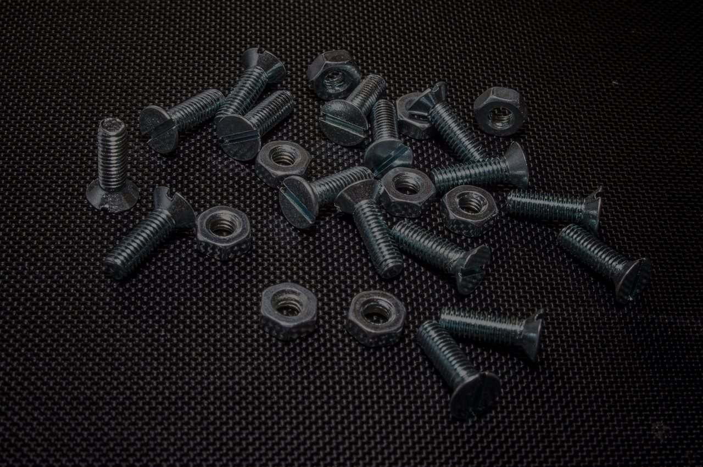

  Providing innovative
  industrial solutions

  [Explore](https://advanceautomationbrunei.com/products-and-services)[About](https://advanceautomationbrunei.com/about-us)
- 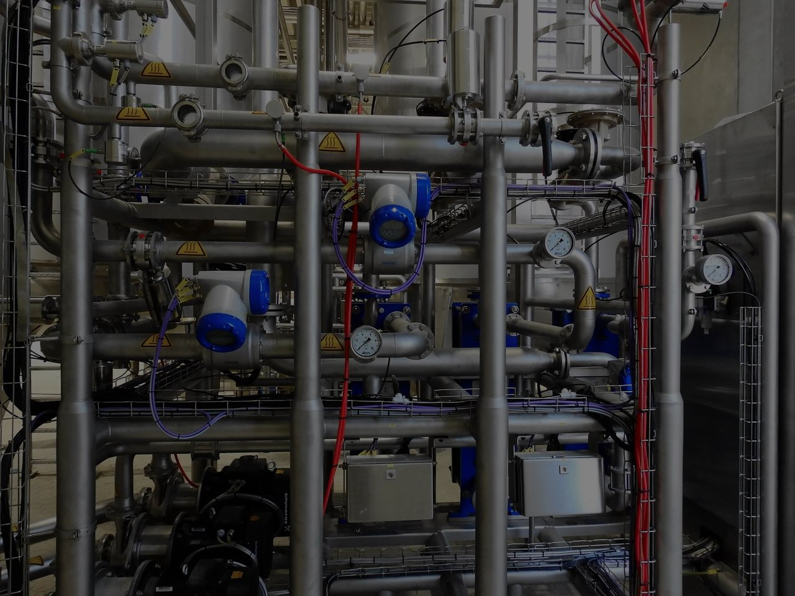

  Leader in mechanical &
  engineering services

  [Explore](https://advanceautomationbrunei.com/products-and-services)[About](https://advanceautomationbrunei.com/about-us)
- 

  We are the leader in
  pump and valves repairs

  [Explore](https://advanceautomationbrunei.com/products-and-services)[About](https://advanceautomationbrunei.com/about-us)

## Welcome to Advance Automation

#### More than 8 years of experience in the oil and gas industry

Advance Automation Sdn Bhd. was established in 2010. It was the brainchild of our Respected Dato and his childrens, forming a team of expertise

As Brunei Darussalam is striving towards International Level, it is in our honest faith to assist and upgrade the status of Brunei Darussalam to that level, by striving ourselves to achieve the ISO. Our Mainline of Business are Flow Control, Gas Actuators, Control Valves, Instrument Valves, Pipeline Strainers, Sales, Services and Callibrates, Fire Protection System, Passive Fire Protection and Head Shielding. Pump & Rotating Equipments. Flame Arresters & Tank Accessories.

[Read more](https://advanceautomationbrunei.com/about-us)

Call us

[(+673) 8278 288](tel:+6738278288)

[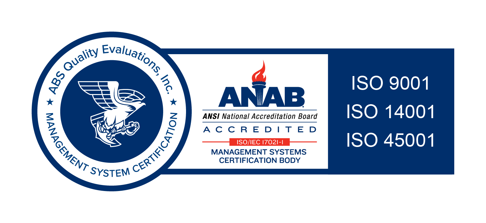](tel:+6738278288)

#### AITI Licensed

AITI Accredited Business Status with ICT Accredited Business under Class 1.

#### Quality Policy

Committed to the production and devlivery of quality products for our customer.

#### ISO certified

We are ISO 9001:2015 Quality and ISO 14001:2015 Environmental Certified

#### Ministries License

KPN/R/2/2012/8/5180 Class II Kementerian Pembangunan Negera Brunei Darulssalam.

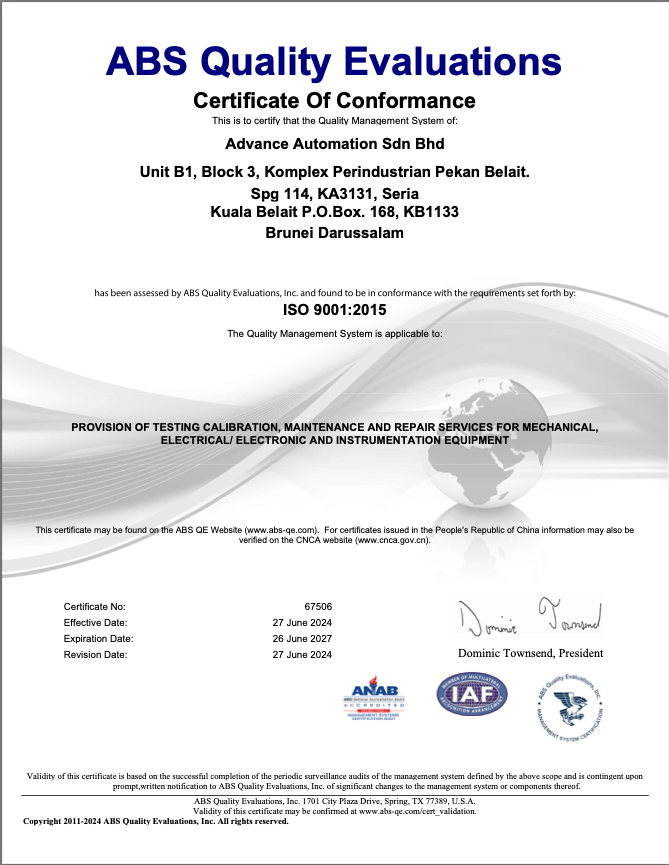 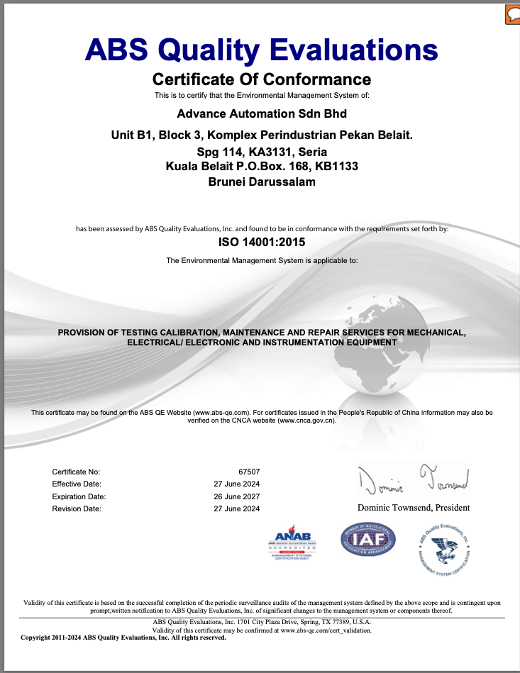 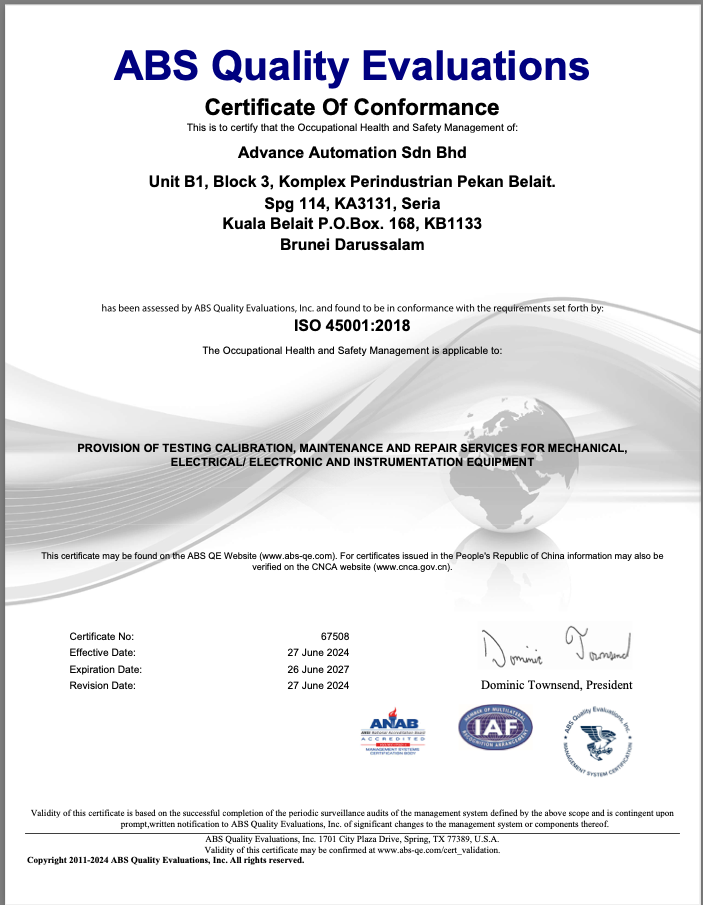

### Our services

[read more](https://advanceautomationbrunei.com/products-and-services/custom-made)

[#### Custom Made](https://advanceautomationbrunei.com/products-and-services/custom-made)

Customs Made to your Esteemed Organisation requirements such as Gaskets And Washers, Rope and Sling, Stud Bolts and Taggings

[read more](https://advanceautomationbrunei.com/products-and-services/calibration-certification-services)

[#### Calibration & Certification](https://advanceautomationbrunei.com/products-and-services/calibration-certification-services)

We can maintain all the calibration information you will ever have to know without you having to file or retrieve any paper if you desire.

[read more](https://advanceautomationbrunei.com/products-and-services/safety-products)

[#### Safety Product](https://advanceautomationbrunei.com/products-and-services/safety-products)

We have a wide Range of Safety Products ranging from Personal Safety Apparels, Harness, PPE, Protection Suits to Equipments.

[read more](https://advanceautomationbrunei.com/products-and-services/control-and-instrument-valves)

[#### Control & Instrument Valves](https://advanceautomationbrunei.com/products-and-services/control-and-instrument-valves)

We have a wide range of Gas, Liquid and Pressure Valves,includes, Sales, Service, Parts and Consumables and Calibration Certification.

[read more](https://advanceautomationbrunei.com/products-and-services/capabilities)

[#### Capabilities](https://advanceautomationbrunei.com/products-and-services/capabilities)

We provide range of capabilities such as Length Dimension Measurement, Electrical and Instruments and Temperatures Devices.

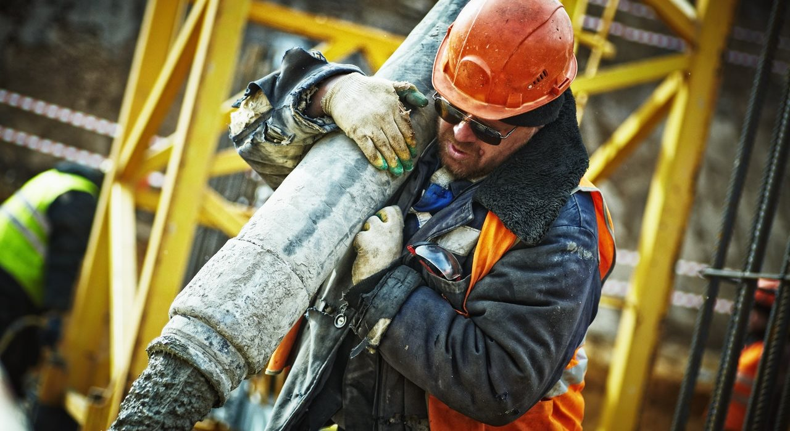

[read more](https://advanceautomationbrunei.com/products-and-services/engineering-and-services)

[#### Engineering And Services](https://advanceautomationbrunei.com/products-and-services/engineering-and-services)

Heat Exchanges, Engines Overhaul, Lab Equipmentm, Motor & Pump Repairs, Pump Testing, Valve Actuators Repairs, Valve Repairs.

26

#### Happy clients

1083

#### Projects completed

32

#### Qualified Employees

5

#### Awards won

### What we do

Our Mainline of Business are Pipeline Strainers, Sales, Services and Callibrates. Flow Control, Gas Actuators, Control Valves, Instrument Valves. (Mechanical, Electrical and Electronics).

[Engineering and Services](#) [Calibration & Certification](#) [Fire Protection System](#)[Pump & Rotating Equipments](#)[Flame Arresters & Tank Accessories](#)

### Download files

[#### Sevice Quality

Service-Quality-ADT.PDF](https://advanceautomationbrunei.com/download/pdf/AAB-Service-Quality-ADT.pdf)

[#### Quality Policy

AAD-Quality-Policy.PDF](https://advanceautomationbrunei.com/download/pdf/AAD-Quality-Policy.pdf)

### Why choose us

- #### Best quality

  We only deliver the highest quality goods with the mission is to exceed customer's expectations
- #### Technology Commitment

  Commiting to our Financial Resources to New Technologies, Equipment, Instrumentation and Technique.

### Latest news

- [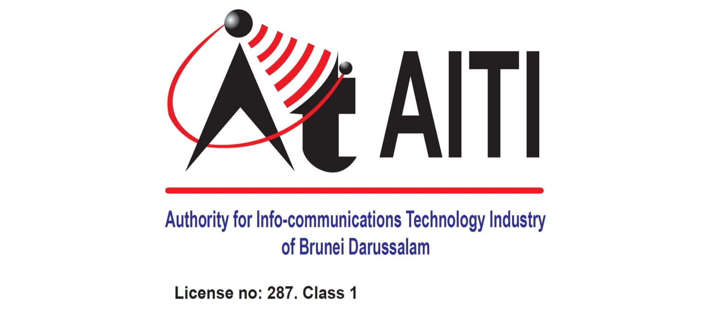](https://advanceautomationbrunei.com/news-n-events/item/25-awarded-aiti-license "Continue reading \"Advance Automation Sdn Bhd awarded AITI License\"")

  18

  Jul

  in [News & Events](https://advanceautomationbrunei.com/news-n-events)

  [Advance Automation Sdn Bhd awarded AITI License](https://advanceautomationbrunei.com/news-n-events/item/25-awarded-aiti-license)

  Advance Automation Sdn Bhd was awarded an AITI License in 11th Feb 2015.

  [READ\_MORE](https://advanceautomationbrunei.com/news-n-events/item/25-awarded-aiti-license)
- [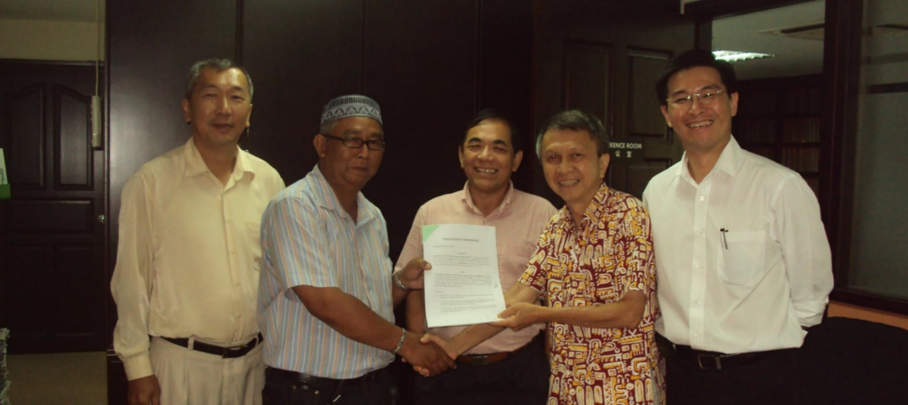](https://advanceautomationbrunei.com/news-n-events/item/24-mou-with-mewah-raya-sdn-bhd "Continue reading \"MOU signing with Mewah Raya Sdn Bhd\"")

  03

  Sep

  in [News & Events](https://advanceautomationbrunei.com/news-n-events)

  [MOU signing with Mewah Raya Sdn Bhd](https://advanceautomationbrunei.com/news-n-events/item/24-mou-with-mewah-raya-sdn-bhd)

  MOU Signing Between Advance Automation Sdn Bhd and Mewah Raya Sdn Bhd, 7th May 2014

  [READ\_MORE](https://advanceautomationbrunei.com/news-n-events/item/24-mou-with-mewah-raya-sdn-bhd)
- 

  28

  Feb

  in [News & Events](https://advanceautomationbrunei.com/news-n-events)

  [MOU with Ramacon Corporation Sdn Bhd](https://advanceautomationbrunei.com/news-n-events/item/23-mou-with-ramacon-corporation)

  MOU Signing with Ramacon Corporation Sdn Bhd At Kota Kinabalu, Sabah, on 21st Feb 2013

  [READ\_MORE](https://advanceautomationbrunei.com/news-n-events/item/23-mou-with-ramacon-corporation)

---

## About us

- URL: https://advanceautomationbrunei.com/about-us
- Raw HTML: `pages/about-us.html`
- Meta description: Advance Automation Sdn Bhd. was established in 2010. It was the brainchild of our Respected Dato and his childrens, forming a team of expertise
- Breadcrumb: About us

### Our Motto

- Service with an Honest faith
- By Constantly listening to our Client’s requirement and updating our Capabilities.
- Constantly Commiting to our Financial Resources to New Technologies and Equipment.
- Remaining up-to-date to new Instrumentation and Techniques.
- Providing the Service which are Customer’s satisfactory.
- Adhering and exceeding to Clients Expections.

## Advance Automation Sdn Bhd

#### Advance Automation Sdn Bhd. was established in 2010

It was the brainchild of our Respected Dato and his childrens, forming a team of expertise consisting of,

- Design and Automation Engineer.(Bsc.
- Mechanical).Mechatronics Engineer
- (Ms Sc Elect). X-Rays and Inspection Technician.
- Turbine Rotating Equipment Technician.
- Tools and Equipment’s Inspectors.

As Brunei Darussalam is striving towards International Level, it is in our honest faith to assist and upgrade the status of Brunei Darussalam to that level, by striving ourselves to achieve the ISO.

It is our Vision and Goal to achieve the ISO (International Standards).

#### Quality Policy

Committed to the production and devlivery of quality products for our customer.

#### ISO certified

We are ISO 9001:2015 Quality and ISO 14001:2015 Environmental Certified.

#### Calibration & Certification

We can maintain all the calibration information you will ever have to know without you having to file.

#### Engineering And Services

Heat Exchanges, Engines Overhaul, Lab Equipment, Motor & Pump Repairs, Pump Testing, Valve Actuators Repairs.

#### Safety Product

Range of Safety Products ranging from Personal Safety Apparels, Harness, PPE, Protection Suits.

#### Custom Made

Customs Made to your requirements such as Gaskets And Washers, Rope and Sling, Stud Bolts and Taggings

#### Control & Instrument Valves

Gas, Liquid and Pressure Valves,includes, Sales, Service, Parts and Consumables and Calibration Certification.

#### Capabilities

Capabilities such as Length Dimension Measurement, Electrical and Instruments and Temperatures Devices.

## Industries leader

The company ensures that all personal are fully acquainted with the Quality Policy and objectives

through on-going training and education at all levels.

26

#### Happy clients

1083

#### Projects completed

32

#### Qualified Employees

5

#### Awards won

---

## Products and Services

- URL: https://advanceautomationbrunei.com/products-and-services
- Raw HTML: `pages/products-and-services.html`
- Meta description: Advance Automation Sdn Bhd. was established in 2010. It was the brainchild of our Respected Dato and his childrens, forming a team of expertise
- Breadcrumb: Products and Services

[read more](https://advanceautomationbrunei.com/products-and-services/custom-made)

[#### Custom Made](https://advanceautomationbrunei.com/products-and-services/custom-made)

Customs Made to your Esteemed Organisation requirements such as Gaskets And Washers, Rope and Sling, Stud Bolts and Taggings

[read more](https://advanceautomationbrunei.com/products-and-services/calibration-certification-services)

[#### Calibration & Certification](https://advanceautomationbrunei.com/products-and-services/calibration-certification-services)

We can maintain all the calibration information you will ever have to know without you having to file or retrieve any paper if you desire.

[read more](https://advanceautomationbrunei.com/products-and-services/safety-products)

[#### Safety Product](https://advanceautomationbrunei.com/products-and-services/safety-products)

We have a wide Range of Safety Products ranging from Personal Safety Apparels, Harness, PPE, Protection Suits to Equipments.

[read more](https://advanceautomationbrunei.com/products-and-services/control-and-instrument-valves)

[#### Control & Instrument Valves](https://advanceautomationbrunei.com/products-and-services/control-and-instrument-valves)

We have a wide range of Gas, Liquid and Pressure Valves,includes, Sales, Service, Parts and Consumables and Calibration Certification.

[read more](https://advanceautomationbrunei.com/products-and-services/capabilities)

[#### Capabilities](https://advanceautomationbrunei.com/products-and-services/capabilities)

We provide range of capabilities such as Length Dimension Measurement, Electrical and Instruments and Temperatures Devices.

[read more](https://advanceautomationbrunei.com/products-and-services/engineering-and-services)

[#### Engineering And Services](https://advanceautomationbrunei.com/products-and-services/engineering-and-services)

Heat Exchanges, Engines Overhaul, Lab Equipmentm, Motor & Pump Repairs, Pump Testing, Valve Actuators Repairs, Valve Repairs.

### Search

---

## Services

- URL: https://advanceautomationbrunei.com/products-and-services/calibration-certification-services/itemlist/category/7-services
- Raw HTML: `pages/products-and-services/calibration-certification-services/itemlist/category/7-services.html`
- Breadcrumb: Products and Services / Calibration & Certification / Services

## Services

:   in
    [Engineering & Services](https://advanceautomationbrunei.com/products-and-services/engineering-and-services)

### [Valve Repairs and Services](https://advanceautomationbrunei.com/products-and-services/engineering-and-services/valve-repairs)

:   in
    [Engineering & Services](https://advanceautomationbrunei.com/products-and-services/engineering-and-services)

### [Valve Actuators Repairs & Services](https://advanceautomationbrunei.com/products-and-services/engineering-and-services/valve-actuators-repairs)

:   in
    [Engineering & Services](https://advanceautomationbrunei.com/products-and-services/engineering-and-services)

### [Pump Repairs and Services](https://advanceautomationbrunei.com/products-and-services/engineering-and-services/pump-repairs)

:   in
    [Custom Made](https://advanceautomationbrunei.com/products-and-services/custom-made)

### [Gaskets and Washers](https://advanceautomationbrunei.com/products-and-services/custom-made/gaskets-and-washers)

:   in
    [Custom Made](https://advanceautomationbrunei.com/products-and-services/custom-made)

### [Rope and Sling](https://advanceautomationbrunei.com/products-and-services/custom-made/rope-and-sling)

:   in
    [Custom Made](https://advanceautomationbrunei.com/products-and-services/custom-made)

### [Stainless Steel Stud Bolts](https://advanceautomationbrunei.com/products-and-services/custom-made/stud-bolts)

:   in
    [Custom Made](https://advanceautomationbrunei.com/products-and-services/custom-made)

### [Safety Isolations Polymer Taggings](https://advanceautomationbrunei.com/products-and-services/custom-made/polymer-taggings)

:   in
    [Safety](https://advanceautomationbrunei.com/products-and-services/safety-products)

### [Personal Safety](https://advanceautomationbrunei.com/products-and-services/safety-products/personal-safety)

:   in
    [Safety](https://advanceautomationbrunei.com/products-and-services/safety-products)

### [Safety Equipments](https://advanceautomationbrunei.com/products-and-services/safety-products/safety-equipments)

:   in
    [Services](https://advanceautomationbrunei.com/products-and-services/calibration-certification-services/itemlist/category/7-services)

### [Calibration & Certification and Services](https://advanceautomationbrunei.com/products-and-services/calibration-certification-services)

- Start
- Prev
- 1
- [2](https://advanceautomationbrunei.com/products-and-services/calibration-certification-services/itemlist/category/7-services?start=10 "2")
- [Next](https://advanceautomationbrunei.com/products-and-services/calibration-certification-services/itemlist/category/7-services?start=10 "Next")
- [End](https://advanceautomationbrunei.com/products-and-services/calibration-certification-services/itemlist/category/7-services?start=10 "End")

Page 1 of 2

### Search

### Products & Services

- [Custom Made](https://advanceautomationbrunei.com/products-and-services/custom-made)
  - [Gaskets and Washers](https://advanceautomationbrunei.com/products-and-services/custom-made/gaskets-and-washers)
  - [Rope and Sling](https://advanceautomationbrunei.com/products-and-services/custom-made/rope-and-sling)
  - [Stud Bolts](https://advanceautomationbrunei.com/products-and-services/custom-made/stud-bolts)
  - [Polymer Taggings](https://advanceautomationbrunei.com/products-and-services/custom-made/polymer-taggings)
- [Calibration & Certification](https://advanceautomationbrunei.com/products-and-services/calibration-certification-services)
- [Safety Product](https://advanceautomationbrunei.com/products-and-services/safety-products)
  - [Personal Safety](https://advanceautomationbrunei.com/products-and-services/safety-products/personal-safety)
  - [Safety Equipments](https://advanceautomationbrunei.com/products-and-services/safety-products/safety-equipments)
- [Control & Instrument Valves](https://advanceautomationbrunei.com/products-and-services/control-and-instrument-valves)
- [Capabilities](https://advanceautomationbrunei.com/products-and-services/capabilities)
  - [Electrical and Instruments](https://advanceautomationbrunei.com/products-and-services/capabilities/electrical-and-instruments)
  - [Temperatures Devices](https://advanceautomationbrunei.com/products-and-services/capabilities/temperatures-devices)
  - [Dimension Measurement](https://advanceautomationbrunei.com/products-and-services/capabilities/dimension-measurement)
- [Engineering And Services](https://advanceautomationbrunei.com/products-and-services/engineering-and-services)
  - [Heat Exchangers](https://advanceautomationbrunei.com/products-and-services/engineering-and-services/heat-exchangers)
  - [Engines Overhaul](https://advanceautomationbrunei.com/products-and-services/engineering-and-services/engines-overhaul)
  - [Lab Equipment Repairs](https://advanceautomationbrunei.com/products-and-services/engineering-and-services/lab-equipment-repairs)
  - [Motor Repairs](https://advanceautomationbrunei.com/products-and-services/engineering-and-services/motor-repairs)
  - [Pump Testing](https://advanceautomationbrunei.com/products-and-services/engineering-and-services/pump-testing)
  - [Pump Repairs](https://advanceautomationbrunei.com/products-and-services/engineering-and-services/pump-repairs)
  - [Valve Actuators Repairs](https://advanceautomationbrunei.com/products-and-services/engineering-and-services/valve-actuators-repairs)
  - [Valve Repairs](https://advanceautomationbrunei.com/products-and-services/engineering-and-services/valve-repairs)

---

## Services

- URL: https://advanceautomationbrunei.com/products-and-services/calibration-certification-services/itemlist/category/7-services?start=10
- Raw HTML: `pages/products-and-services/calibration-certification-services/itemlist/category/7-services__start-10.html`
- Breadcrumb: Products and Services / Calibration & Certification / Services

## Services

:   in
    [Services](https://advanceautomationbrunei.com/products-and-services/calibration-certification-services/itemlist/category/7-services)

### [Control & Instrument Valve](https://advanceautomationbrunei.com/products-and-services/control-and-instrument-valves)

:   in
    [Capabilities](https://advanceautomationbrunei.com/products-and-services/capabilities)

### [Temperatures Devices](https://advanceautomationbrunei.com/products-and-services/capabilities/temperatures-devices)

:   in
    [Capabilities](https://advanceautomationbrunei.com/products-and-services/capabilities)

### [Electrical and Instruments](https://advanceautomationbrunei.com/products-and-services/capabilities/electrical-and-instruments)

:   in
    [Capabilities](https://advanceautomationbrunei.com/products-and-services/capabilities)

### [Length Dimension Measurement](https://advanceautomationbrunei.com/products-and-services/capabilities/dimension-measurement)

:   in
    [Engineering & Services](https://advanceautomationbrunei.com/products-and-services/engineering-and-services)

### [Heat Exchangers Repairs](https://advanceautomationbrunei.com/products-and-services/engineering-and-services/heat-exchangers)

:   in
    [Engineering & Services](https://advanceautomationbrunei.com/products-and-services/engineering-and-services)

### [Engines Overhaul](https://advanceautomationbrunei.com/products-and-services/engineering-and-services/engines-overhaul)

:   in
    [Engineering & Services](https://advanceautomationbrunei.com/products-and-services/engineering-and-services)

### [Laboratory Equipment Repairs](https://advanceautomationbrunei.com/products-and-services/engineering-and-services/lab-equipment-repairs)

:   in
    [Engineering & Services](https://advanceautomationbrunei.com/products-and-services/engineering-and-services)

### [Motor Repairs and Services](https://advanceautomationbrunei.com/products-and-services/engineering-and-services/motor-repairs)

:   in
    [Engineering & Services](https://advanceautomationbrunei.com/products-and-services/engineering-and-services)

### [Pump Performance Testing Facility](https://advanceautomationbrunei.com/products-and-services/engineering-and-services/pump-testing)

- [Start](https://advanceautomationbrunei.com/products-and-services/calibration-certification-services/itemlist/category/7-services?start=0 "Start")
- [Prev](https://advanceautomationbrunei.com/products-and-services/calibration-certification-services/itemlist/category/7-services?start=0 "Prev")
- [1](https://advanceautomationbrunei.com/products-and-services/calibration-certification-services/itemlist/category/7-services?start=0 "1")
- 2
- Next
- End

Page 2 of 2

### Search

### Products & Services

- [Custom Made](https://advanceautomationbrunei.com/products-and-services/custom-made)
  - [Gaskets and Washers](https://advanceautomationbrunei.com/products-and-services/custom-made/gaskets-and-washers)
  - [Rope and Sling](https://advanceautomationbrunei.com/products-and-services/custom-made/rope-and-sling)
  - [Stud Bolts](https://advanceautomationbrunei.com/products-and-services/custom-made/stud-bolts)
  - [Polymer Taggings](https://advanceautomationbrunei.com/products-and-services/custom-made/polymer-taggings)
- [Calibration & Certification](https://advanceautomationbrunei.com/products-and-services/calibration-certification-services)
- [Safety Product](https://advanceautomationbrunei.com/products-and-services/safety-products)
  - [Personal Safety](https://advanceautomationbrunei.com/products-and-services/safety-products/personal-safety)
  - [Safety Equipments](https://advanceautomationbrunei.com/products-and-services/safety-products/safety-equipments)
- [Control & Instrument Valves](https://advanceautomationbrunei.com/products-and-services/control-and-instrument-valves)
- [Capabilities](https://advanceautomationbrunei.com/products-and-services/capabilities)
  - [Electrical and Instruments](https://advanceautomationbrunei.com/products-and-services/capabilities/electrical-and-instruments)
  - [Temperatures Devices](https://advanceautomationbrunei.com/products-and-services/capabilities/temperatures-devices)
  - [Dimension Measurement](https://advanceautomationbrunei.com/products-and-services/capabilities/dimension-measurement)
- [Engineering And Services](https://advanceautomationbrunei.com/products-and-services/engineering-and-services)
  - [Heat Exchangers](https://advanceautomationbrunei.com/products-and-services/engineering-and-services/heat-exchangers)
  - [Engines Overhaul](https://advanceautomationbrunei.com/products-and-services/engineering-and-services/engines-overhaul)
  - [Lab Equipment Repairs](https://advanceautomationbrunei.com/products-and-services/engineering-and-services/lab-equipment-repairs)
  - [Motor Repairs](https://advanceautomationbrunei.com/products-and-services/engineering-and-services/motor-repairs)
  - [Pump Testing](https://advanceautomationbrunei.com/products-and-services/engineering-and-services/pump-testing)
  - [Pump Repairs](https://advanceautomationbrunei.com/products-and-services/engineering-and-services/pump-repairs)
  - [Valve Actuators Repairs](https://advanceautomationbrunei.com/products-and-services/engineering-and-services/valve-actuators-repairs)
  - [Valve Repairs](https://advanceautomationbrunei.com/products-and-services/engineering-and-services/valve-repairs)

---

## Services

- URL: https://advanceautomationbrunei.com/products-and-services/control-and-instrument-valves/itemlist/category/7-services
- Raw HTML: `pages/products-and-services/control-and-instrument-valves/itemlist/category/7-services.html`
- Breadcrumb: Products and Services / Control & Instrument Valves / Services

## Services

:   in
    [Engineering & Services](https://advanceautomationbrunei.com/products-and-services/engineering-and-services)

### [Valve Repairs and Services](https://advanceautomationbrunei.com/products-and-services/engineering-and-services/valve-repairs)

:   in
    [Engineering & Services](https://advanceautomationbrunei.com/products-and-services/engineering-and-services)

### [Valve Actuators Repairs & Services](https://advanceautomationbrunei.com/products-and-services/engineering-and-services/valve-actuators-repairs)

:   in
    [Engineering & Services](https://advanceautomationbrunei.com/products-and-services/engineering-and-services)

### [Pump Repairs and Services](https://advanceautomationbrunei.com/products-and-services/engineering-and-services/pump-repairs)

:   in
    [Custom Made](https://advanceautomationbrunei.com/products-and-services/custom-made)

### [Gaskets and Washers](https://advanceautomationbrunei.com/products-and-services/custom-made/gaskets-and-washers)

:   in
    [Custom Made](https://advanceautomationbrunei.com/products-and-services/custom-made)

### [Rope and Sling](https://advanceautomationbrunei.com/products-and-services/custom-made/rope-and-sling)

:   in
    [Custom Made](https://advanceautomationbrunei.com/products-and-services/custom-made)

### [Stainless Steel Stud Bolts](https://advanceautomationbrunei.com/products-and-services/custom-made/stud-bolts)

:   in
    [Custom Made](https://advanceautomationbrunei.com/products-and-services/custom-made)

### [Safety Isolations Polymer Taggings](https://advanceautomationbrunei.com/products-and-services/custom-made/polymer-taggings)

:   in
    [Safety](https://advanceautomationbrunei.com/products-and-services/safety-products)

### [Personal Safety](https://advanceautomationbrunei.com/products-and-services/safety-products/personal-safety)

:   in
    [Safety](https://advanceautomationbrunei.com/products-and-services/safety-products)

### [Safety Equipments](https://advanceautomationbrunei.com/products-and-services/safety-products/safety-equipments)

:   in
    [Services](https://advanceautomationbrunei.com/products-and-services/control-and-instrument-valves/itemlist/category/7-services)

### [Calibration & Certification and Services](https://advanceautomationbrunei.com/products-and-services/calibration-certification-services)

- Start
- Prev
- 1
- [2](https://advanceautomationbrunei.com/products-and-services/control-and-instrument-valves/itemlist/category/7-services?start=10 "2")
- [Next](https://advanceautomationbrunei.com/products-and-services/control-and-instrument-valves/itemlist/category/7-services?start=10 "Next")
- [End](https://advanceautomationbrunei.com/products-and-services/control-and-instrument-valves/itemlist/category/7-services?start=10 "End")

Page 1 of 2

### Search

### Products & Services

- [Custom Made](https://advanceautomationbrunei.com/products-and-services/custom-made)
  - [Gaskets and Washers](https://advanceautomationbrunei.com/products-and-services/custom-made/gaskets-and-washers)
  - [Rope and Sling](https://advanceautomationbrunei.com/products-and-services/custom-made/rope-and-sling)
  - [Stud Bolts](https://advanceautomationbrunei.com/products-and-services/custom-made/stud-bolts)
  - [Polymer Taggings](https://advanceautomationbrunei.com/products-and-services/custom-made/polymer-taggings)
- [Calibration & Certification](https://advanceautomationbrunei.com/products-and-services/calibration-certification-services)
- [Safety Product](https://advanceautomationbrunei.com/products-and-services/safety-products)
  - [Personal Safety](https://advanceautomationbrunei.com/products-and-services/safety-products/personal-safety)
  - [Safety Equipments](https://advanceautomationbrunei.com/products-and-services/safety-products/safety-equipments)
- [Control & Instrument Valves](https://advanceautomationbrunei.com/products-and-services/control-and-instrument-valves)
- [Capabilities](https://advanceautomationbrunei.com/products-and-services/capabilities)
  - [Electrical and Instruments](https://advanceautomationbrunei.com/products-and-services/capabilities/electrical-and-instruments)
  - [Temperatures Devices](https://advanceautomationbrunei.com/products-and-services/capabilities/temperatures-devices)
  - [Dimension Measurement](https://advanceautomationbrunei.com/products-and-services/capabilities/dimension-measurement)
- [Engineering And Services](https://advanceautomationbrunei.com/products-and-services/engineering-and-services)
  - [Heat Exchangers](https://advanceautomationbrunei.com/products-and-services/engineering-and-services/heat-exchangers)
  - [Engines Overhaul](https://advanceautomationbrunei.com/products-and-services/engineering-and-services/engines-overhaul)
  - [Lab Equipment Repairs](https://advanceautomationbrunei.com/products-and-services/engineering-and-services/lab-equipment-repairs)
  - [Motor Repairs](https://advanceautomationbrunei.com/products-and-services/engineering-and-services/motor-repairs)
  - [Pump Testing](https://advanceautomationbrunei.com/products-and-services/engineering-and-services/pump-testing)
  - [Pump Repairs](https://advanceautomationbrunei.com/products-and-services/engineering-and-services/pump-repairs)
  - [Valve Actuators Repairs](https://advanceautomationbrunei.com/products-and-services/engineering-and-services/valve-actuators-repairs)
  - [Valve Repairs](https://advanceautomationbrunei.com/products-and-services/engineering-and-services/valve-repairs)

---

## Services

- URL: https://advanceautomationbrunei.com/products-and-services/control-and-instrument-valves/itemlist/category/7-services?start=10
- Raw HTML: `pages/products-and-services/control-and-instrument-valves/itemlist/category/7-services__start-10.html`
- Breadcrumb: Products and Services / Control & Instrument Valves / Services

## Services

:   in
    [Services](https://advanceautomationbrunei.com/products-and-services/control-and-instrument-valves/itemlist/category/7-services)

### [Control & Instrument Valve](https://advanceautomationbrunei.com/products-and-services/control-and-instrument-valves)

:   in
    [Capabilities](https://advanceautomationbrunei.com/products-and-services/capabilities)

### [Temperatures Devices](https://advanceautomationbrunei.com/products-and-services/capabilities/temperatures-devices)

:   in
    [Capabilities](https://advanceautomationbrunei.com/products-and-services/capabilities)

### [Electrical and Instruments](https://advanceautomationbrunei.com/products-and-services/capabilities/electrical-and-instruments)

:   in
    [Capabilities](https://advanceautomationbrunei.com/products-and-services/capabilities)

### [Length Dimension Measurement](https://advanceautomationbrunei.com/products-and-services/capabilities/dimension-measurement)

:   in
    [Engineering & Services](https://advanceautomationbrunei.com/products-and-services/engineering-and-services)

### [Heat Exchangers Repairs](https://advanceautomationbrunei.com/products-and-services/engineering-and-services/heat-exchangers)

:   in
    [Engineering & Services](https://advanceautomationbrunei.com/products-and-services/engineering-and-services)

### [Engines Overhaul](https://advanceautomationbrunei.com/products-and-services/engineering-and-services/engines-overhaul)

:   in
    [Engineering & Services](https://advanceautomationbrunei.com/products-and-services/engineering-and-services)

### [Laboratory Equipment Repairs](https://advanceautomationbrunei.com/products-and-services/engineering-and-services/lab-equipment-repairs)

:   in
    [Engineering & Services](https://advanceautomationbrunei.com/products-and-services/engineering-and-services)

### [Motor Repairs and Services](https://advanceautomationbrunei.com/products-and-services/engineering-and-services/motor-repairs)

:   in
    [Engineering & Services](https://advanceautomationbrunei.com/products-and-services/engineering-and-services)

### [Pump Performance Testing Facility](https://advanceautomationbrunei.com/products-and-services/engineering-and-services/pump-testing)

- [Start](https://advanceautomationbrunei.com/products-and-services/control-and-instrument-valves/itemlist/category/7-services?start=0 "Start")
- [Prev](https://advanceautomationbrunei.com/products-and-services/control-and-instrument-valves/itemlist/category/7-services?start=0 "Prev")
- [1](https://advanceautomationbrunei.com/products-and-services/control-and-instrument-valves/itemlist/category/7-services?start=0 "1")
- 2
- Next
- End

Page 2 of 2

### Search

### Products & Services

- [Custom Made](https://advanceautomationbrunei.com/products-and-services/custom-made)
  - [Gaskets and Washers](https://advanceautomationbrunei.com/products-and-services/custom-made/gaskets-and-washers)
  - [Rope and Sling](https://advanceautomationbrunei.com/products-and-services/custom-made/rope-and-sling)
  - [Stud Bolts](https://advanceautomationbrunei.com/products-and-services/custom-made/stud-bolts)
  - [Polymer Taggings](https://advanceautomationbrunei.com/products-and-services/custom-made/polymer-taggings)
- [Calibration & Certification](https://advanceautomationbrunei.com/products-and-services/calibration-certification-services)
- [Safety Product](https://advanceautomationbrunei.com/products-and-services/safety-products)
  - [Personal Safety](https://advanceautomationbrunei.com/products-and-services/safety-products/personal-safety)
  - [Safety Equipments](https://advanceautomationbrunei.com/products-and-services/safety-products/safety-equipments)
- [Control & Instrument Valves](https://advanceautomationbrunei.com/products-and-services/control-and-instrument-valves)
- [Capabilities](https://advanceautomationbrunei.com/products-and-services/capabilities)
  - [Electrical and Instruments](https://advanceautomationbrunei.com/products-and-services/capabilities/electrical-and-instruments)
  - [Temperatures Devices](https://advanceautomationbrunei.com/products-and-services/capabilities/temperatures-devices)
  - [Dimension Measurement](https://advanceautomationbrunei.com/products-and-services/capabilities/dimension-measurement)
- [Engineering And Services](https://advanceautomationbrunei.com/products-and-services/engineering-and-services)
  - [Heat Exchangers](https://advanceautomationbrunei.com/products-and-services/engineering-and-services/heat-exchangers)
  - [Engines Overhaul](https://advanceautomationbrunei.com/products-and-services/engineering-and-services/engines-overhaul)
  - [Lab Equipment Repairs](https://advanceautomationbrunei.com/products-and-services/engineering-and-services/lab-equipment-repairs)
  - [Motor Repairs](https://advanceautomationbrunei.com/products-and-services/engineering-and-services/motor-repairs)
  - [Pump Testing](https://advanceautomationbrunei.com/products-and-services/engineering-and-services/pump-testing)
  - [Pump Repairs](https://advanceautomationbrunei.com/products-and-services/engineering-and-services/pump-repairs)
  - [Valve Actuators Repairs](https://advanceautomationbrunei.com/products-and-services/engineering-and-services/valve-actuators-repairs)
  - [Valve Repairs](https://advanceautomationbrunei.com/products-and-services/engineering-and-services/valve-repairs)

---

## Custom Made

- URL: https://advanceautomationbrunei.com/products-and-services/custom-made
- Raw HTML: `pages/products-and-services/custom-made.html`
- Breadcrumb: Products and Services / Custom Made

## Custom Made

:   in
    [Custom Made](https://advanceautomationbrunei.com/products-and-services/custom-made)

### [Gaskets and Washers](https://advanceautomationbrunei.com/products-and-services/custom-made/gaskets-and-washers)

:   in
    [Custom Made](https://advanceautomationbrunei.com/products-and-services/custom-made)

### [Rope and Sling](https://advanceautomationbrunei.com/products-and-services/custom-made/rope-and-sling)

:   in
    [Custom Made](https://advanceautomationbrunei.com/products-and-services/custom-made)

### [Stainless Steel Stud Bolts](https://advanceautomationbrunei.com/products-and-services/custom-made/stud-bolts)

:   in
    [Custom Made](https://advanceautomationbrunei.com/products-and-services/custom-made)

### [Safety Isolations Polymer Taggings](https://advanceautomationbrunei.com/products-and-services/custom-made/polymer-taggings)

### Search

### Products & Services

- [Custom Made](https://advanceautomationbrunei.com/products-and-services/custom-made)
  - [Gaskets and Washers](https://advanceautomationbrunei.com/products-and-services/custom-made/gaskets-and-washers)
  - [Rope and Sling](https://advanceautomationbrunei.com/products-and-services/custom-made/rope-and-sling)
  - [Stud Bolts](https://advanceautomationbrunei.com/products-and-services/custom-made/stud-bolts)
  - [Polymer Taggings](https://advanceautomationbrunei.com/products-and-services/custom-made/polymer-taggings)
- [Calibration & Certification](https://advanceautomationbrunei.com/products-and-services/calibration-certification-services)
- [Safety Product](https://advanceautomationbrunei.com/products-and-services/safety-products)
  - [Personal Safety](https://advanceautomationbrunei.com/products-and-services/safety-products/personal-safety)
  - [Safety Equipments](https://advanceautomationbrunei.com/products-and-services/safety-products/safety-equipments)
- [Control & Instrument Valves](https://advanceautomationbrunei.com/products-and-services/control-and-instrument-valves)
- [Capabilities](https://advanceautomationbrunei.com/products-and-services/capabilities)
  - [Electrical and Instruments](https://advanceautomationbrunei.com/products-and-services/capabilities/electrical-and-instruments)
  - [Temperatures Devices](https://advanceautomationbrunei.com/products-and-services/capabilities/temperatures-devices)
  - [Dimension Measurement](https://advanceautomationbrunei.com/products-and-services/capabilities/dimension-measurement)
- [Engineering And Services](https://advanceautomationbrunei.com/products-and-services/engineering-and-services)
  - [Heat Exchangers](https://advanceautomationbrunei.com/products-and-services/engineering-and-services/heat-exchangers)
  - [Engines Overhaul](https://advanceautomationbrunei.com/products-and-services/engineering-and-services/engines-overhaul)
  - [Lab Equipment Repairs](https://advanceautomationbrunei.com/products-and-services/engineering-and-services/lab-equipment-repairs)
  - [Motor Repairs](https://advanceautomationbrunei.com/products-and-services/engineering-and-services/motor-repairs)
  - [Pump Testing](https://advanceautomationbrunei.com/products-and-services/engineering-and-services/pump-testing)
  - [Pump Repairs](https://advanceautomationbrunei.com/products-and-services/engineering-and-services/pump-repairs)
  - [Valve Actuators Repairs](https://advanceautomationbrunei.com/products-and-services/engineering-and-services/valve-actuators-repairs)
  - [Valve Repairs](https://advanceautomationbrunei.com/products-and-services/engineering-and-services/valve-repairs)

---

## Gaskets and Washers

- URL: https://advanceautomationbrunei.com/products-and-services/custom-made/gaskets-and-washers
- Raw HTML: `pages/products-and-services/custom-made/gaskets-and-washers.html`
- Meta description: Gaskets &amp;amp; Washers &amp;nbsp; &amp;nbsp;&amp;nbsp; &amp;nbsp; &amp;nbsp; &amp;nbsp; &amp;nbsp; &amp;nbsp;&amp;nbsp; &amp;nbsp; &amp;nbsp; &amp;...
- Breadcrumb: Products and Services / Custom Made / Gaskets and Washers

:   in
    [Custom Made](https://advanceautomationbrunei.com/products-and-services/custom-made)

- [Print](https://advanceautomationbrunei.com/products-and-services/custom-made/gaskets-and-washers?tmpl=component&print=1)
- [Email](https://advanceautomationbrunei.com/component/mailto/?tmpl=component&template=too_fac3heat&link=8bdcbbde3d0c8949e4099b9f6b35cd4574239bce)

### Gaskets & Washers

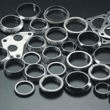     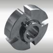     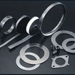      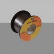     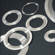

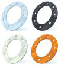      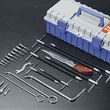     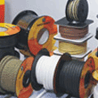     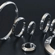     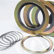

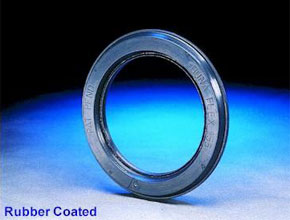    

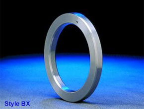    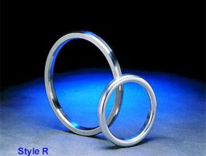

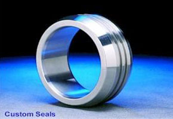

[« Rope and Sling](https://advanceautomationbrunei.com/products-and-services/custom-made/rope-and-sling)

### Search

### Products & Services

- [Custom Made](https://advanceautomationbrunei.com/products-and-services/custom-made)
  - [Gaskets and Washers](https://advanceautomationbrunei.com/products-and-services/custom-made/gaskets-and-washers)
  - [Rope and Sling](https://advanceautomationbrunei.com/products-and-services/custom-made/rope-and-sling)
  - [Stud Bolts](https://advanceautomationbrunei.com/products-and-services/custom-made/stud-bolts)
  - [Polymer Taggings](https://advanceautomationbrunei.com/products-and-services/custom-made/polymer-taggings)
- [Calibration & Certification](https://advanceautomationbrunei.com/products-and-services/calibration-certification-services)
- [Safety Product](https://advanceautomationbrunei.com/products-and-services/safety-products)
  - [Personal Safety](https://advanceautomationbrunei.com/products-and-services/safety-products/personal-safety)
  - [Safety Equipments](https://advanceautomationbrunei.com/products-and-services/safety-products/safety-equipments)
- [Control & Instrument Valves](https://advanceautomationbrunei.com/products-and-services/control-and-instrument-valves)
- [Capabilities](https://advanceautomationbrunei.com/products-and-services/capabilities)
  - [Electrical and Instruments](https://advanceautomationbrunei.com/products-and-services/capabilities/electrical-and-instruments)
  - [Temperatures Devices](https://advanceautomationbrunei.com/products-and-services/capabilities/temperatures-devices)
  - [Dimension Measurement](https://advanceautomationbrunei.com/products-and-services/capabilities/dimension-measurement)
- [Engineering And Services](https://advanceautomationbrunei.com/products-and-services/engineering-and-services)
  - [Heat Exchangers](https://advanceautomationbrunei.com/products-and-services/engineering-and-services/heat-exchangers)
  - [Engines Overhaul](https://advanceautomationbrunei.com/products-and-services/engineering-and-services/engines-overhaul)
  - [Lab Equipment Repairs](https://advanceautomationbrunei.com/products-and-services/engineering-and-services/lab-equipment-repairs)
  - [Motor Repairs](https://advanceautomationbrunei.com/products-and-services/engineering-and-services/motor-repairs)
  - [Pump Testing](https://advanceautomationbrunei.com/products-and-services/engineering-and-services/pump-testing)
  - [Pump Repairs](https://advanceautomationbrunei.com/products-and-services/engineering-and-services/pump-repairs)
  - [Valve Actuators Repairs](https://advanceautomationbrunei.com/products-and-services/engineering-and-services/valve-actuators-repairs)
  - [Valve Repairs](https://advanceautomationbrunei.com/products-and-services/engineering-and-services/valve-repairs)

---

## Rope and Sling

- URL: https://advanceautomationbrunei.com/products-and-services/custom-made/rope-and-sling
- Raw HTML: `pages/products-and-services/custom-made/rope-and-sling.html`
- Meta description: Safety Equipments &amp;nbsp;
- Breadcrumb: Products and Services / Custom Made / Rope and Sling

:   in
    [Custom Made](https://advanceautomationbrunei.com/products-and-services/custom-made)

- [Print](https://advanceautomationbrunei.com/products-and-services/custom-made/rope-and-sling?tmpl=component&print=1)
- [Email](https://advanceautomationbrunei.com/component/mailto/?tmpl=component&template=too_fac3heat&link=3b0c8e8634e97dd909006278a25c9b99255e43d4)

### Safety Equipments

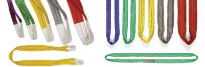

[« Stainless Steel Stud Bolts](https://advanceautomationbrunei.com/products-and-services/custom-made/stud-bolts)
[Gaskets and Washers »](https://advanceautomationbrunei.com/products-and-services/custom-made/gaskets-and-washers)

### Search

### Products & Services

- [Custom Made](https://advanceautomationbrunei.com/products-and-services/custom-made)
  - [Gaskets and Washers](https://advanceautomationbrunei.com/products-and-services/custom-made/gaskets-and-washers)
  - [Rope and Sling](https://advanceautomationbrunei.com/products-and-services/custom-made/rope-and-sling)
  - [Stud Bolts](https://advanceautomationbrunei.com/products-and-services/custom-made/stud-bolts)
  - [Polymer Taggings](https://advanceautomationbrunei.com/products-and-services/custom-made/polymer-taggings)
- [Calibration & Certification](https://advanceautomationbrunei.com/products-and-services/calibration-certification-services)
- [Safety Product](https://advanceautomationbrunei.com/products-and-services/safety-products)
  - [Personal Safety](https://advanceautomationbrunei.com/products-and-services/safety-products/personal-safety)
  - [Safety Equipments](https://advanceautomationbrunei.com/products-and-services/safety-products/safety-equipments)
- [Control & Instrument Valves](https://advanceautomationbrunei.com/products-and-services/control-and-instrument-valves)
- [Capabilities](https://advanceautomationbrunei.com/products-and-services/capabilities)
  - [Electrical and Instruments](https://advanceautomationbrunei.com/products-and-services/capabilities/electrical-and-instruments)
  - [Temperatures Devices](https://advanceautomationbrunei.com/products-and-services/capabilities/temperatures-devices)
  - [Dimension Measurement](https://advanceautomationbrunei.com/products-and-services/capabilities/dimension-measurement)
- [Engineering And Services](https://advanceautomationbrunei.com/products-and-services/engineering-and-services)
  - [Heat Exchangers](https://advanceautomationbrunei.com/products-and-services/engineering-and-services/heat-exchangers)
  - [Engines Overhaul](https://advanceautomationbrunei.com/products-and-services/engineering-and-services/engines-overhaul)
  - [Lab Equipment Repairs](https://advanceautomationbrunei.com/products-and-services/engineering-and-services/lab-equipment-repairs)
  - [Motor Repairs](https://advanceautomationbrunei.com/products-and-services/engineering-and-services/motor-repairs)
  - [Pump Testing](https://advanceautomationbrunei.com/products-and-services/engineering-and-services/pump-testing)
  - [Pump Repairs](https://advanceautomationbrunei.com/products-and-services/engineering-and-services/pump-repairs)
  - [Valve Actuators Repairs](https://advanceautomationbrunei.com/products-and-services/engineering-and-services/valve-actuators-repairs)
  - [Valve Repairs](https://advanceautomationbrunei.com/products-and-services/engineering-and-services/valve-repairs)

---

## Stud Bolts

- URL: https://advanceautomationbrunei.com/products-and-services/custom-made/stud-bolts
- Raw HTML: `pages/products-and-services/custom-made/stud-bolts.html`
- Meta description: Galvanised &amp;amp; Stainless Steel Stud Bolts &amp;nbsp; &amp;nbsp;&amp;nbsp;
- Breadcrumb: Products and Services / Custom Made / Stud Bolts

:   in
    [Custom Made](https://advanceautomationbrunei.com/products-and-services/custom-made)

- [Print](https://advanceautomationbrunei.com/products-and-services/custom-made/stud-bolts?tmpl=component&print=1)
- [Email](https://advanceautomationbrunei.com/component/mailto/?tmpl=component&template=too_fac3heat&link=d8dddf511aeb9d04cd07cf4a0c7a7cc5599d8b55)

### Galvanised & Stainless Steel Stud Bolts

|  |
| --- |
| Stud Bolts 4Stud-Bolts-3 Stud-Bolts-1  Stud-Bolts-2  Stud-Bolts-5  Stud-Bolts-6 |

[« Safety Isolations Polymer Taggings](https://advanceautomationbrunei.com/products-and-services/custom-made/polymer-taggings)
[Rope and Sling »](https://advanceautomationbrunei.com/products-and-services/custom-made/rope-and-sling)

### Search

### Products & Services

- [Custom Made](https://advanceautomationbrunei.com/products-and-services/custom-made)
  - [Gaskets and Washers](https://advanceautomationbrunei.com/products-and-services/custom-made/gaskets-and-washers)
  - [Rope and Sling](https://advanceautomationbrunei.com/products-and-services/custom-made/rope-and-sling)
  - [Stud Bolts](https://advanceautomationbrunei.com/products-and-services/custom-made/stud-bolts)
  - [Polymer Taggings](https://advanceautomationbrunei.com/products-and-services/custom-made/polymer-taggings)
- [Calibration & Certification](https://advanceautomationbrunei.com/products-and-services/calibration-certification-services)
- [Safety Product](https://advanceautomationbrunei.com/products-and-services/safety-products)
  - [Personal Safety](https://advanceautomationbrunei.com/products-and-services/safety-products/personal-safety)
  - [Safety Equipments](https://advanceautomationbrunei.com/products-and-services/safety-products/safety-equipments)
- [Control & Instrument Valves](https://advanceautomationbrunei.com/products-and-services/control-and-instrument-valves)
- [Capabilities](https://advanceautomationbrunei.com/products-and-services/capabilities)
  - [Electrical and Instruments](https://advanceautomationbrunei.com/products-and-services/capabilities/electrical-and-instruments)
  - [Temperatures Devices](https://advanceautomationbrunei.com/products-and-services/capabilities/temperatures-devices)
  - [Dimension Measurement](https://advanceautomationbrunei.com/products-and-services/capabilities/dimension-measurement)
- [Engineering And Services](https://advanceautomationbrunei.com/products-and-services/engineering-and-services)
  - [Heat Exchangers](https://advanceautomationbrunei.com/products-and-services/engineering-and-services/heat-exchangers)
  - [Engines Overhaul](https://advanceautomationbrunei.com/products-and-services/engineering-and-services/engines-overhaul)
  - [Lab Equipment Repairs](https://advanceautomationbrunei.com/products-and-services/engineering-and-services/lab-equipment-repairs)
  - [Motor Repairs](https://advanceautomationbrunei.com/products-and-services/engineering-and-services/motor-repairs)
  - [Pump Testing](https://advanceautomationbrunei.com/products-and-services/engineering-and-services/pump-testing)
  - [Pump Repairs](https://advanceautomationbrunei.com/products-and-services/engineering-and-services/pump-repairs)
  - [Valve Actuators Repairs](https://advanceautomationbrunei.com/products-and-services/engineering-and-services/valve-actuators-repairs)
  - [Valve Repairs](https://advanceautomationbrunei.com/products-and-services/engineering-and-services/valve-repairs)

---

## Polymer Taggings

- URL: https://advanceautomationbrunei.com/products-and-services/custom-made/polymer-taggings
- Raw HTML: `pages/products-and-services/custom-made/polymer-taggings.html`
- Meta description: Safety Isolations Polymer Taggings &amp;nbsp; No Entry Tags &amp;nbsp; Inspections Record Tags (2-3mm Polymer) &amp;nbsp; Fire Action &amp;nbsp; &amp;...
- Breadcrumb: Products and Services / Custom Made / Polymer Taggings

:   in
    [Custom Made](https://advanceautomationbrunei.com/products-and-services/custom-made)

- [Print](https://advanceautomationbrunei.com/products-and-services/custom-made/polymer-taggings?tmpl=component&print=1)
- [Email](https://advanceautomationbrunei.com/component/mailto/?tmpl=component&template=too_fac3heat&link=c7a55b606b9c46d542ecdfe7df40edb1b341c97c)

### Safety Isolations Polymer Taggings

No Entry Tags

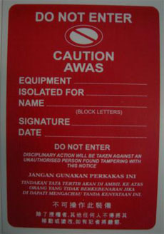  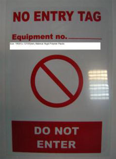

Inspections Record Tags (2-3mm Polymer)

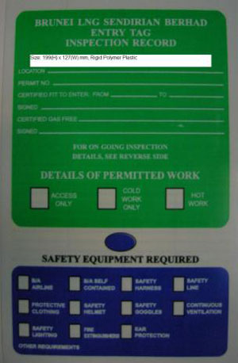  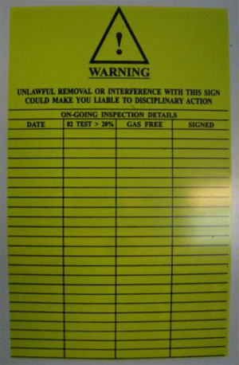

Fire Action

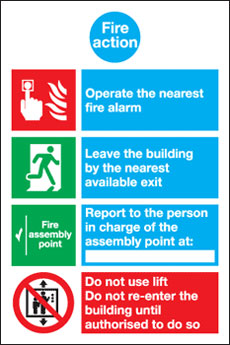  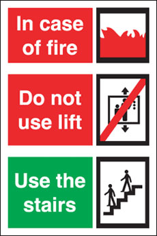

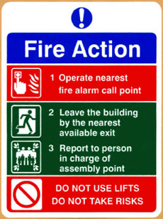

Custom Made (all sizes) Entry/Exit T-Card
Optional: Heat Transfer Printing ( Barcode, Staffs Names and Codings)

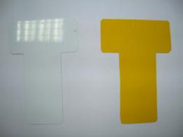  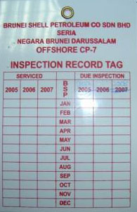

Zip Locks Bag for Documents Inspections (Customs made to sizes with Heat Transfer Printing)

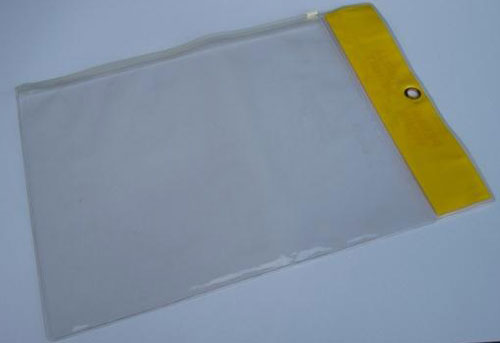

[Stainless Steel Stud Bolts »](https://advanceautomationbrunei.com/products-and-services/custom-made/stud-bolts)

### Search

### Products & Services

- [Custom Made](https://advanceautomationbrunei.com/products-and-services/custom-made)
  - [Gaskets and Washers](https://advanceautomationbrunei.com/products-and-services/custom-made/gaskets-and-washers)
  - [Rope and Sling](https://advanceautomationbrunei.com/products-and-services/custom-made/rope-and-sling)
  - [Stud Bolts](https://advanceautomationbrunei.com/products-and-services/custom-made/stud-bolts)
  - [Polymer Taggings](https://advanceautomationbrunei.com/products-and-services/custom-made/polymer-taggings)
- [Calibration & Certification](https://advanceautomationbrunei.com/products-and-services/calibration-certification-services)
- [Safety Product](https://advanceautomationbrunei.com/products-and-services/safety-products)
  - [Personal Safety](https://advanceautomationbrunei.com/products-and-services/safety-products/personal-safety)
  - [Safety Equipments](https://advanceautomationbrunei.com/products-and-services/safety-products/safety-equipments)
- [Control & Instrument Valves](https://advanceautomationbrunei.com/products-and-services/control-and-instrument-valves)
- [Capabilities](https://advanceautomationbrunei.com/products-and-services/capabilities)
  - [Electrical and Instruments](https://advanceautomationbrunei.com/products-and-services/capabilities/electrical-and-instruments)
  - [Temperatures Devices](https://advanceautomationbrunei.com/products-and-services/capabilities/temperatures-devices)
  - [Dimension Measurement](https://advanceautomationbrunei.com/products-and-services/capabilities/dimension-measurement)
- [Engineering And Services](https://advanceautomationbrunei.com/products-and-services/engineering-and-services)
  - [Heat Exchangers](https://advanceautomationbrunei.com/products-and-services/engineering-and-services/heat-exchangers)
  - [Engines Overhaul](https://advanceautomationbrunei.com/products-and-services/engineering-and-services/engines-overhaul)
  - [Lab Equipment Repairs](https://advanceautomationbrunei.com/products-and-services/engineering-and-services/lab-equipment-repairs)
  - [Motor Repairs](https://advanceautomationbrunei.com/products-and-services/engineering-and-services/motor-repairs)
  - [Pump Testing](https://advanceautomationbrunei.com/products-and-services/engineering-and-services/pump-testing)
  - [Pump Repairs](https://advanceautomationbrunei.com/products-and-services/engineering-and-services/pump-repairs)
  - [Valve Actuators Repairs](https://advanceautomationbrunei.com/products-and-services/engineering-and-services/valve-actuators-repairs)
  - [Valve Repairs](https://advanceautomationbrunei.com/products-and-services/engineering-and-services/valve-repairs)

---

## Calibration & Certification

- URL: https://advanceautomationbrunei.com/products-and-services/calibration-certification-services
- Raw HTML: `pages/products-and-services/calibration-certification-services.html`
- Meta description: Calibration &amp;amp; Certification and Services &amp;nbsp; WHAT WE CALIBRATE: Pressure: Pneumatic &amp;amp; Hydraulic - Gauges, Controllers, Recorder...
- Breadcrumb: Products and Services / Calibration & Certification

:   in
    [Services](https://advanceautomationbrunei.com/products-and-services/calibration-certification-services/itemlist/category/7-services)

- [Print](https://advanceautomationbrunei.com/products-and-services/calibration-certification-services?tmpl=component&print=1)
- [Email](https://advanceautomationbrunei.com/component/mailto/?tmpl=component&template=too_fac3heat&link=0f75339d72dc6e26724a9e445b78dd3d037ff961)

### Calibration & Certification and Services

**WHAT WE CALIBRATE:**

|  |  |
| --- | --- |
| Pressure: | Pneumatic & Hydraulic - Gauges, Controllers, Recorders, Transmitters & Calibrators |
| Test & Calibration: | Thermocouples, RTD's, Indicators, Controllers, Recorders, Transmitters & Calibrators |
| Dimensional: | DVM's, Oscilloscopes, Hand-held Calibrators, Dead-Weight Testers, Wet & Dry Block Calibrators, Backflow Test Kits, Communicators, Bench Calibrators & Humidity Instrumentation |
| Temperature: | Micrometers, Calibrators, Depth Height & Bore Gauges, Indicators, Flatness and Optical Comparators |
| Electrical: | Volts AC/DC, Current AC/DC, Resistance, Capacitance, Frequency, (source & measurement) |
| Mechanical: | Hardness, Torque Measurement, Balances & Tensiometers |

**CALIBRATION MANAGEMENT SYSTEMS**

Advance Automation Sdn Bhd can maintain all the calibration information you will ever have to know without you having to file or retrieve any paper if you desire.  With a Advance Automation Sdn Bhd Calibration Management System, your QA and inspection departments become more effective and efficient.  Recall notifications, adjustment/repair summaries, test, measurement and diagnostic equipment master lists, reverse traceability and calibration certifications both long and short form are just some of the objective evidence provided to you by our management system.  We provide a complete turn key calibration alternative or the specific calibration service you need.

**SERVICE INCLUDE:**

|  |  |
| --- | --- |
| Calibration Interval Optimization | Traceability |
| Loop Calibration | Recall Scheduling |
| Multi-Point Calibration | Single Source |
| Instrument Index | Single-Point Calibration |

**ADVANCE AUTOMATION SDN BHD INDUSTRIAL REFURBISHMENT AND REVERSE ENGINEERING ELECTRONIC REPAIR AND TESTING DEPOT**

Advance Automation Sdn Bhd electronic repair facilities were originally developed to support our  technicians with repair and refurbishment of irreplaceable electronic control systems with immediate turn-around to maintain customer production. These capabilities have continued to grow based on customer requests, and Advance Automation Sdn Bhd now repairs all of the major brands of AC and DC Motor drives, programmable controllers, counters, timers, temperature controllers, instrumentation,  process controls, encoders, PLC’s, electronic boards, power supplies, plus much more.

 **MAJOR ADVANTAGES**

- Absolute reliability (items are load tested and warranted)
- Emergency service
- Rapid Turn Around Times (average within 10 working days)
- Cost savings guaranteed (compared to the OEM)
- Single source for multiple brands, enabling vendor reduction
- All repair prices are based on standards and procedures associated with  electronic repair classifications.
- OEM discontinued product repair & support

**OUTSOURCED ITEMS**

As an added service to our Customers, when we are not presently servicing an item ourselves, our Outsourcing Department will process your item through a qualified outsource vender at competitive pricing.  Please call Sales Service if you have any questions concerning the service of an item.

**INSTRUMENTATION SERVICES**

Advance Automation Sdn Bhd provides a large range of Instrumentation Services to meet specific Customer and Industry specific requirements including:

 **Manpower Field Service**

- Electronics Engineering Technician
- Instrumentation Engineering Technician
- Electrical Engineering Technician
- Engineering
- Contract Admin Technician

**Engineering Services**

- Up Grades & Retrofits
- Manpower Supply
- Programming
- System Integration

**Qualifications & Certifications**

- Certified Technicians
- Professional Engineers
- OEM Trained Staff
- Safety, General & Industry Specific
- Meeting the requirement of Quality Assurance ISO 9001-2008

**Qualifications - Technical Services**

 **Electronic Repairs Depot**

- Full Service On All Repairs Including Diagnostics
- NIST/NRC Traceable, ISO 9000 Compliance
- Certification Programs, Contracts & Warrantees
- Fast Turnaround
- Fully Qualified Electronic Engineers & Technicians

**Advance Automation Sdn Bhd Technical Manpower Strengths:**

- Customer Service Response - On demand and contract service from a skilled and experienced staffs
- Long-term Customer Satisfaction - Advance Automation Sdn Bhd has a reputation of consistent and exceptional results for our many customers through:
- Commitment to Quality - Quality is a fundamental business principle at Advance Automation Sdn Bhd, with compliance to:
  - IEC 17025:2008
  - ISO 9001-2008
  - ISO 14001: 2004

**Advance Automation Sdn Bhd Technical Manpower Services** provides Technical Staffing and Project Management to meet your specific requirements. Advance Automation Sdn BHD Technicians/Mechanics/Engineers/Project Managers can be part of your team or provide complete department responsibility for short or long term needs:

- **Qualifications & Certifications**
  - Certified Technicians
  - Certified Engineers

- **Manpower Field Service**
  - Electronics Engineering Technicial
  - Instrumentation Engineering Technician
  - Electrical Engineering Technicial
  - Engineering
  - Contract Admin Technician

**Typical equipment Calibrated in Advance Automation Sdn Bhd**

|  |  |
| --- | --- |
| AC /DC Hipot Testers | Microscopes |
| Ammeters | Multimeters |
| Calipers | Oscilloscopes |
| Chart Recorders | Panel Meters |
| Clamp-On Ammeters | Power Supplies |
| Counters | Precision Balls |
| Current Shunts | Pressure Gauges |
| Data Loggers | Pressure Transducers |
| Dead Weight Testers | Process Calibrators |
| Decade Boxes | Protractors |
| Dial Indicators | R.T.D. ‘s |
| Digital Multimeters | R.T.D. Simulators |
| Digital Tachometers | Scales |
| ESD Testers | Steel rules |
| Go / No Go Gauges | Straight Edges |
| Height Gauges | Super Micrometers |
| Inclinometers | Tachometers |
| Indicators | Tape Measures |
| Laser Micrometers | Tensiometers |
| Levels | Test Indicators |
| Load Cells | Liquid in Glass Thermometers |
| Machinist Rules | Thickness Gauges |
| Machinist Squares | Thread Pitch Gauges |
| Megohmmeters | Torque Wrenches |
| Micrometers | Vacuum gauges |

**Major Brands Calibrated & Serviced by Advance Automation Sdn Bhd**

|  |  |
| --- | --- |
| ABB | GEC |
| Actaris | General Electric |
| AEG | Hewlett Packard |
| Allen-Bradley | Honeywell |
| Ametek | Horiba |
| Ashcroft | IBM |
| Barber Coleman | Invensys |
| Brooks | ITT |
| BW Technologies | Kent-Taylor |
| Controlotron | Krohne |
| Control Microsystems | Modicon |
| Danfoss | NEC |
| DEC | Neptune Industrial |
| Dressser | Omron |
| Emerson Process | Pacific Scientific |
| Endress + hauser | Rockwell Automation |
| Fanuc | Rosemount |
| Fisher Control | Schlumberger |
| Fisher & Porter | Siemens |
| Fluke | United Electric |
| Foxboro | Yamatake |
| Fuji Electric | Yokogawa |

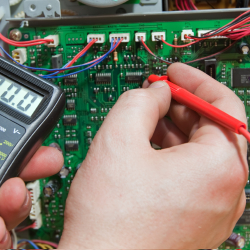

ELECTRICAL & ELCTRONIC

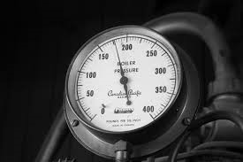

PRESSURE

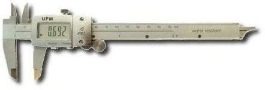

DIMENSIONAL

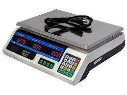

WEIGHNING, LOADCELL & SCALE

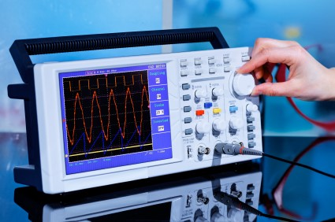

TELECOMMUNICATION & NETWORKING

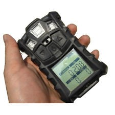

GAS MONITORING & DETECTION

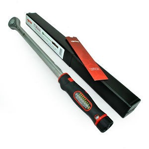

TORQUE CALIBRATION SERVICES

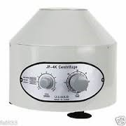

LABORATORY

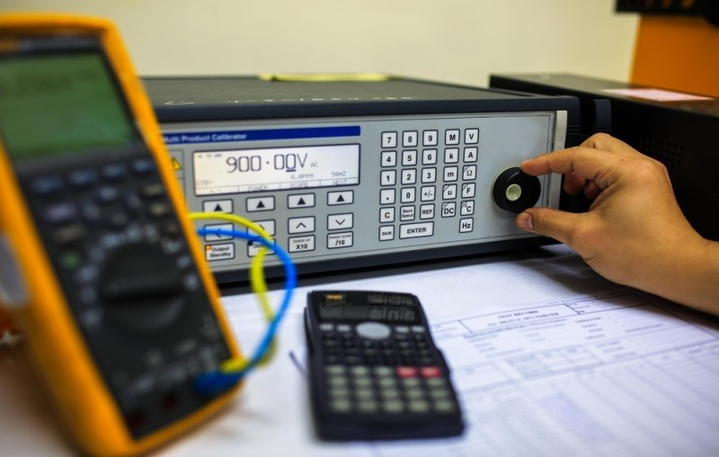

ON-SITE CALIBRATION SERVICE

[« Control & Instrument Valve](https://advanceautomationbrunei.com/products-and-services/control-and-instrument-valves)

### Search

### Products & Services

- [Custom Made](https://advanceautomationbrunei.com/products-and-services/custom-made)
  - [Gaskets and Washers](https://advanceautomationbrunei.com/products-and-services/custom-made/gaskets-and-washers)
  - [Rope and Sling](https://advanceautomationbrunei.com/products-and-services/custom-made/rope-and-sling)
  - [Stud Bolts](https://advanceautomationbrunei.com/products-and-services/custom-made/stud-bolts)
  - [Polymer Taggings](https://advanceautomationbrunei.com/products-and-services/custom-made/polymer-taggings)
- [Calibration & Certification](https://advanceautomationbrunei.com/products-and-services/calibration-certification-services)
- [Safety Product](https://advanceautomationbrunei.com/products-and-services/safety-products)
  - [Personal Safety](https://advanceautomationbrunei.com/products-and-services/safety-products/personal-safety)
  - [Safety Equipments](https://advanceautomationbrunei.com/products-and-services/safety-products/safety-equipments)
- [Control & Instrument Valves](https://advanceautomationbrunei.com/products-and-services/control-and-instrument-valves)
- [Capabilities](https://advanceautomationbrunei.com/products-and-services/capabilities)
  - [Electrical and Instruments](https://advanceautomationbrunei.com/products-and-services/capabilities/electrical-and-instruments)
  - [Temperatures Devices](https://advanceautomationbrunei.com/products-and-services/capabilities/temperatures-devices)
  - [Dimension Measurement](https://advanceautomationbrunei.com/products-and-services/capabilities/dimension-measurement)
- [Engineering And Services](https://advanceautomationbrunei.com/products-and-services/engineering-and-services)
  - [Heat Exchangers](https://advanceautomationbrunei.com/products-and-services/engineering-and-services/heat-exchangers)
  - [Engines Overhaul](https://advanceautomationbrunei.com/products-and-services/engineering-and-services/engines-overhaul)
  - [Lab Equipment Repairs](https://advanceautomationbrunei.com/products-and-services/engineering-and-services/lab-equipment-repairs)
  - [Motor Repairs](https://advanceautomationbrunei.com/products-and-services/engineering-and-services/motor-repairs)
  - [Pump Testing](https://advanceautomationbrunei.com/products-and-services/engineering-and-services/pump-testing)
  - [Pump Repairs](https://advanceautomationbrunei.com/products-and-services/engineering-and-services/pump-repairs)
  - [Valve Actuators Repairs](https://advanceautomationbrunei.com/products-and-services/engineering-and-services/valve-actuators-repairs)
  - [Valve Repairs](https://advanceautomationbrunei.com/products-and-services/engineering-and-services/valve-repairs)

---

## Safety Product

- URL: https://advanceautomationbrunei.com/products-and-services/safety-products
- Raw HTML: `pages/products-and-services/safety-products.html`
- Breadcrumb: Products and Services / Safety Product

## Safety

:   in
    [Safety](https://advanceautomationbrunei.com/products-and-services/safety-products)

### [Personal Safety](https://advanceautomationbrunei.com/products-and-services/safety-products/personal-safety)

:   in
    [Safety](https://advanceautomationbrunei.com/products-and-services/safety-products)

### [Safety Equipments](https://advanceautomationbrunei.com/products-and-services/safety-products/safety-equipments)

### Search

### Products & Services

- [Custom Made](https://advanceautomationbrunei.com/products-and-services/custom-made)
  - [Gaskets and Washers](https://advanceautomationbrunei.com/products-and-services/custom-made/gaskets-and-washers)
  - [Rope and Sling](https://advanceautomationbrunei.com/products-and-services/custom-made/rope-and-sling)
  - [Stud Bolts](https://advanceautomationbrunei.com/products-and-services/custom-made/stud-bolts)
  - [Polymer Taggings](https://advanceautomationbrunei.com/products-and-services/custom-made/polymer-taggings)
- [Calibration & Certification](https://advanceautomationbrunei.com/products-and-services/calibration-certification-services)
- [Safety Product](https://advanceautomationbrunei.com/products-and-services/safety-products)
  - [Personal Safety](https://advanceautomationbrunei.com/products-and-services/safety-products/personal-safety)
  - [Safety Equipments](https://advanceautomationbrunei.com/products-and-services/safety-products/safety-equipments)
- [Control & Instrument Valves](https://advanceautomationbrunei.com/products-and-services/control-and-instrument-valves)
- [Capabilities](https://advanceautomationbrunei.com/products-and-services/capabilities)
  - [Electrical and Instruments](https://advanceautomationbrunei.com/products-and-services/capabilities/electrical-and-instruments)
  - [Temperatures Devices](https://advanceautomationbrunei.com/products-and-services/capabilities/temperatures-devices)
  - [Dimension Measurement](https://advanceautomationbrunei.com/products-and-services/capabilities/dimension-measurement)
- [Engineering And Services](https://advanceautomationbrunei.com/products-and-services/engineering-and-services)
  - [Heat Exchangers](https://advanceautomationbrunei.com/products-and-services/engineering-and-services/heat-exchangers)
  - [Engines Overhaul](https://advanceautomationbrunei.com/products-and-services/engineering-and-services/engines-overhaul)
  - [Lab Equipment Repairs](https://advanceautomationbrunei.com/products-and-services/engineering-and-services/lab-equipment-repairs)
  - [Motor Repairs](https://advanceautomationbrunei.com/products-and-services/engineering-and-services/motor-repairs)
  - [Pump Testing](https://advanceautomationbrunei.com/products-and-services/engineering-and-services/pump-testing)
  - [Pump Repairs](https://advanceautomationbrunei.com/products-and-services/engineering-and-services/pump-repairs)
  - [Valve Actuators Repairs](https://advanceautomationbrunei.com/products-and-services/engineering-and-services/valve-actuators-repairs)
  - [Valve Repairs](https://advanceautomationbrunei.com/products-and-services/engineering-and-services/valve-repairs)

---

## Personal Safety

- URL: https://advanceautomationbrunei.com/products-and-services/safety-products/personal-safety
- Raw HTML: `pages/products-and-services/safety-products/personal-safety.html`
- Meta description: Personal Safety &amp;nbsp; Personal safety Apparels &amp;nbsp;&amp;nbsp;&amp;nbsp; Emergency CPR Facial and Eyes Wash StopDrop Tools Safety Slings &am...
- Breadcrumb: Products and Services / Safety Product / Personal Safety

:   in
    [Safety](https://advanceautomationbrunei.com/products-and-services/safety-products)

- [Print](https://advanceautomationbrunei.com/products-and-services/safety-products/personal-safety?tmpl=component&print=1)
- [Email](https://advanceautomationbrunei.com/component/mailto/?tmpl=component&template=too_fac3heat&link=9c0b747f3c2cac51259f3c23409b9948f7067b73)

### Personal Safety

Personal safety Apparels

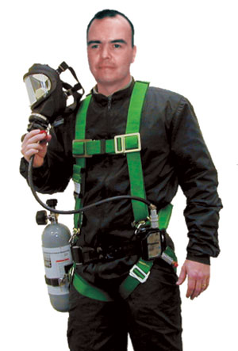    

Emergency CPR

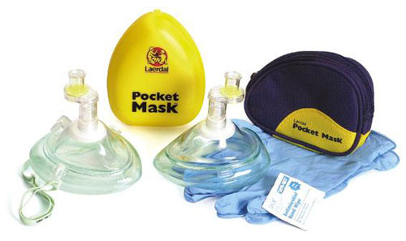

Facial and Eyes Wash

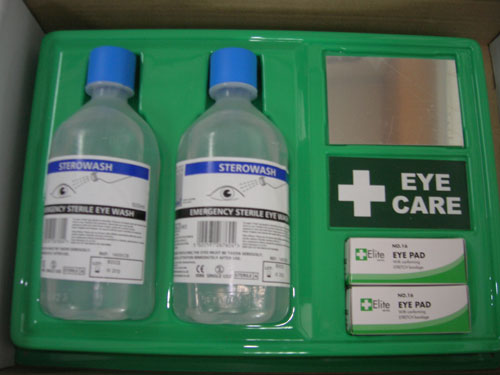

StopDrop Tools Safety Slings

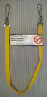  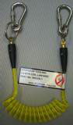  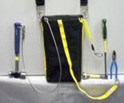  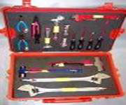

[« Safety Equipments](https://advanceautomationbrunei.com/products-and-services/safety-products/safety-equipments)

### Search

### Products & Services

- [Custom Made](https://advanceautomationbrunei.com/products-and-services/custom-made)
  - [Gaskets and Washers](https://advanceautomationbrunei.com/products-and-services/custom-made/gaskets-and-washers)
  - [Rope and Sling](https://advanceautomationbrunei.com/products-and-services/custom-made/rope-and-sling)
  - [Stud Bolts](https://advanceautomationbrunei.com/products-and-services/custom-made/stud-bolts)
  - [Polymer Taggings](https://advanceautomationbrunei.com/products-and-services/custom-made/polymer-taggings)
- [Calibration & Certification](https://advanceautomationbrunei.com/products-and-services/calibration-certification-services)
- [Safety Product](https://advanceautomationbrunei.com/products-and-services/safety-products)
  - [Personal Safety](https://advanceautomationbrunei.com/products-and-services/safety-products/personal-safety)
  - [Safety Equipments](https://advanceautomationbrunei.com/products-and-services/safety-products/safety-equipments)
- [Control & Instrument Valves](https://advanceautomationbrunei.com/products-and-services/control-and-instrument-valves)
- [Capabilities](https://advanceautomationbrunei.com/products-and-services/capabilities)
  - [Electrical and Instruments](https://advanceautomationbrunei.com/products-and-services/capabilities/electrical-and-instruments)
  - [Temperatures Devices](https://advanceautomationbrunei.com/products-and-services/capabilities/temperatures-devices)
  - [Dimension Measurement](https://advanceautomationbrunei.com/products-and-services/capabilities/dimension-measurement)
- [Engineering And Services](https://advanceautomationbrunei.com/products-and-services/engineering-and-services)
  - [Heat Exchangers](https://advanceautomationbrunei.com/products-and-services/engineering-and-services/heat-exchangers)
  - [Engines Overhaul](https://advanceautomationbrunei.com/products-and-services/engineering-and-services/engines-overhaul)
  - [Lab Equipment Repairs](https://advanceautomationbrunei.com/products-and-services/engineering-and-services/lab-equipment-repairs)
  - [Motor Repairs](https://advanceautomationbrunei.com/products-and-services/engineering-and-services/motor-repairs)
  - [Pump Testing](https://advanceautomationbrunei.com/products-and-services/engineering-and-services/pump-testing)
  - [Pump Repairs](https://advanceautomationbrunei.com/products-and-services/engineering-and-services/pump-repairs)
  - [Valve Actuators Repairs](https://advanceautomationbrunei.com/products-and-services/engineering-and-services/valve-actuators-repairs)
  - [Valve Repairs](https://advanceautomationbrunei.com/products-and-services/engineering-and-services/valve-repairs)

---

## Safety Equipments

- URL: https://advanceautomationbrunei.com/products-and-services/safety-products/safety-equipments
- Raw HTML: `pages/products-and-services/safety-products/safety-equipments.html`
- Meta description: Rope &amp;amp; Sling (Custom Made to fit) &amp;nbsp; Emergency Escape Rope Ladder (ANZIC)Shackles and Hooks &amp;nbsp; Safety Walk /StepsGrips, Hooks...
- Breadcrumb: Products and Services / Safety Product / Safety Equipments

:   in
    [Safety](https://advanceautomationbrunei.com/products-and-services/safety-products)

- [Print](https://advanceautomationbrunei.com/products-and-services/safety-products/safety-equipments?tmpl=component&print=1)
- [Email](https://advanceautomationbrunei.com/component/mailto/?tmpl=component&template=too_fac3heat&link=6e0440f84d03a5d9f5c1758726c51497fac87897)

### Rope & Sling (Custom Made to fit)

Emergency Escape Rope Ladder (ANZIC)
Shackles and Hooks

  

Safety Walk /Steps
Grips, Hooks and Bolts

[Personal Safety »](https://advanceautomationbrunei.com/products-and-services/safety-products/personal-safety)

### Search

### Products & Services

- [Custom Made](https://advanceautomationbrunei.com/products-and-services/custom-made)
  - [Gaskets and Washers](https://advanceautomationbrunei.com/products-and-services/custom-made/gaskets-and-washers)
  - [Rope and Sling](https://advanceautomationbrunei.com/products-and-services/custom-made/rope-and-sling)
  - [Stud Bolts](https://advanceautomationbrunei.com/products-and-services/custom-made/stud-bolts)
  - [Polymer Taggings](https://advanceautomationbrunei.com/products-and-services/custom-made/polymer-taggings)
- [Calibration & Certification](https://advanceautomationbrunei.com/products-and-services/calibration-certification-services)
- [Safety Product](https://advanceautomationbrunei.com/products-and-services/safety-products)
  - [Personal Safety](https://advanceautomationbrunei.com/products-and-services/safety-products/personal-safety)
  - [Safety Equipments](https://advanceautomationbrunei.com/products-and-services/safety-products/safety-equipments)
- [Control & Instrument Valves](https://advanceautomationbrunei.com/products-and-services/control-and-instrument-valves)
- [Capabilities](https://advanceautomationbrunei.com/products-and-services/capabilities)
  - [Electrical and Instruments](https://advanceautomationbrunei.com/products-and-services/capabilities/electrical-and-instruments)
  - [Temperatures Devices](https://advanceautomationbrunei.com/products-and-services/capabilities/temperatures-devices)
  - [Dimension Measurement](https://advanceautomationbrunei.com/products-and-services/capabilities/dimension-measurement)
- [Engineering And Services](https://advanceautomationbrunei.com/products-and-services/engineering-and-services)
  - [Heat Exchangers](https://advanceautomationbrunei.com/products-and-services/engineering-and-services/heat-exchangers)
  - [Engines Overhaul](https://advanceautomationbrunei.com/products-and-services/engineering-and-services/engines-overhaul)
  - [Lab Equipment Repairs](https://advanceautomationbrunei.com/products-and-services/engineering-and-services/lab-equipment-repairs)
  - [Motor Repairs](https://advanceautomationbrunei.com/products-and-services/engineering-and-services/motor-repairs)
  - [Pump Testing](https://advanceautomationbrunei.com/products-and-services/engineering-and-services/pump-testing)
  - [Pump Repairs](https://advanceautomationbrunei.com/products-and-services/engineering-and-services/pump-repairs)
  - [Valve Actuators Repairs](https://advanceautomationbrunei.com/products-and-services/engineering-and-services/valve-actuators-repairs)
  - [Valve Repairs](https://advanceautomationbrunei.com/products-and-services/engineering-and-services/valve-repairs)

---

## Control & Instrument Valves

- URL: https://advanceautomationbrunei.com/products-and-services/control-and-instrument-valves
- Raw HTML: `pages/products-and-services/control-and-instrument-valves.html`
- Meta description: Control &amp;amp; Instrument Valve &amp;nbsp; We have a wide range of Gas, Liquid and Pressure Valves, Please see our Valves Range.Our Services includ...
- Breadcrumb: Products and Services / Control & Instrument Valves

:   in
    [Services](https://advanceautomationbrunei.com/products-and-services/control-and-instrument-valves/itemlist/category/7-services)

- [Print](https://advanceautomationbrunei.com/products-and-services/control-and-instrument-valves?tmpl=component&print=1)
- [Email](https://advanceautomationbrunei.com/component/mailto/?tmpl=component&template=too_fac3heat&link=35f2ffa29ce871650e49aea550178be4c58abc37)

### Control & Instrument Valve

We have a wide range of Gas, Liquid and Pressure Valves, Please see our Valves Range.
Our Services includes, Sales, Service, Parts and Consumables and Calibration Certifications.

|  |  |
| --- | --- |
| 11-Hydraulic-Press  Hydraulic Press | 12-Drifter-Set  Drifter Set |
| 13-Seals-cams | 14-Sales-Services-Cert |
| Seals and Cams replacement,Testing and Certifications | Sales, Service and Certifications |

**Pipeline Valves and Strainers and Tank Accessories**

**  **

**  **

********

**** ****

**  **

[Calibration & Certification and Services »](https://advanceautomationbrunei.com/products-and-services/calibration-certification-services)

### Search

### Products & Services

- [Custom Made](https://advanceautomationbrunei.com/products-and-services/custom-made)
  - [Gaskets and Washers](https://advanceautomationbrunei.com/products-and-services/custom-made/gaskets-and-washers)
  - [Rope and Sling](https://advanceautomationbrunei.com/products-and-services/custom-made/rope-and-sling)
  - [Stud Bolts](https://advanceautomationbrunei.com/products-and-services/custom-made/stud-bolts)
  - [Polymer Taggings](https://advanceautomationbrunei.com/products-and-services/custom-made/polymer-taggings)
- [Calibration & Certification](https://advanceautomationbrunei.com/products-and-services/calibration-certification-services)
- [Safety Product](https://advanceautomationbrunei.com/products-and-services/safety-products)
  - [Personal Safety](https://advanceautomationbrunei.com/products-and-services/safety-products/personal-safety)
  - [Safety Equipments](https://advanceautomationbrunei.com/products-and-services/safety-products/safety-equipments)
- [Control & Instrument Valves](https://advanceautomationbrunei.com/products-and-services/control-and-instrument-valves)
- [Capabilities](https://advanceautomationbrunei.com/products-and-services/capabilities)
  - [Electrical and Instruments](https://advanceautomationbrunei.com/products-and-services/capabilities/electrical-and-instruments)
  - [Temperatures Devices](https://advanceautomationbrunei.com/products-and-services/capabilities/temperatures-devices)
  - [Dimension Measurement](https://advanceautomationbrunei.com/products-and-services/capabilities/dimension-measurement)
- [Engineering And Services](https://advanceautomationbrunei.com/products-and-services/engineering-and-services)
  - [Heat Exchangers](https://advanceautomationbrunei.com/products-and-services/engineering-and-services/heat-exchangers)
  - [Engines Overhaul](https://advanceautomationbrunei.com/products-and-services/engineering-and-services/engines-overhaul)
  - [Lab Equipment Repairs](https://advanceautomationbrunei.com/products-and-services/engineering-and-services/lab-equipment-repairs)
  - [Motor Repairs](https://advanceautomationbrunei.com/products-and-services/engineering-and-services/motor-repairs)
  - [Pump Testing](https://advanceautomationbrunei.com/products-and-services/engineering-and-services/pump-testing)
  - [Pump Repairs](https://advanceautomationbrunei.com/products-and-services/engineering-and-services/pump-repairs)
  - [Valve Actuators Repairs](https://advanceautomationbrunei.com/products-and-services/engineering-and-services/valve-actuators-repairs)
  - [Valve Repairs](https://advanceautomationbrunei.com/products-and-services/engineering-and-services/valve-repairs)

---

## Capabilities

- URL: https://advanceautomationbrunei.com/products-and-services/capabilities
- Raw HTML: `pages/products-and-services/capabilities.html`
- Breadcrumb: Products and Services / Capabilities

## Capabilities

:   in
    [Capabilities](https://advanceautomationbrunei.com/products-and-services/capabilities)

### [Temperatures Devices](https://advanceautomationbrunei.com/products-and-services/capabilities/temperatures-devices)

:   in
    [Capabilities](https://advanceautomationbrunei.com/products-and-services/capabilities)

### [Electrical and Instruments](https://advanceautomationbrunei.com/products-and-services/capabilities/electrical-and-instruments)

:   in
    [Capabilities](https://advanceautomationbrunei.com/products-and-services/capabilities)

### [Length Dimension Measurement](https://advanceautomationbrunei.com/products-and-services/capabilities/dimension-measurement)

### Search

### Products & Services

- [Custom Made](https://advanceautomationbrunei.com/products-and-services/custom-made)
  - [Gaskets and Washers](https://advanceautomationbrunei.com/products-and-services/custom-made/gaskets-and-washers)
  - [Rope and Sling](https://advanceautomationbrunei.com/products-and-services/custom-made/rope-and-sling)
  - [Stud Bolts](https://advanceautomationbrunei.com/products-and-services/custom-made/stud-bolts)
  - [Polymer Taggings](https://advanceautomationbrunei.com/products-and-services/custom-made/polymer-taggings)
- [Calibration & Certification](https://advanceautomationbrunei.com/products-and-services/calibration-certification-services)
- [Safety Product](https://advanceautomationbrunei.com/products-and-services/safety-products)
  - [Personal Safety](https://advanceautomationbrunei.com/products-and-services/safety-products/personal-safety)
  - [Safety Equipments](https://advanceautomationbrunei.com/products-and-services/safety-products/safety-equipments)
- [Control & Instrument Valves](https://advanceautomationbrunei.com/products-and-services/control-and-instrument-valves)
- [Capabilities](https://advanceautomationbrunei.com/products-and-services/capabilities)
  - [Electrical and Instruments](https://advanceautomationbrunei.com/products-and-services/capabilities/electrical-and-instruments)
  - [Temperatures Devices](https://advanceautomationbrunei.com/products-and-services/capabilities/temperatures-devices)
  - [Dimension Measurement](https://advanceautomationbrunei.com/products-and-services/capabilities/dimension-measurement)
- [Engineering And Services](https://advanceautomationbrunei.com/products-and-services/engineering-and-services)
  - [Heat Exchangers](https://advanceautomationbrunei.com/products-and-services/engineering-and-services/heat-exchangers)
  - [Engines Overhaul](https://advanceautomationbrunei.com/products-and-services/engineering-and-services/engines-overhaul)
  - [Lab Equipment Repairs](https://advanceautomationbrunei.com/products-and-services/engineering-and-services/lab-equipment-repairs)
  - [Motor Repairs](https://advanceautomationbrunei.com/products-and-services/engineering-and-services/motor-repairs)
  - [Pump Testing](https://advanceautomationbrunei.com/products-and-services/engineering-and-services/pump-testing)
  - [Pump Repairs](https://advanceautomationbrunei.com/products-and-services/engineering-and-services/pump-repairs)
  - [Valve Actuators Repairs](https://advanceautomationbrunei.com/products-and-services/engineering-and-services/valve-actuators-repairs)
  - [Valve Repairs](https://advanceautomationbrunei.com/products-and-services/engineering-and-services/valve-repairs)

---

## Electrical and Instruments

- URL: https://advanceautomationbrunei.com/products-and-services/capabilities/electrical-and-instruments
- Raw HTML: `pages/products-and-services/capabilities/electrical-and-instruments.html`
- Meta description: Electrical &amp;amp; Instruments &amp;nbsp; AC/DC Calibrator AC Low Ohm Tester Ammeter Alternators Altimeters Air Pressure Controllers Attenuator Clam...
- Breadcrumb: Products and Services / Capabilities / Electrical and Instruments

:   in
    [Capabilities](https://advanceautomationbrunei.com/products-and-services/capabilities)

- [Print](https://advanceautomationbrunei.com/products-and-services/capabilities/electrical-and-instruments?tmpl=component&print=1)
- [Email](https://advanceautomationbrunei.com/component/mailto/?tmpl=component&template=too_fac3heat&link=718558a084acffb4cb2aa85260de33c14f219321)

### Electrical & Instruments

|  |  |  |
| --- | --- | --- |
| AC/DC Calibrator | AC Low Ohm Tester | Ammeter |
| Alternators | Altimeters | Air Pressure Controllers |
| Attenuator | Clamp Meters | Control Panels Metering |
| Decade LCR Box | DMM Metering | Data Analyzers |
| ESD Metering Device | ESD Meters | Echo Sounder Meters |
| Fuel Analyzers | Fuel Metering Device | Fuel Grading Analyzers |
| Frequency Counter | Ground Tester / Meters | Hipot Voltage Tester |
| High Voltage Divider | High Voltage Meters | Insulations Testers |
| LCR Bridge Meter | Logic Analyzer | Logic Signal Generator |
| Meg ohm meter |  |  |
| Milli ohm meter | Network Analyzer | Oscillators |
| Oscilloscope | Panel Metering Device | Power Supply AC |
| Resistance Meter (ohm) | Shunt | Signal Generator |
| Stroboscope | Spectrum Metering Device | Standards LCR |
| Static Metering Device | Stopwatch and Timer | Tachometer |
| Voltage Stabilizer | Voltage Generators |  |
| Wrist Strap Tester |  |  |

[« Length Dimension Measurement](https://advanceautomationbrunei.com/products-and-services/capabilities/dimension-measurement)
[Temperatures Devices »](https://advanceautomationbrunei.com/products-and-services/capabilities/temperatures-devices)

### Search

### Products & Services

- [Custom Made](https://advanceautomationbrunei.com/products-and-services/custom-made)
  - [Gaskets and Washers](https://advanceautomationbrunei.com/products-and-services/custom-made/gaskets-and-washers)
  - [Rope and Sling](https://advanceautomationbrunei.com/products-and-services/custom-made/rope-and-sling)
  - [Stud Bolts](https://advanceautomationbrunei.com/products-and-services/custom-made/stud-bolts)
  - [Polymer Taggings](https://advanceautomationbrunei.com/products-and-services/custom-made/polymer-taggings)
- [Calibration & Certification](https://advanceautomationbrunei.com/products-and-services/calibration-certification-services)
- [Safety Product](https://advanceautomationbrunei.com/products-and-services/safety-products)
  - [Personal Safety](https://advanceautomationbrunei.com/products-and-services/safety-products/personal-safety)
  - [Safety Equipments](https://advanceautomationbrunei.com/products-and-services/safety-products/safety-equipments)
- [Control & Instrument Valves](https://advanceautomationbrunei.com/products-and-services/control-and-instrument-valves)
- [Capabilities](https://advanceautomationbrunei.com/products-and-services/capabilities)
  - [Electrical and Instruments](https://advanceautomationbrunei.com/products-and-services/capabilities/electrical-and-instruments)
  - [Temperatures Devices](https://advanceautomationbrunei.com/products-and-services/capabilities/temperatures-devices)
  - [Dimension Measurement](https://advanceautomationbrunei.com/products-and-services/capabilities/dimension-measurement)
- [Engineering And Services](https://advanceautomationbrunei.com/products-and-services/engineering-and-services)
  - [Heat Exchangers](https://advanceautomationbrunei.com/products-and-services/engineering-and-services/heat-exchangers)
  - [Engines Overhaul](https://advanceautomationbrunei.com/products-and-services/engineering-and-services/engines-overhaul)
  - [Lab Equipment Repairs](https://advanceautomationbrunei.com/products-and-services/engineering-and-services/lab-equipment-repairs)
  - [Motor Repairs](https://advanceautomationbrunei.com/products-and-services/engineering-and-services/motor-repairs)
  - [Pump Testing](https://advanceautomationbrunei.com/products-and-services/engineering-and-services/pump-testing)
  - [Pump Repairs](https://advanceautomationbrunei.com/products-and-services/engineering-and-services/pump-repairs)
  - [Valve Actuators Repairs](https://advanceautomationbrunei.com/products-and-services/engineering-and-services/valve-actuators-repairs)
  - [Valve Repairs](https://advanceautomationbrunei.com/products-and-services/engineering-and-services/valve-repairs)

---

## Temperatures Devices

- URL: https://advanceautomationbrunei.com/products-and-services/capabilities/temperatures-devices
- Raw HTML: `pages/products-and-services/capabilities/temperatures-devices.html`
- Meta description: Temperatures Devices &amp;nbsp; Block Callibrators Chart Recorders (Pnuematics) Enviromental Chamber Freezer Units Cold Room RH Indicators RTD Units S...
- Breadcrumb: Products and Services / Capabilities / Temperatures Devices

:   in
    [Capabilities](https://advanceautomationbrunei.com/products-and-services/capabilities)

- [Print](https://advanceautomationbrunei.com/products-and-services/capabilities/temperatures-devices?tmpl=component&print=1)
- [Email](https://advanceautomationbrunei.com/component/mailto/?tmpl=component&template=too_fac3heat&link=b049a47c3167f61247873b56a92eb9808d510b04)

### Temperatures Devices

|  |  |  |
| --- | --- | --- |
| Block Callibrators | Chart Recorders (Pnuematics) | Enviromental Chamber |
| Freezer Units | Cold Room | RH Indicators |
| RTD Units | Soldering Iron / Stations | Solder System Tester |
| Temperature Profiler /Loggers | Temperature Bath | Temperature Controller |
| Temp. /RH Chart Recorder | Thermohygraph | Thermocouple |
| Thermometer |  |  |

[« Electrical and Instruments](https://advanceautomationbrunei.com/products-and-services/capabilities/electrical-and-instruments)

### Search

### Products & Services

- [Custom Made](https://advanceautomationbrunei.com/products-and-services/custom-made)
  - [Gaskets and Washers](https://advanceautomationbrunei.com/products-and-services/custom-made/gaskets-and-washers)
  - [Rope and Sling](https://advanceautomationbrunei.com/products-and-services/custom-made/rope-and-sling)
  - [Stud Bolts](https://advanceautomationbrunei.com/products-and-services/custom-made/stud-bolts)
  - [Polymer Taggings](https://advanceautomationbrunei.com/products-and-services/custom-made/polymer-taggings)
- [Calibration & Certification](https://advanceautomationbrunei.com/products-and-services/calibration-certification-services)
- [Safety Product](https://advanceautomationbrunei.com/products-and-services/safety-products)
  - [Personal Safety](https://advanceautomationbrunei.com/products-and-services/safety-products/personal-safety)
  - [Safety Equipments](https://advanceautomationbrunei.com/products-and-services/safety-products/safety-equipments)
- [Control & Instrument Valves](https://advanceautomationbrunei.com/products-and-services/control-and-instrument-valves)
- [Capabilities](https://advanceautomationbrunei.com/products-and-services/capabilities)
  - [Electrical and Instruments](https://advanceautomationbrunei.com/products-and-services/capabilities/electrical-and-instruments)
  - [Temperatures Devices](https://advanceautomationbrunei.com/products-and-services/capabilities/temperatures-devices)
  - [Dimension Measurement](https://advanceautomationbrunei.com/products-and-services/capabilities/dimension-measurement)
- [Engineering And Services](https://advanceautomationbrunei.com/products-and-services/engineering-and-services)
  - [Heat Exchangers](https://advanceautomationbrunei.com/products-and-services/engineering-and-services/heat-exchangers)
  - [Engines Overhaul](https://advanceautomationbrunei.com/products-and-services/engineering-and-services/engines-overhaul)
  - [Lab Equipment Repairs](https://advanceautomationbrunei.com/products-and-services/engineering-and-services/lab-equipment-repairs)
  - [Motor Repairs](https://advanceautomationbrunei.com/products-and-services/engineering-and-services/motor-repairs)
  - [Pump Testing](https://advanceautomationbrunei.com/products-and-services/engineering-and-services/pump-testing)
  - [Pump Repairs](https://advanceautomationbrunei.com/products-and-services/engineering-and-services/pump-repairs)
  - [Valve Actuators Repairs](https://advanceautomationbrunei.com/products-and-services/engineering-and-services/valve-actuators-repairs)
  - [Valve Repairs](https://advanceautomationbrunei.com/products-and-services/engineering-and-services/valve-repairs)

---

## Dimension Measurement

- URL: https://advanceautomationbrunei.com/products-and-services/capabilities/dimension-measurement
- Raw HTML: `pages/products-and-services/capabilities/dimension-measurement.html`
- Meta description: Length Dimension Measurement &amp;nbsp; Calipers Depth Gauge &amp;nbsp; Dial Thickness Gauge Digimatic Indicators &amp;nbsp; Dead Weight Tester Extern...
- Breadcrumb: Products and Services / Capabilities / Dimension Measurement

:   in
    [Capabilities](https://advanceautomationbrunei.com/products-and-services/capabilities)

- [Print](https://advanceautomationbrunei.com/products-and-services/capabilities/dimension-measurement?tmpl=component&print=1)
- [Email](https://advanceautomationbrunei.com/component/mailto/?tmpl=component&template=too_fac3heat&link=2f7469d13aa9d2b526b6ffbfc7b3b7648f373df3)

### Length Dimension Measurement

|  |  |  |
| --- | --- | --- |
| Calipers | Depth Gauge |  |
| Dial Thickness Gauge | Digimatic Indicators |  |
| Dead Weight Tester | External Micrometer |  |
| Feeler Gauge | Granite Surface Plate |  |
| Height Gauge | Height Masters |  |
| Internal Micrometer |  |  |
| MU Checkers | Pin Gauge Calibration Tester | Push Pull Gauge |
| Pressure Gauges | Pressure Thermocouple | Profile Projector |
| Torque Meters | Torque Driver |  |
| Weighing Machine |  |  |

[Electrical and Instruments »](https://advanceautomationbrunei.com/products-and-services/capabilities/electrical-and-instruments)

### Search

### Products & Services

- [Custom Made](https://advanceautomationbrunei.com/products-and-services/custom-made)
  - [Gaskets and Washers](https://advanceautomationbrunei.com/products-and-services/custom-made/gaskets-and-washers)
  - [Rope and Sling](https://advanceautomationbrunei.com/products-and-services/custom-made/rope-and-sling)
  - [Stud Bolts](https://advanceautomationbrunei.com/products-and-services/custom-made/stud-bolts)
  - [Polymer Taggings](https://advanceautomationbrunei.com/products-and-services/custom-made/polymer-taggings)
- [Calibration & Certification](https://advanceautomationbrunei.com/products-and-services/calibration-certification-services)
- [Safety Product](https://advanceautomationbrunei.com/products-and-services/safety-products)
  - [Personal Safety](https://advanceautomationbrunei.com/products-and-services/safety-products/personal-safety)
  - [Safety Equipments](https://advanceautomationbrunei.com/products-and-services/safety-products/safety-equipments)
- [Control & Instrument Valves](https://advanceautomationbrunei.com/products-and-services/control-and-instrument-valves)
- [Capabilities](https://advanceautomationbrunei.com/products-and-services/capabilities)
  - [Electrical and Instruments](https://advanceautomationbrunei.com/products-and-services/capabilities/electrical-and-instruments)
  - [Temperatures Devices](https://advanceautomationbrunei.com/products-and-services/capabilities/temperatures-devices)
  - [Dimension Measurement](https://advanceautomationbrunei.com/products-and-services/capabilities/dimension-measurement)
- [Engineering And Services](https://advanceautomationbrunei.com/products-and-services/engineering-and-services)
  - [Heat Exchangers](https://advanceautomationbrunei.com/products-and-services/engineering-and-services/heat-exchangers)
  - [Engines Overhaul](https://advanceautomationbrunei.com/products-and-services/engineering-and-services/engines-overhaul)
  - [Lab Equipment Repairs](https://advanceautomationbrunei.com/products-and-services/engineering-and-services/lab-equipment-repairs)
  - [Motor Repairs](https://advanceautomationbrunei.com/products-and-services/engineering-and-services/motor-repairs)
  - [Pump Testing](https://advanceautomationbrunei.com/products-and-services/engineering-and-services/pump-testing)
  - [Pump Repairs](https://advanceautomationbrunei.com/products-and-services/engineering-and-services/pump-repairs)
  - [Valve Actuators Repairs](https://advanceautomationbrunei.com/products-and-services/engineering-and-services/valve-actuators-repairs)
  - [Valve Repairs](https://advanceautomationbrunei.com/products-and-services/engineering-and-services/valve-repairs)

---

## Engineering And Services

- URL: https://advanceautomationbrunei.com/products-and-services/engineering-and-services
- Raw HTML: `pages/products-and-services/engineering-and-services.html`
- Breadcrumb: Products and Services / Engineering And Services

## Engineering & Services

:   in
    [Engineering & Services](https://advanceautomationbrunei.com/products-and-services/engineering-and-services)

### [Valve Repairs and Services](https://advanceautomationbrunei.com/products-and-services/engineering-and-services/valve-repairs)

:   in
    [Engineering & Services](https://advanceautomationbrunei.com/products-and-services/engineering-and-services)

### [Valve Actuators Repairs & Services](https://advanceautomationbrunei.com/products-and-services/engineering-and-services/valve-actuators-repairs)

:   in
    [Engineering & Services](https://advanceautomationbrunei.com/products-and-services/engineering-and-services)

### [Pump Repairs and Services](https://advanceautomationbrunei.com/products-and-services/engineering-and-services/pump-repairs)

:   in
    [Engineering & Services](https://advanceautomationbrunei.com/products-and-services/engineering-and-services)

### [Heat Exchangers Repairs](https://advanceautomationbrunei.com/products-and-services/engineering-and-services/heat-exchangers)

:   in
    [Engineering & Services](https://advanceautomationbrunei.com/products-and-services/engineering-and-services)

### [Engines Overhaul](https://advanceautomationbrunei.com/products-and-services/engineering-and-services/engines-overhaul)

:   in
    [Engineering & Services](https://advanceautomationbrunei.com/products-and-services/engineering-and-services)

### [Laboratory Equipment Repairs](https://advanceautomationbrunei.com/products-and-services/engineering-and-services/lab-equipment-repairs)

:   in
    [Engineering & Services](https://advanceautomationbrunei.com/products-and-services/engineering-and-services)

### [Motor Repairs and Services](https://advanceautomationbrunei.com/products-and-services/engineering-and-services/motor-repairs)

:   in
    [Engineering & Services](https://advanceautomationbrunei.com/products-and-services/engineering-and-services)

### [Pump Performance Testing Facility](https://advanceautomationbrunei.com/products-and-services/engineering-and-services/pump-testing)

### Search

### Products & Services

- [Custom Made](https://advanceautomationbrunei.com/products-and-services/custom-made)
  - [Gaskets and Washers](https://advanceautomationbrunei.com/products-and-services/custom-made/gaskets-and-washers)
  - [Rope and Sling](https://advanceautomationbrunei.com/products-and-services/custom-made/rope-and-sling)
  - [Stud Bolts](https://advanceautomationbrunei.com/products-and-services/custom-made/stud-bolts)
  - [Polymer Taggings](https://advanceautomationbrunei.com/products-and-services/custom-made/polymer-taggings)
- [Calibration & Certification](https://advanceautomationbrunei.com/products-and-services/calibration-certification-services)
- [Safety Product](https://advanceautomationbrunei.com/products-and-services/safety-products)
  - [Personal Safety](https://advanceautomationbrunei.com/products-and-services/safety-products/personal-safety)
  - [Safety Equipments](https://advanceautomationbrunei.com/products-and-services/safety-products/safety-equipments)
- [Control & Instrument Valves](https://advanceautomationbrunei.com/products-and-services/control-and-instrument-valves)
- [Capabilities](https://advanceautomationbrunei.com/products-and-services/capabilities)
  - [Electrical and Instruments](https://advanceautomationbrunei.com/products-and-services/capabilities/electrical-and-instruments)
  - [Temperatures Devices](https://advanceautomationbrunei.com/products-and-services/capabilities/temperatures-devices)
  - [Dimension Measurement](https://advanceautomationbrunei.com/products-and-services/capabilities/dimension-measurement)
- [Engineering And Services](https://advanceautomationbrunei.com/products-and-services/engineering-and-services)
  - [Heat Exchangers](https://advanceautomationbrunei.com/products-and-services/engineering-and-services/heat-exchangers)
  - [Engines Overhaul](https://advanceautomationbrunei.com/products-and-services/engineering-and-services/engines-overhaul)
  - [Lab Equipment Repairs](https://advanceautomationbrunei.com/products-and-services/engineering-and-services/lab-equipment-repairs)
  - [Motor Repairs](https://advanceautomationbrunei.com/products-and-services/engineering-and-services/motor-repairs)
  - [Pump Testing](https://advanceautomationbrunei.com/products-and-services/engineering-and-services/pump-testing)
  - [Pump Repairs](https://advanceautomationbrunei.com/products-and-services/engineering-and-services/pump-repairs)
  - [Valve Actuators Repairs](https://advanceautomationbrunei.com/products-and-services/engineering-and-services/valve-actuators-repairs)
  - [Valve Repairs](https://advanceautomationbrunei.com/products-and-services/engineering-and-services/valve-repairs)

---

## Heat Exchangers

- URL: https://advanceautomationbrunei.com/products-and-services/engineering-and-services/heat-exchangers
- Raw HTML: `pages/products-and-services/engineering-and-services/heat-exchangers.html`
- Meta description: Heat Exchangers Repairs and Services &amp;nbsp; QUALITY MANAGEMENT Continuous quality assurance is an integral part of the Advance Automation Sdn Bhd...
- Breadcrumb: Products and Services / Engineering And Services / Heat Exchangers

:   in
    [Engineering & Services](https://advanceautomationbrunei.com/products-and-services/engineering-and-services)

- [Print](https://advanceautomationbrunei.com/products-and-services/engineering-and-services/heat-exchangers?tmpl=component&print=1)
- [Email](https://advanceautomationbrunei.com/component/mailto/?tmpl=component&template=too_fac3heat&link=aa3493613c66e51faf9473d4f6624e28e9b7fcc1)

### Heat Exchangers Repairs and Services

**QUALITY MANAGEMENT**

Continuous quality assurance is an integral part of the Advance Automation Sdn Bhd corporate philosophy.

Qur quality management system is compliance with the ISO 9001:2008 requirements. In order to guarantee consistently high quality to our customers, we work according to a key performance indicator orientated quality management system.

**AFTER SALES SERVICE – ANYTIME AND EVERYWHERE**

We take care of our services during the entire operational lifetime. We aim to provide the best customer service anytime and everywhere.

- Maintenance - genuine spare parts supply. Failure analysis, repair, field service
- Fast Emergency Support
- Start-up Assistance
- Consulting for continuous improvement

Our service specialists as well as our service centers work in a global network to support you best.

|  |  |
| --- | --- |
| **Field Support Services**  **Heat Exchanger Fabrication and Repair**  Specializing in heat exchanger manufacturing and repair, our heat exchanger services facility stocks a diverse inventory of materials and heat exchanger equipment that allows us to quickly adapt to our client’s specialized requirements and specifications.  Upon client request, we will schedule shop time in preparation for field projects in order to ensure a short turnaround time for field maintenance work.  **Heat Exchanger Services**  We manufacture, repair and refurbish any size and type of heat exchangers including:   - Shell and Tube Bundles - Straight-tubed Heat Exchangers - U-bundle Heat Exchangers - Plate Exchangers - Coil-style Heat Exchangers - Fin-fan Coolers - Hairpin Exchangers | **Equipment and Materials**  To assist us in quickly adapting to specialized customer requirements, we stock a large inventory of heat exchanger specific equipment and material.  **Materials Inventory**   - Steel Tubing - Tapered Tubing Plugs - Plate and Tubing Material - Plugs and Gaskets   **Heat Exchanger Equipment**   - Tube Expanders - Rolling Guns - Tube Pulling and Testing Equipment   **Quality Control**  Prior to shipment, all manufactured components undergo thorough Quality Control inspection to ensure conformance to ASME codes Sec. VIII Div. 1 and 2. |

**TURNKEY EXCHANGERS AND MECHANICAL SERVICES**

Advance Automation Sdn Bhd provides turnkey heat exchanger and capital project services. Advance Automation Sdn Bhd safely and reliable meets your specialty welding and heat exchanger requirement on a 24/7/356 basis. Our expanding bundle extraction technology and blind-to-blind capabilities minimize both scheduled and unscheduled downtime, and provide both you with better budgetary and spend decisions.

|  |  |
| --- | --- |
| **What We Do**   - Blind-to-blind heat exchanger disassembly - Bundle extraction and installation - Loading and transportation - Pre-decommission de-sludging “wash outs” (Chemical Cleaning) - Dis-assembly and re-assembly including bolt (de) troquing and (de) tensioning - Cleaning of shell and components mostly using non-held hand, semi or fully automated equipment - High pressure water jetting - Dry cleaning by rotating brushes - Ultra Hhigh pressure water jetting   - Heat exchanger repairs:   - Retubing of complete bundles or single tubes   - Expanding and welding   - In-situ machining   - Shell repairs   - Plugging     - Pressure testing:     - Hydro-testing     - IRIS tube inspection     - NDT     - Boroscope     - Online thermo dynamics monitoring | **Why Advance Automation Sdn Bhd?**   - Single supplier, single point of contact - Company-wide commitment to safety - Highly trained, experienced and industry-recognized operators - Field and shop machining, tube seal welding, and rolling   - Engineering, manufacturing and technical support |

  

**HEAT EXCHANGER MECHANICAL SERVICES**

**FIELD AND SHOP REPAIRS**

Exchanger bundle can be repaired on-site or transported to Advance Automation Sdn Bhd shop for repair. All work is performed by highly trained and experienced engineers and technicians to standards. Services include:

**Retubing**

Full retubes, partial retubes or single tube replacement available on all types of exchangers; rolling and replacing of tubes of all sizes and metallurgies.

**Rerating**

“R” stamp repairs to heads, shells, flanges, baffles and all other components.

**Mechanical Repairs**

Engineers and technicians are cross-trained to proficiently provide machining, technical bolting, gasket change, stud disintegration and other repairs.

**TESTING SERVICES**

Advance Automation Sdn Bhd provides post-assembly testing on all sizes and types of exchangers to ensure a leak-free startup and trouble-free service. Non-destructive testing may include air testing, vacuum testing and hydro testing to verify the mechanical integrity of all tubes, gaskets, bolting and repairs.

[« Engines Overhaul](https://advanceautomationbrunei.com/products-and-services/engineering-and-services/engines-overhaul)
[Pump Repairs and Services »](https://advanceautomationbrunei.com/products-and-services/engineering-and-services/pump-repairs)

### Search

### Products & Services

- [Custom Made](https://advanceautomationbrunei.com/products-and-services/custom-made)
  - [Gaskets and Washers](https://advanceautomationbrunei.com/products-and-services/custom-made/gaskets-and-washers)
  - [Rope and Sling](https://advanceautomationbrunei.com/products-and-services/custom-made/rope-and-sling)
  - [Stud Bolts](https://advanceautomationbrunei.com/products-and-services/custom-made/stud-bolts)
  - [Polymer Taggings](https://advanceautomationbrunei.com/products-and-services/custom-made/polymer-taggings)
- [Calibration & Certification](https://advanceautomationbrunei.com/products-and-services/calibration-certification-services)
- [Safety Product](https://advanceautomationbrunei.com/products-and-services/safety-products)
  - [Personal Safety](https://advanceautomationbrunei.com/products-and-services/safety-products/personal-safety)
  - [Safety Equipments](https://advanceautomationbrunei.com/products-and-services/safety-products/safety-equipments)
- [Control & Instrument Valves](https://advanceautomationbrunei.com/products-and-services/control-and-instrument-valves)
- [Capabilities](https://advanceautomationbrunei.com/products-and-services/capabilities)
  - [Electrical and Instruments](https://advanceautomationbrunei.com/products-and-services/capabilities/electrical-and-instruments)
  - [Temperatures Devices](https://advanceautomationbrunei.com/products-and-services/capabilities/temperatures-devices)
  - [Dimension Measurement](https://advanceautomationbrunei.com/products-and-services/capabilities/dimension-measurement)
- [Engineering And Services](https://advanceautomationbrunei.com/products-and-services/engineering-and-services)
  - [Heat Exchangers](https://advanceautomationbrunei.com/products-and-services/engineering-and-services/heat-exchangers)
  - [Engines Overhaul](https://advanceautomationbrunei.com/products-and-services/engineering-and-services/engines-overhaul)
  - [Lab Equipment Repairs](https://advanceautomationbrunei.com/products-and-services/engineering-and-services/lab-equipment-repairs)
  - [Motor Repairs](https://advanceautomationbrunei.com/products-and-services/engineering-and-services/motor-repairs)
  - [Pump Testing](https://advanceautomationbrunei.com/products-and-services/engineering-and-services/pump-testing)
  - [Pump Repairs](https://advanceautomationbrunei.com/products-and-services/engineering-and-services/pump-repairs)
  - [Valve Actuators Repairs](https://advanceautomationbrunei.com/products-and-services/engineering-and-services/valve-actuators-repairs)
  - [Valve Repairs](https://advanceautomationbrunei.com/products-and-services/engineering-and-services/valve-repairs)

---

## Engines Overhaul

- URL: https://advanceautomationbrunei.com/products-and-services/engineering-and-services/engines-overhaul
- Raw HTML: `pages/products-and-services/engineering-and-services/engines-overhaul.html`
- Meta description: Industrial, Marine, &amp;amp; Commercial Engines Services &amp;nbsp; DIESEL ENGINE SERVICE &amp;nbsp; Convenience and Competitive Pricing Our competen...
- Breadcrumb: Products and Services / Engineering And Services / Engines Overhaul

:   in
    [Engineering & Services](https://advanceautomationbrunei.com/products-and-services/engineering-and-services)

- [Print](https://advanceautomationbrunei.com/products-and-services/engineering-and-services/engines-overhaul?tmpl=component&print=1)
- [Email](https://advanceautomationbrunei.com/component/mailto/?tmpl=component&template=too_fac3heat&link=fd7c4285d9ff0958b11a7e4b5ef05f97a149d4c7)

### Industrial, Marine, & Commercial Engines Services

**DIESEL ENGINE SERVICE**

Convenience and Competitive Pricing

Our competent mechanics have the experience, training, and diverse knowledge to complete your entire scope of work on virtually every type of diesel engine and related equipment:

Marine engines, industrial engines, generators, large and small rolling stock, cylinder head reconditioning, transmissions, and related equipment.

**Services**: repair, emergency repair, maintenance, generator maintenance programs, engine overhauls, power takeoffs, refurbishing, remanufacturing, dynamometer testing, inframe and out of frame, and more.

**Excellence** recipient for attaining the highest standard of professionalism and meeting engine’s rigid standards for attaining this designation.

100% Satisfaction Guarantee and all workmanship comes with a workmanship warranty. You can count on Advance Automation Sdn Bhd to do the job right the first time and stand behind our work.

Servicing Caterpillar, Cummins, Detroit Diesel, Briggs & Stratton, Deutz, Ford Lehman, Funk, GE, Generac, Hatz, Isuzu, John Deere, Kohler, Kubota, Mitsubishi, Onan, Perkins, Sabre, Subaru, Twin Disc, Universal, Volvo, Westerbeke, Yanmar and more.

Contact us now to talk with a diesel engine specialist about your diesel engines and related equipment.

**MARINE ENGINE SERVICE**

Our highly competent mechanics have huge years of experience and on-going training. They are flexible and adaptable to ensure every customer receives quality, timely work every time. As the oldest existing for Caterpillar, Perkins, Detroit Diesel, and Yanmar, our mechanics are among the best at keeping older engines running like new.

Save Time and Money If You Have More Than One Make of Engine On Board

You’ll only need one mechanic from Advance Automation Sdn Bhd to service all of your engines. Whether we travel to your boat - you’ll save valuable time and save money. Many boats are repaired right here in our yard shop, too. Wherever your work is done, all vessels are covered by our marine liability insurance.

Services

- Maintenance:marine engine tune-ups, semi-annual and annual generator maintenance, load bank testing, preventative maintenance, top-end overhauls, in-frame overhauls, major overhauls, oil and fluid changes, coolant flushing, inspections, etc.
- Repowers:all marine engines, propeller sizing, exhaust systems, fuel systems, instrumentation, controls, engine horsepower matching, transmission selection
- Testing and other services:dynamometer testing, load bank testing, back pressure testing, fuel consumption testing, oil consumption testing, performance testing, sea trials, dock trials, generator start up, etc.

Types of equipment: all marine engines, all marine generators, turbochargers, fuel pumps, injectors, cylinder heads, marine transmissions, and related equipment.

Servicing Caterpillar, Cummins, Detroit Diesel, Ford Lehman, Isuzu, John Deere, Mitsubishi, Perkins, Sabre, Universal Volvo, Westerbeke, Yanmar and more.

**Contact us**now to talk with a marine engine specialist about your marine engines and related equipment.

# **GENERATOR SERVICE**

Expertise, quality work, and competitive pricing are among the many reasons Advance Automation Sdn Bhd has earned a trusted reputation for generator service - marine, commercial, industrial, and home/residential generators. The majority of repairs are completed on our first visit - saving you time and money. How do we do it? Our technicians hold certificates of accomplishment for Caterpillar, Cummins, GE, Generac, Kohler, Briggs & Stratton, and Onan. In addition, their understanding of generator manufacturing enables them to excel at maintaining, repairing, repowering and testing a diverse array of generators.

Services for All Makes of Generators

- Maintenanceincluding engine tune-ups, annual and semi-annual generator maintenance, load bank testing, preventative maintenance, top-end overhauls, in-frame overhauls, major overhauls, oil and fluid changes, coolant flushing, inspections, hoses and belts, transfer switch inspections, transfer switch repairs, generator bearing service, voltage regulators, controller service, fuel tank cleaning, etc.
- Repairsincluding all generator engines, generators, turbochargers, fuel pumps, injectors, cylinder heads, engine overhauls, engine inframes, transfer switches, voltage regulator repairs, etc.
- Repowersincluding generator replacement, engine replacement, complete generator set replacements, transfer switches, switch gear, etc.
- Testing including load bank testing, load transfer, building load tests, performance testing, etc.
- Other generator servicesincluding system sizing and governor service.

Servicing Caterpillar, Cummins, GE, Generac, Kohler, Briggs & Stratton, Onan and more.

Considering a new generator? We can help you determine the correct size of generator you need and install your complete system.

Contact us now to talk with a generator specialist about your generator maintenance, repair, repower, testing, and other services.

**INDUSTRIAL ENGINE SERVICE**

Competitive Pricing, Quality Work, and Timely Response

Is it time to replace, repower, repair, or service the diesel engines driving your hydraulics, pumps, compressors, generators, or other industrial equipment? Our diesel engine technicians have earned certificates of accomplishment from Caterpillar, Cummins, Detroit Diesel, Deutz, Funk, Hatz, Isuzu, John Deere, Kubota, Perkins, Subaru, Twin Disc, and Yanmar. They have training and experience on a diverse range of industrial engines. We provide expert level service for virtually all brands of diesel engines. Unsure what you need? Ask us about sizing an engine for your equipment and your loads.

Services

- Maintenanceincluding industrial engine tune-ups, annual and semi-annual maintenance, preventative maintenance, top-end overhauls, in-frame overhauls, major overhauls, oil and fluid changes, coolant flushing, inspections, etc.
- Repairsincluding all engines, generators, turbochargers, fuel pumps, injectors, cylinder heads, engine overhauls, engine inframes, etc.
- Repowersincluding EPA replacement engines, system integration, engine sizing, etc.
- Otherservices including dynamometer testing, system integration (hydraulic, pumps, generators), engine sizing, etc.
- Reliable - Cost Effective - Save Time - Peace of Mind

 Maintenance, remanufacturing, repair, and overhauls in our shop. Repair Services :  call us at +673 8278288

Servicing Caterpillar, Cummins, Detroit Diesel, Deutz, Funk, Hatz, Isuzu, John Deere, Kubota, Perkins, Subaru, Twin Disc, Yanmar and more.

Need parts? Come in or call for all diesel engine parts. Satisfaction Guaranteed and all workmanship is covered by our workmanship warranty.

Contact us now to talk with an industrial engine specialist about your engine maintenance, repair, repower, testing, and other diesel engine services.

**TESTING SERVICES**

Periodic testing helps to ensure optimal engine and generator performance. It can help you avoid unexpected breakdowns, costly repairs, and life threatening emergencies. Do you depend on diesel engines or generators to keep your boat, industrial equipment, data center, surgery center, or other operations running? Testing reports the condition of your equipment so you can schedule preventative maintenance, repair, repower, or replacement. Save time and money by avoiding parts or equipment failure and by improving your engine’s fuel efficiency.

Concerned about your engine being worn out or clogged by carbon? A performance test will report the condition of your engine and exercise your engine or generator to remove carbon build-up.

- Testing servicesinclude dynamometer testing, load bank testing, performance testing, sea trials, etc. Use these tests for engines and generators that are rebuilt, modified or serviced to ensure they are ready to perform.
- Related testing servicesinclude back pressure testing, compression testing, crankcase pressure testing, leak down testing, crankshaft deflection testing, safety testing, etc.

Most of these tests can be performed at our yard shop.

We use industry leading testing equipment including Avtron, Simplex, and Go-Power.

Contact us now to talk with a diesel engine specialist about testing your engines and generators.

[« Laboratory Equipment Repairs](https://advanceautomationbrunei.com/products-and-services/engineering-and-services/lab-equipment-repairs)
[Heat Exchangers Repairs »](https://advanceautomationbrunei.com/products-and-services/engineering-and-services/heat-exchangers)

### Search

### Products & Services

- [Custom Made](https://advanceautomationbrunei.com/products-and-services/custom-made)
  - [Gaskets and Washers](https://advanceautomationbrunei.com/products-and-services/custom-made/gaskets-and-washers)
  - [Rope and Sling](https://advanceautomationbrunei.com/products-and-services/custom-made/rope-and-sling)
  - [Stud Bolts](https://advanceautomationbrunei.com/products-and-services/custom-made/stud-bolts)
  - [Polymer Taggings](https://advanceautomationbrunei.com/products-and-services/custom-made/polymer-taggings)
- [Calibration & Certification](https://advanceautomationbrunei.com/products-and-services/calibration-certification-services)
- [Safety Product](https://advanceautomationbrunei.com/products-and-services/safety-products)
  - [Personal Safety](https://advanceautomationbrunei.com/products-and-services/safety-products/personal-safety)
  - [Safety Equipments](https://advanceautomationbrunei.com/products-and-services/safety-products/safety-equipments)
- [Control & Instrument Valves](https://advanceautomationbrunei.com/products-and-services/control-and-instrument-valves)
- [Capabilities](https://advanceautomationbrunei.com/products-and-services/capabilities)
  - [Electrical and Instruments](https://advanceautomationbrunei.com/products-and-services/capabilities/electrical-and-instruments)
  - [Temperatures Devices](https://advanceautomationbrunei.com/products-and-services/capabilities/temperatures-devices)
  - [Dimension Measurement](https://advanceautomationbrunei.com/products-and-services/capabilities/dimension-measurement)
- [Engineering And Services](https://advanceautomationbrunei.com/products-and-services/engineering-and-services)
  - [Heat Exchangers](https://advanceautomationbrunei.com/products-and-services/engineering-and-services/heat-exchangers)
  - [Engines Overhaul](https://advanceautomationbrunei.com/products-and-services/engineering-and-services/engines-overhaul)
  - [Lab Equipment Repairs](https://advanceautomationbrunei.com/products-and-services/engineering-and-services/lab-equipment-repairs)
  - [Motor Repairs](https://advanceautomationbrunei.com/products-and-services/engineering-and-services/motor-repairs)
  - [Pump Testing](https://advanceautomationbrunei.com/products-and-services/engineering-and-services/pump-testing)
  - [Pump Repairs](https://advanceautomationbrunei.com/products-and-services/engineering-and-services/pump-repairs)
  - [Valve Actuators Repairs](https://advanceautomationbrunei.com/products-and-services/engineering-and-services/valve-actuators-repairs)
  - [Valve Repairs](https://advanceautomationbrunei.com/products-and-services/engineering-and-services/valve-repairs)

---

## Lab Equipment Repairs

- URL: https://advanceautomationbrunei.com/products-and-services/engineering-and-services/lab-equipment-repairs
- Raw HTML: `pages/products-and-services/engineering-and-services/lab-equipment-repairs.html`
- Meta description: Laboratory Equipment Repairs &amp;amp; Services &amp;nbsp; Instrument service and repair plays a pivotal role in your path to lab efficiencies. With o...
- Breadcrumb: Products and Services / Engineering And Services / Lab Equipment Repairs

:   in
    [Engineering & Services](https://advanceautomationbrunei.com/products-and-services/engineering-and-services)

- [Print](https://advanceautomationbrunei.com/products-and-services/engineering-and-services/lab-equipment-repairs?tmpl=component&print=1)
- [Email](https://advanceautomationbrunei.com/component/mailto/?tmpl=component&template=too_fac3heat&link=8ec39b232f5e49b95c7ba30ac889a3749167ac76)

### Laboratory Equipment Repairs & Services

Instrument service and repair plays a pivotal role in your path to lab efficiencies. With our multi-vendor instrument service plans, preventive maintenance plans, and equipment repair solutions, your lab will be on its way to optimized operations.

Instrument Service & Repair Plans:

- Instrument Service Plans
- Preventive Maintenance Plans
- Depot Repair

**PREVENTIVE MAINTENANCE PLANS**

Maximize scientific, operational and financial efficiencies with preventive maintenance

Many labs underestimate the value of preventive maintenance (PM). When weighing the value of PMs, it is important to consider that preventive maintenance offers these benefits:

- Reduces ‘lost’ time due to equipment failure: Instrument downtime is costly, especially during critical workloads. Continuous care and preventive maintenance reduces the risk that a critical instrument is offline when needed.

- Safeguards your lab’s Good Laboratory Practices (GLP): GLP requires that instruments in a lab subject to regulatory oversight have a documented Preventive Maintenance program. Missed PMs are easily found in an audit. If multiple PMs are missed, a pattern of noncompliance could lead to an enforcement action. GLP requires that lab equipment operates within manufacturer’s specifications. Instrument performance declines over time as parts wear and components age. Advance Automation Sdn Bhd Preventive Maintenance protocols are designed to keep equipment operating within specifications.

- Extends the life of an instrument: Instruments subject to intermittent and inconsistent maintenance have a shorter working life. Ongoing preventive maintenance is more cost effective - and more easily managed - compared to emergency repairs and capital equipment replacement.

- Includes predictive maintenance: Preventive Maintenance is also predictive maintenance. Our team of experienced OneSource engineers can anticipate future problems and propose remedial actions to avoid untimely system failure.

- Advance Automation Sdn Bhd engineers know how to look for signs of wear, corrosion, discoloration, evidence of rubbing, missing parts or the presence of wrong parts.

- During a PM visit, Advance Automation Sdn Bhd engineers perform catalogued replacements of things such as pump seals and injector parts, inspection of the old parts offers evidence of wear problems, corrosion, or other issues.

- Advance Automation Sdn Bhd engineers also conduct prescribed inspections on the alignment of pumps, drives, tubing, and other components. They perform dynamic balance of rotating assemblies and measure shaft axial variances. These and other procedures provide valuable clues concerning the current condition of a component, and the possibility of future failure.

Ordering Preventive Maintenance

Every lab is different - with different business and technical needs. Advance Automation Sdn Bhd delivers preventive maintenance for your lab instruments as a standalone service, or in combination with an instrument service plan.

Standalone service:

- Preventive maintenance is ordered and delivered as needed.

In conjunction with a service plan:

- Comprehensive Service Plan: Two preventive maintenance visits included in Plan.
- Basic Service Plan: One preventive maintenance visit included in Plan.
- Repair Service Plan: Ordered and delivered as needed, not included in Plan.

Preventive Maintenance Plans

- Reduces ‘lost’ time due to equipment failure
- Safeguards your lab’s Good Laboratory Practices (GLP)
- Extends the life of an instrument
- Includes predictive maintenance

**DEPOT REPAIR**

This is a cost-effective option for repair, preventive maintenance, calibration and upgrades.

- Maximize scientific, operational and financial efficiencies
- Affordable service coverage options
- Repair, Preventive Maintenance, Calibration & Upgrades
- Billable and SRC service contracts available
- Five Business Day Turnaround
- Priority phone and email updates on instrument status\*(Note: only for specific products)

Contact us to schedule maintenance or repair.

Depot Repair

Ship your instrument to our Service Repair Centers (SRC) for return-to-factory or depot repair services on select instruments.

[« Motor Repairs and Services](https://advanceautomationbrunei.com/products-and-services/engineering-and-services/motor-repairs)
[Engines Overhaul »](https://advanceautomationbrunei.com/products-and-services/engineering-and-services/engines-overhaul)

### Search

### Products & Services

- [Custom Made](https://advanceautomationbrunei.com/products-and-services/custom-made)
  - [Gaskets and Washers](https://advanceautomationbrunei.com/products-and-services/custom-made/gaskets-and-washers)
  - [Rope and Sling](https://advanceautomationbrunei.com/products-and-services/custom-made/rope-and-sling)
  - [Stud Bolts](https://advanceautomationbrunei.com/products-and-services/custom-made/stud-bolts)
  - [Polymer Taggings](https://advanceautomationbrunei.com/products-and-services/custom-made/polymer-taggings)
- [Calibration & Certification](https://advanceautomationbrunei.com/products-and-services/calibration-certification-services)
- [Safety Product](https://advanceautomationbrunei.com/products-and-services/safety-products)
  - [Personal Safety](https://advanceautomationbrunei.com/products-and-services/safety-products/personal-safety)
  - [Safety Equipments](https://advanceautomationbrunei.com/products-and-services/safety-products/safety-equipments)
- [Control & Instrument Valves](https://advanceautomationbrunei.com/products-and-services/control-and-instrument-valves)
- [Capabilities](https://advanceautomationbrunei.com/products-and-services/capabilities)
  - [Electrical and Instruments](https://advanceautomationbrunei.com/products-and-services/capabilities/electrical-and-instruments)
  - [Temperatures Devices](https://advanceautomationbrunei.com/products-and-services/capabilities/temperatures-devices)
  - [Dimension Measurement](https://advanceautomationbrunei.com/products-and-services/capabilities/dimension-measurement)
- [Engineering And Services](https://advanceautomationbrunei.com/products-and-services/engineering-and-services)
  - [Heat Exchangers](https://advanceautomationbrunei.com/products-and-services/engineering-and-services/heat-exchangers)
  - [Engines Overhaul](https://advanceautomationbrunei.com/products-and-services/engineering-and-services/engines-overhaul)
  - [Lab Equipment Repairs](https://advanceautomationbrunei.com/products-and-services/engineering-and-services/lab-equipment-repairs)
  - [Motor Repairs](https://advanceautomationbrunei.com/products-and-services/engineering-and-services/motor-repairs)
  - [Pump Testing](https://advanceautomationbrunei.com/products-and-services/engineering-and-services/pump-testing)
  - [Pump Repairs](https://advanceautomationbrunei.com/products-and-services/engineering-and-services/pump-repairs)
  - [Valve Actuators Repairs](https://advanceautomationbrunei.com/products-and-services/engineering-and-services/valve-actuators-repairs)
  - [Valve Repairs](https://advanceautomationbrunei.com/products-and-services/engineering-and-services/valve-repairs)

---

## Motor Repairs

- URL: https://advanceautomationbrunei.com/products-and-services/engineering-and-services/motor-repairs
- Raw HTML: `pages/products-and-services/engineering-and-services/motor-repairs.html`
- Meta description: Motor Repairs and Services &amp;nbsp; Advance Automation Sdn Bhd can offer a full repair service on all of your motor needs. If required, we can atten...
- Breadcrumb: Products and Services / Engineering And Services / Motor Repairs

:   in
    [Engineering & Services](https://advanceautomationbrunei.com/products-and-services/engineering-and-services)

- [Print](https://advanceautomationbrunei.com/products-and-services/engineering-and-services/motor-repairs?tmpl=component&print=1)
- [Email](https://advanceautomationbrunei.com/component/mailto/?tmpl=component&template=too_fac3heat&link=9c596a642ab47cb36a5c67c1523cd6b38330e9c1)

### Motor Repairs and Services

Advance Automation Sdn Bhd can offer a full repair service on all of your motor needs. If required, we can attend site and remove the motors from your premises to transport them back to our workshop facilities.

Our motor repair facility serves the electric motor needs of a variety of industries, including power generation, agricultural, metal fabrication, industrial, and water management.

From specialized repairs to on-site field services, our experienced engineers and technicians provide reliable and timely services that help promote increased up-time and productivity. We service all-sized electrical motors, from large multi-thousand horsepower units to small fractional motors. Our repair shop is outfitted with modern repair equipment that is accompanied by qualified and experienced mechanics who pride themselves on providing exceptional customer service.

**Why Turn To Advance Automation Sdn Bhd?**

- We continually work at being a leader in every aspect of our industry.
- Modern facility well equipped for any sized job
- Experienced and committed mechanics and technical support staff
- Largest parts, motors, and drives inventory in the area
- In-House machine shop services
- Field Service Programs
- All repairs are performed to EASA, NEMA and IEC Standards
- 24 / 7 Service Available

**Our Mission at Advance Automation Sdn Bhd**

Our mission is to continue being the leader in the electric motor repair industry, providing a full warranty on our work, offering the latest in diagnostic tools to ensure a quality job, and to continue educating our fully trained support staff. Every job is repaired to EASA Quality Assurance Standards because at Advance Automation Sdn Bhd,  we are committed to total customer satisfaction.

**SERVICES**

 We provide a full warranty on all of our work

**COMPLETELY COMMITTED TO CUSTOMER SATISFACTION**

Our repair services at Lewis Motor Repair are all encompassing and include testing, repair, and rewinds for small, large and extra-large AC and DC electric motors and mechanical systems. From shop repairs to on-site apparatus servicing, we employ certified mechanics and a qualified support staff capable of executing your repair needs in an efficient and professional manner 24 hours a day, seven days a week (24/7).

All mechanical repairs on shafts, end bells, bearing journals etc are handled in house by our experienced machinists and engineers. Motor rewinds can be undertaken promptly & efficiently with motors being rebuilt using the highest quality wire, varnish and insulation to ensure long lasting repairs.

        

Every motor repaired is fully electrically and mechanically tested in our Test Cell, with Voltage, Current, Shaft speed in addition to full Condition Monitoring results recorded.

All repairs are performed to meet the standards put forth by:

[Electrical Apparatus Service Association (EASA)](http://www.easa.com/)
 [National Electrical Manufacturers Association (NEMA)](http://www.nema.org/)
 [International Electrotechnical Commission (IEC)](http://www.iec.ch/)

For more information, please call our Technical Manager, CJ Tiong  or email him at This email address is being protected from spambots. You need JavaScript enabled to view it.

**SHOP CAPABILITIES**

Fully Equipped Electric Motor Rewind and Repair Facilities:

|  |  |
| --- | --- |
| Up to 2500 HP AC & DC  DC Motor Repair  DC Armature Rewinding  Field Rewind  Hermetic Rewinding  Welder Repair  Pump & Gear Box Repair  DC Brush Holder Refurbishing  Slip Ring Rebuilding  Electronic PC Board Repair  AC & DC Testing Capabilities to 5000 Volts  Surge Comparison Testing  MEG-OHM Testing  AC & DC Hi-Pot Testing | Armature Bar to Bar Testing  Rotor-Bar Testing & Repair  Dynamometer Load Testing  Motor Core Loss Testing & Core Repairing  Generator Load Testing  Vibration/Alignment Analyzing  Electro-Magnet Coil Testing  AC/DC Coil Testing & Winding  Tachometer Testing & Repair  Medium Voltage Form Coil Rewinding  Spray Welding Metalizing Service  Spindle & Machine Tool Repair  CNC Coil Winding Machine |

**SPECIALIZED SERVICES**

|  |
| --- |
| In House Dynamic Balancing – 9000 lb capability  Custom Control Panel Fabrication  Electric, Custom Fan & Custom Roller Balancing  Electro-Magnet Reconditioning & Rewinding  Custom DC Brush Ring & Brush Holder Parts Manufacturing  Medium Voltage Formed Coil Rewinding  Frequency Generator/Convertor Rebuilding & MG Set Repair  Custom-Built Electric Motor Capabilities |

[« Pump Performance Testing Facility](https://advanceautomationbrunei.com/products-and-services/engineering-and-services/pump-testing)
[Laboratory Equipment Repairs »](https://advanceautomationbrunei.com/products-and-services/engineering-and-services/lab-equipment-repairs)

### Search

### Products & Services

- [Custom Made](https://advanceautomationbrunei.com/products-and-services/custom-made)
  - [Gaskets and Washers](https://advanceautomationbrunei.com/products-and-services/custom-made/gaskets-and-washers)
  - [Rope and Sling](https://advanceautomationbrunei.com/products-and-services/custom-made/rope-and-sling)
  - [Stud Bolts](https://advanceautomationbrunei.com/products-and-services/custom-made/stud-bolts)
  - [Polymer Taggings](https://advanceautomationbrunei.com/products-and-services/custom-made/polymer-taggings)
- [Calibration & Certification](https://advanceautomationbrunei.com/products-and-services/calibration-certification-services)
- [Safety Product](https://advanceautomationbrunei.com/products-and-services/safety-products)
  - [Personal Safety](https://advanceautomationbrunei.com/products-and-services/safety-products/personal-safety)
  - [Safety Equipments](https://advanceautomationbrunei.com/products-and-services/safety-products/safety-equipments)
- [Control & Instrument Valves](https://advanceautomationbrunei.com/products-and-services/control-and-instrument-valves)
- [Capabilities](https://advanceautomationbrunei.com/products-and-services/capabilities)
  - [Electrical and Instruments](https://advanceautomationbrunei.com/products-and-services/capabilities/electrical-and-instruments)
  - [Temperatures Devices](https://advanceautomationbrunei.com/products-and-services/capabilities/temperatures-devices)
  - [Dimension Measurement](https://advanceautomationbrunei.com/products-and-services/capabilities/dimension-measurement)
- [Engineering And Services](https://advanceautomationbrunei.com/products-and-services/engineering-and-services)
  - [Heat Exchangers](https://advanceautomationbrunei.com/products-and-services/engineering-and-services/heat-exchangers)
  - [Engines Overhaul](https://advanceautomationbrunei.com/products-and-services/engineering-and-services/engines-overhaul)
  - [Lab Equipment Repairs](https://advanceautomationbrunei.com/products-and-services/engineering-and-services/lab-equipment-repairs)
  - [Motor Repairs](https://advanceautomationbrunei.com/products-and-services/engineering-and-services/motor-repairs)
  - [Pump Testing](https://advanceautomationbrunei.com/products-and-services/engineering-and-services/pump-testing)
  - [Pump Repairs](https://advanceautomationbrunei.com/products-and-services/engineering-and-services/pump-repairs)
  - [Valve Actuators Repairs](https://advanceautomationbrunei.com/products-and-services/engineering-and-services/valve-actuators-repairs)
  - [Valve Repairs](https://advanceautomationbrunei.com/products-and-services/engineering-and-services/valve-repairs)

---

## Pump Testing

- URL: https://advanceautomationbrunei.com/products-and-services/engineering-and-services/pump-testing
- Raw HTML: `pages/products-and-services/engineering-and-services/pump-testing.html`
- Meta description: Pump Performance Testing Facility &amp;nbsp; PUMP TESTING SERVICE Advance Automation Sdn Bhd’ state-of-the-art Pump Test Facility is designed to provi...
- Breadcrumb: Products and Services / Engineering And Services / Pump Testing

:   in
    [Engineering & Services](https://advanceautomationbrunei.com/products-and-services/engineering-and-services)

- [Print](https://advanceautomationbrunei.com/products-and-services/engineering-and-services/pump-testing?tmpl=component&print=1)
- [Email](https://advanceautomationbrunei.com/component/mailto/?tmpl=component&template=too_fac3heat&link=eb0721710b8532da5e26f9f71ef84283b6af7d36)

### Pump Performance Testing Facility

**PUMP TESTING SERVICE**

Advance Automation Sdn Bhd’ state-of-the-art Pump Test Facility is designed to provide performance and NPSHR tests in accordance with latest edition of API 610.

Advance Automation Sdn Bhd performs performance tests of our product across the pump’s operating region to ensure that it meets customer design specifications.

Our pump testing service is also available for customers who already own a pump and want it tested for performance.

**HAVE YOUR PUMP TESTED**

Contact Advance Automation Sdn Bhd’ sales representative regarding price and scheduling at our Test Facility for your next pump performance test. If you have any queries regarding our services, please call our Technical Manager, CJ Tiong and email him on  This email address is being protected from spambots. You need JavaScript enabled to view it.

**COMPREHENSIVE PERFORMANCE TEST**

A critical function of any pump manufacturer is the performance testing of their product across the pump’s operating region to ensure that it meets design specifications. Advance Automation Sdn Bhd’s Pump Test Facility is designed to provide performance and NPSHR tests in accordance with latest edition of API 610.

The heart of the Advance Automation Sdn Bhd Test Facility is its custom designed PLC based automated pump test software (APTS) that allows all system parameters to be monitored and controlled from a central control station. APTS provides precise system control to achieve and maintain specific operating conditions so that data from calibrated precision electronic sensors can be collected and recorded for use in determining pump performance.

This state-of-the-art facility utilizes Variable Frequency Drive technology to maintain precise speed control on units through 600 HP @ 460 volt, and a 4160 volt solid state “soft start” to achieve a controlled acceleration up to synchronous operating speed on units through 2000 HP.

While many pump test facilities still use calibrated motors and kilowatt meters to calculate power, the torque coupling used by Advance Automation Sdn Bhd measures torque and speed at the input shaft of the pump. This data is then used to determine horsepower and efficiency.

Flow is measured by one of three calibrated magnetic flow meters installed in dedicated metering runs, while calibrated electronic sensors measure pressure at API compliant metering spools connected to the suction and discharge nozzles of the pump.

A vacuum pump is employed to reduce pressure on our 16,000 gallon tank when low NPSHR values are required. Conversely, up to 100 psi of blanket air pressure can be applied to the tank for those pumps requiring more NPSHA at their rated conditions.

**TEST FACILITY**

A performance test is carried out on every unit that is repaired before it is dispatched.

In carrying out a performance test we are able to compare the result of the repaired unit versus the OEM (Original Equipment Manufacturer) results. We aim to exceed 80% of OEM unit results. We also record a complete set of condition monitoring results to establish a ‘carpet’ reading which can be compared to site results once installed. This gives our clients the piece of mind that when the unit is installed, it will perform correctly first time.

We also provide a Performance Test Facility to many OEMs and pump repair companies who do not have their own facility or it is not large enough for particular jobs.

**WHY PERFORMANCE TEST?**

- Proven Performance & Quality - Clients want to run the equipment at its’ optimum efficiency. Running Pumps which are worn & inefficient is time consuming and costly with respect to electrical consumption.
- Test Certificate Issued &  Performance Curve - Test and OEM Curve Compared
- Condition Monitoring Readings - Proven bearing conditions

**TEST FACILITY CAPABILITIES**

- Maximum test flow: 7500 GPM
- Maximum discharge test pressure: 2000 psi
- 16,000 gallon supply tank rated from full vacuum to 100 psi
- 460 volt through 600 HP
- 4160 volt over 600 HP through 2000 HP
- Calibrated flow, pressure, vibration, torque, temperature and speed measuring equipment
- Variable Frequency Drive for precise speed control through 600 HP @ 460 volt
- Solid State soft start for low impact motor starting over 600 HP through 2000 HP @ 4160 volt
- Test motors through 2000 HP
- Calibrated magnetic flow meters 2", 6", & 10" monitor flow through 7500 GPM
- 3 ranges of calibrated torque couplings provide data to calculate brake horsepower and efficiency. Precision speed measurement (RPM) collected with an advanced laser speed ring assembly
- NPSHR test accomplished through the use of a vacuum pump
- On-site electronic meteorological grade barometer provides data to accurately calculate NPSHR
- Baseplate mounted units can be tested using job motor if horsepower rating is sufficient for testing with water
- Advance Automation Sdn Bhd test procedure based on API 610 criteria. Standards can be modified to meet specific customer requirements.

These features combined produce the most accurate test possible, the results of which are then compiled into a certified comprehensive report.

**PUMP GROUP TEST FACILITIES**

- Suction Diameters from 1” – 12”
- Discharge Diameters – Up to 20”
- Flow Rates from 0.01 m3/Hr to 900m3/Hr
- Power – 315kVa Supply to Inverters
- Range of 6 Inverters from 1kW to 250Kw
- Slave Motors up to 250kW
- Water Supply – 30m3 Above Ground Tank, 45m3 Below Ground Tank
- 30 Tonne Overhead Gantry Craneage
- Up to 10 Metre Length Submersible / Borehole Tested
- Vacuum Pump Testing using Orifice Plate Method
- Conventional & Thermodynamic Testing Employed
- Customer Witness Testing Welcomed

Below is a list of readings recorded through an automated and proven software system and calculated throughout every performance test:

- Electrical Power (kW)
- Flow Rate (m3/Hr)
- Suction Head (mH2O)
- Discharge Head (mH2O)
- Suction Temperature measured to 1/1000 Degree (⁰C)
- Discharge Pressure measured to 1/1000 Degree (⁰C)
- Vibration Analysis at 8 locations (mm/s & ⁰C)
- Shaft Speed (RPM)
- Ambient Pressure & Relative Humidity (mbar & %H2O)

**SERVICE**

Advance Automation Sdn Bhd facility is capable of servicing and repairing all varieties of vertical and horizontal single and multistage pumps along with  satellite pump and mechanical seal repair shops. Remanufactured API end-suction pumps in 6-8 weeks, Remanufactured multistage pumps in 10-12 weeks, and As-Is for immediate shipment.

[Motor Repairs and Services »](https://advanceautomationbrunei.com/products-and-services/engineering-and-services/motor-repairs)

### Search

### Products & Services

- [Custom Made](https://advanceautomationbrunei.com/products-and-services/custom-made)
  - [Gaskets and Washers](https://advanceautomationbrunei.com/products-and-services/custom-made/gaskets-and-washers)
  - [Rope and Sling](https://advanceautomationbrunei.com/products-and-services/custom-made/rope-and-sling)
  - [Stud Bolts](https://advanceautomationbrunei.com/products-and-services/custom-made/stud-bolts)
  - [Polymer Taggings](https://advanceautomationbrunei.com/products-and-services/custom-made/polymer-taggings)
- [Calibration & Certification](https://advanceautomationbrunei.com/products-and-services/calibration-certification-services)
- [Safety Product](https://advanceautomationbrunei.com/products-and-services/safety-products)
  - [Personal Safety](https://advanceautomationbrunei.com/products-and-services/safety-products/personal-safety)
  - [Safety Equipments](https://advanceautomationbrunei.com/products-and-services/safety-products/safety-equipments)
- [Control & Instrument Valves](https://advanceautomationbrunei.com/products-and-services/control-and-instrument-valves)
- [Capabilities](https://advanceautomationbrunei.com/products-and-services/capabilities)
  - [Electrical and Instruments](https://advanceautomationbrunei.com/products-and-services/capabilities/electrical-and-instruments)
  - [Temperatures Devices](https://advanceautomationbrunei.com/products-and-services/capabilities/temperatures-devices)
  - [Dimension Measurement](https://advanceautomationbrunei.com/products-and-services/capabilities/dimension-measurement)
- [Engineering And Services](https://advanceautomationbrunei.com/products-and-services/engineering-and-services)
  - [Heat Exchangers](https://advanceautomationbrunei.com/products-and-services/engineering-and-services/heat-exchangers)
  - [Engines Overhaul](https://advanceautomationbrunei.com/products-and-services/engineering-and-services/engines-overhaul)
  - [Lab Equipment Repairs](https://advanceautomationbrunei.com/products-and-services/engineering-and-services/lab-equipment-repairs)
  - [Motor Repairs](https://advanceautomationbrunei.com/products-and-services/engineering-and-services/motor-repairs)
  - [Pump Testing](https://advanceautomationbrunei.com/products-and-services/engineering-and-services/pump-testing)
  - [Pump Repairs](https://advanceautomationbrunei.com/products-and-services/engineering-and-services/pump-repairs)
  - [Valve Actuators Repairs](https://advanceautomationbrunei.com/products-and-services/engineering-and-services/valve-actuators-repairs)
  - [Valve Repairs](https://advanceautomationbrunei.com/products-and-services/engineering-and-services/valve-repairs)

---

## Pump Repairs

- URL: https://advanceautomationbrunei.com/products-and-services/engineering-and-services/pump-repairs
- Raw HTML: `pages/products-and-services/engineering-and-services/pump-repairs.html`
- Meta description: Pump Repairs and Services &amp;nbsp; &amp;nbsp; We repair and refurbish every type of rotating and associated plant equipment from all&amp;nbsp;indust...
- Breadcrumb: Products and Services / Engineering And Services / Pump Repairs

:   in
    [Engineering & Services](https://advanceautomationbrunei.com/products-and-services/engineering-and-services)

- [Print](https://advanceautomationbrunei.com/products-and-services/engineering-and-services/pump-repairs?tmpl=component&print=1)
- [Email](https://advanceautomationbrunei.com/component/mailto/?tmpl=component&template=too_fac3heat&link=27ebe77b4a492bb8869be2b826aee60e3ebc3ea3)

### Pump Repairs and Services

We repair and refurbish every type of rotating and associated plant equipment from all industries. Our currently  opened purpose built  workshop with a wide range of engineering facilities has lifting capacity, meaning that we can repair some of your largest units.

All units are cleaned on receipt, disassembled and inspected by our quotations engineers, who issue an inspection report  with a quotation for the proposed repair works, supported by digital images from throughout the disassembly process.

Our team of multi skilled staff have many years of combined experience on repairing the following:

- Pumps
- Motors
- Gearboxes
- Fans
- Compressors
- Agitators and Mixers
- Pipework
- Valves
- Tanks and Pressure Vessels
- Rotary Valves
- Centrifuges
- Screw Conveyors

If you have any queries regarding our repair services, please call our Technical Manager, CJ Tiong email him on  This email address is being protected from spambots. You need JavaScript enabled to view it.

**PUMP REPAIRS**

We have a strict procedure that is followed by all our technicians which maximises the speed and efficiency with which the pump can be stripped, inspected quoted and then repaired back to OEM standards.

When a pump enters the workshop for Repair it is allocated an Internal Reference (IR) Number, and a Quality Management (Blue) Folder is kept with each unit.

When Pump Supply & Repair Group sells or repairs a pump for the first time, it is allocated a Tracker Number. This Tracker Number stays with the pump for its entire lifetime, which helps us to calculate the Mean Time Between Failure.

The process is bar coded and tracked electronically at each stage within the workshop, allowing staff members to know the exact location of the pump at all times, and to see the current repair status of the unit.

Refer PUMP REPAIR PROCESS, to see the step by step breakdown of the Pump Repair Process.

Below is a list of some of the pump types that we refurbish and sample quotes for repairs:

|  |  |
| --- | --- |
| Liquid Ring Vacuum Pump | Large Liquid Ring Vacuum Pump |
| Horizontal Multistage Pump | Vertical Multistage Pump |
| Split Case Pump | Chemical Process Pump |
| Submersible Pump | Borehole Pump |
| Axial Flow Pump | Magnetic Drive Pump |
| Gear/Rotary Lobe Pump | Progressive Cavity Pump |
| Air Operated Diaphragm Pump | High Pressure Piston Pump |
| Axial Flow Pump | Screw Vacuum Pump |
| Roots Blower Pump | Positive Displacement Vacuum Pump |

For more information on our Pump Repairs, please contact our Technical Manager, CJ Tiong on +673 8278288, or alternatively you can email him on This email address is being protected from spambots. You need JavaScript enabled to view it.

**PUMP REPAIR PROCESS**

This is a brief outline of a typical pumps progress through our repair service:

**COLLECTION**

Advance Automation Sdn Bhd Warehosue & Logistics Department collect the unit from site and return to workshop facility.

**BOOKING IN**

Unit is ‘Booked In’ by stores staff, and allocated an IR Number. (Tracker Number allocated if necessary)

**CLEANING AND STRIPPING**

Unit is cleaned externally and then disassembled in our ‘Stripping’ area inside the workshop.

**INSPECTION AND QUOTATION**

Unit is then inspected by our experienced Quotations Engineers, measurements are taken and a detailed quote with digital images is issued to the customer.

**CUSTOMER GO-AHEAD**

Upon acceptance from the customer, the pump is then cleaned internally and bead blasted. Necessary parts for the repair are ordered.

**COATINGS**

If coating required, unit is shot blasted and coating is applied.

**MACHINING**

Unit is then passed onto our Machining Team, where it is machined to ensure components create the necessary internal tolerances required within the pump.

**ASSEMBLY**

The unit is then built by our technicians in our Assembly area. They are aided by the documents in the Build Plan Section in the Quality Management Folder. Unit is bench pressure tested and witnessed by a team leader or manager.

**PERFORMANCE TESTING**

Once the unit has passed the pressure test, it is Performance Tested in our state of the art in house testing area.

**SPRAY**

Once tested and the certificate is signed off by management, the unit is sprayed in our 8m wide fully extracted spray booth. Units are sprayed with acid and corrosion resistant epoxy paints.

**FINAL INSPECTION AND QUALITY CONTROL**

The unit then has an Identification Plate riveted to its case and the unit undergoes ‘Final Inspection’ by our stores staff.

**TRANSPORT**

The unit is ether collected or delivered back to the customers site by Advance Automation Sdn Bhd Warehosue & Logistics Department.

**INSTALLATION**

If required, our qualified personnel can install the unit at the customers plant.

[« Heat Exchangers Repairs](https://advanceautomationbrunei.com/products-and-services/engineering-and-services/heat-exchangers)
[Valve Actuators Repairs & Services »](https://advanceautomationbrunei.com/products-and-services/engineering-and-services/valve-actuators-repairs)

### Search

### Products & Services

- [Custom Made](https://advanceautomationbrunei.com/products-and-services/custom-made)
  - [Gaskets and Washers](https://advanceautomationbrunei.com/products-and-services/custom-made/gaskets-and-washers)
  - [Rope and Sling](https://advanceautomationbrunei.com/products-and-services/custom-made/rope-and-sling)
  - [Stud Bolts](https://advanceautomationbrunei.com/products-and-services/custom-made/stud-bolts)
  - [Polymer Taggings](https://advanceautomationbrunei.com/products-and-services/custom-made/polymer-taggings)
- [Calibration & Certification](https://advanceautomationbrunei.com/products-and-services/calibration-certification-services)
- [Safety Product](https://advanceautomationbrunei.com/products-and-services/safety-products)
  - [Personal Safety](https://advanceautomationbrunei.com/products-and-services/safety-products/personal-safety)
  - [Safety Equipments](https://advanceautomationbrunei.com/products-and-services/safety-products/safety-equipments)
- [Control & Instrument Valves](https://advanceautomationbrunei.com/products-and-services/control-and-instrument-valves)
- [Capabilities](https://advanceautomationbrunei.com/products-and-services/capabilities)
  - [Electrical and Instruments](https://advanceautomationbrunei.com/products-and-services/capabilities/electrical-and-instruments)
  - [Temperatures Devices](https://advanceautomationbrunei.com/products-and-services/capabilities/temperatures-devices)
  - [Dimension Measurement](https://advanceautomationbrunei.com/products-and-services/capabilities/dimension-measurement)
- [Engineering And Services](https://advanceautomationbrunei.com/products-and-services/engineering-and-services)
  - [Heat Exchangers](https://advanceautomationbrunei.com/products-and-services/engineering-and-services/heat-exchangers)
  - [Engines Overhaul](https://advanceautomationbrunei.com/products-and-services/engineering-and-services/engines-overhaul)
  - [Lab Equipment Repairs](https://advanceautomationbrunei.com/products-and-services/engineering-and-services/lab-equipment-repairs)
  - [Motor Repairs](https://advanceautomationbrunei.com/products-and-services/engineering-and-services/motor-repairs)
  - [Pump Testing](https://advanceautomationbrunei.com/products-and-services/engineering-and-services/pump-testing)
  - [Pump Repairs](https://advanceautomationbrunei.com/products-and-services/engineering-and-services/pump-repairs)
  - [Valve Actuators Repairs](https://advanceautomationbrunei.com/products-and-services/engineering-and-services/valve-actuators-repairs)
  - [Valve Repairs](https://advanceautomationbrunei.com/products-and-services/engineering-and-services/valve-repairs)

---

## Valve Actuators Repairs

- URL: https://advanceautomationbrunei.com/products-and-services/engineering-and-services/valve-actuators-repairs
- Raw HTML: `pages/products-and-services/engineering-and-services/valve-actuators-repairs.html`
- Meta description: Valve Actuators Repairs and Services &amp;nbsp; Advance Automation Sdn Bhd Site Services provides a comprehensive range of service products, each spec...
- Breadcrumb: Products and Services / Engineering And Services / Valve Actuators Repairs

:   in
    [Engineering & Services](https://advanceautomationbrunei.com/products-and-services/engineering-and-services)

- [Print](https://advanceautomationbrunei.com/products-and-services/engineering-and-services/valve-actuators-repairs?tmpl=component&print=1)
- [Email](https://advanceautomationbrunei.com/component/mailto/?tmpl=component&template=too_fac3heat&link=c90bd8ab67bb37fa5624879cf95dd6fbd02eaa94)

### Valve Actuators Repairs and Services

|  |  |  |
| --- | --- | --- |
| valve_actuators_repairs  Advance Automation Sdn Bhd Site Services provides a comprehensive range of service products, each specifically tailored to meet customers’ requirements.  Emergency and Planned Service encompasses installation, commissioning, upgrading, installation of control systems, troubleshooting and repair of damaged or deteriorating assets. Actuator Overhauls are performed in Advance Automation Sdn Bhd  workshop  to bring long service units back to guaranteed ‘as new’ condition. Health Checks enable customers to prioritize maintenance and replacement planning whilst Preventative Maintenance enhances the integrity of actuators to maximize plant utilization.   Advance Automation Sdn Bhd Site Services has a wealth of experience in Retrofitting new actuators to valves, penstocks and dampers installed on existing plant, as well as the factory assembly of new valves and actuators for plant upgrades and extensions. Capabilities for Extended Scope Projects include surveys, design, procurement, manufacturing and commissioning to cover the broad scope of activities surrounding actuation projects.  **ACTUATOR OVERHAUL**  After a long service life customers may prefer their actuators to be completely overhauled rather than replacing them with new ones. In our workshops we completely strip and rebuild actuators, returning them to their original state.  **ADVANCE AUTOMATION SDN BHD WORKSHOP OVERHAUL**   A large portion of the actuators are still in service. However, depending on the environment and application some actuators may be in need of refurbishment.  We are finding that the demand for refurbishing older products or even newer products that are in harsh environments, is increasing. This is not surprising as there are many thousands of the actuators reliably doing their job in the work place. To satisfy this demand, we offer a certified workshop overhaul capability to bring the actuators products back to full functionality and reliability.   |  |  | | --- | --- | | valve_actuators_before_repair  Above : Before | valve_actuators_after_repair  Above : After |     **The Process**  On receiving an actuator for overhaul we will strip it and produce a report of what work is required to fully refurbish it. This report will be sent to you along with a quote for carrying out the work within a week of its receipt.  Should you choose to have the unit refurbished we would look to complete the works and dispatch the unit back to you typically within a week. Quicker turnarounds can be achieved where required. However, occasionally complete refurbishment can take up to 4 weeks due to the need for special coatings to be renewed or special original parts obtained.  The refurbished actuator will have been:   - Completely stripped, cleaned and inspected. - Oil seals, O-rings, bearings, exterior bolts, and oil will be replaced. - New standard paint applied or specialist coating as required. For the units that are powder painted, any blemishes in the original coating will be repaired to extend their protection. - Completely functionally bench tested. - Re-certified through a production test rig so that a full one year warranty can be given. - Explosion proof actuators - special attention is paid to the flame paths to ensure the continued integrity of the apparatus and compliance with its original certification.   **ADVANCE AUTOMATION SDN BHD WORKSHOP SERVICES**  As a result of fast growing demand for workshop services over the last 18 months, Advance Automation Sdn Bhd has invested in an existing and enlarged service workshop facility in Labuan.  Designed in anticipation of further business increases, the workshop is custom designed to efficiently facilitate the actuation overhaul, repair and upgrade activities performed, as well as the factory fitting of actuators to larger quantities of valves than was previously possible. Improved access to the light and airy workshop is directly linked to carnage covering the majority of the floor area. New enclosed storage has been installed, embodying computerized tracking of every actuator’s status and progress through the workshop.  Work is performed on four fixed and two mobile bench stations, providing increased flexibility by permitting outside technicians to support the permanent workshop technicians during workload peaks. Each work bench is equipped with a PC terminal to enable reports to be generated without delay or interruption. A new production test rig has also been installed for performance testing of all actuators on completion of work. The increased workshop  space also enables a new inside/outside technician to be employed for local service on a same day or next day basis, supported by a fully equipped service vehicle.  The overhaul, repair and upgrade activities performed by the workshop are an integral part of the life-of-plant asset management support offered by Advance Automation Sdn Bhd Site Services.  In general, all the  electric actuator models up to thirty years old can be supported and on completion of work every repaired or overhauled actuator is given a new one year warranty and test certificate confirming that its performance is once again identical to the day that it was first built.  The workshop offers the following services:   - Minor repairs / replacements. - Full actuator overhauls - strip and replace. This service includes a 12 month warranty. - Actuator upgrades and modifications. - Factory fitting of actuators to new valves. - All actuators fully tested and certified. - Bus system testing, modification and replacement. - Full leak detection test facility.   Actuators needing repair should be transported to: Lot. 7563, Unit 18, Komplex Mastercon, Kuala Belait. KA1931 complete with the customer’s contact details.  For further information on the Advance Automation Sdn Bhd Workshop Services contact:  CJ Tiong – Technical Manager.  Email – This email address is being protected from spambots. You need JavaScript enabled to view it.  In addition to workshop services available in Advance Automation Sdn Bhd Site Services offers the following services:   - Emergency service. - Planned service. - Site health checks. - Preventative maintenance. - Retrofitting actuators to existing valves. - Replacing obsolete valve actuation systems. - Shutdown / Turnaround outages. - Extended scope projects.   Advance Automation Sdn Bhd Site Services aims to further develop Advance Automation Sdn Bhd ’s services in the areas of maintenance, management and upgrading of installed actuation assets to ensure that Advance Automation Sdn Bhd can fully support and satisfy the increasing demands from its’ customers on a global basis. |

[« Pump Repairs and Services](https://advanceautomationbrunei.com/products-and-services/engineering-and-services/pump-repairs)
[Valve Repairs and Services »](https://advanceautomationbrunei.com/products-and-services/engineering-and-services/valve-repairs)

### Search

### Products & Services

- [Custom Made](https://advanceautomationbrunei.com/products-and-services/custom-made)
  - [Gaskets and Washers](https://advanceautomationbrunei.com/products-and-services/custom-made/gaskets-and-washers)
  - [Rope and Sling](https://advanceautomationbrunei.com/products-and-services/custom-made/rope-and-sling)
  - [Stud Bolts](https://advanceautomationbrunei.com/products-and-services/custom-made/stud-bolts)
  - [Polymer Taggings](https://advanceautomationbrunei.com/products-and-services/custom-made/polymer-taggings)
- [Calibration & Certification](https://advanceautomationbrunei.com/products-and-services/calibration-certification-services)
- [Safety Product](https://advanceautomationbrunei.com/products-and-services/safety-products)
  - [Personal Safety](https://advanceautomationbrunei.com/products-and-services/safety-products/personal-safety)
  - [Safety Equipments](https://advanceautomationbrunei.com/products-and-services/safety-products/safety-equipments)
- [Control & Instrument Valves](https://advanceautomationbrunei.com/products-and-services/control-and-instrument-valves)
- [Capabilities](https://advanceautomationbrunei.com/products-and-services/capabilities)
  - [Electrical and Instruments](https://advanceautomationbrunei.com/products-and-services/capabilities/electrical-and-instruments)
  - [Temperatures Devices](https://advanceautomationbrunei.com/products-and-services/capabilities/temperatures-devices)
  - [Dimension Measurement](https://advanceautomationbrunei.com/products-and-services/capabilities/dimension-measurement)
- [Engineering And Services](https://advanceautomationbrunei.com/products-and-services/engineering-and-services)
  - [Heat Exchangers](https://advanceautomationbrunei.com/products-and-services/engineering-and-services/heat-exchangers)
  - [Engines Overhaul](https://advanceautomationbrunei.com/products-and-services/engineering-and-services/engines-overhaul)
  - [Lab Equipment Repairs](https://advanceautomationbrunei.com/products-and-services/engineering-and-services/lab-equipment-repairs)
  - [Motor Repairs](https://advanceautomationbrunei.com/products-and-services/engineering-and-services/motor-repairs)
  - [Pump Testing](https://advanceautomationbrunei.com/products-and-services/engineering-and-services/pump-testing)
  - [Pump Repairs](https://advanceautomationbrunei.com/products-and-services/engineering-and-services/pump-repairs)
  - [Valve Actuators Repairs](https://advanceautomationbrunei.com/products-and-services/engineering-and-services/valve-actuators-repairs)
  - [Valve Repairs](https://advanceautomationbrunei.com/products-and-services/engineering-and-services/valve-repairs)

---

## Valve Repairs

- URL: https://advanceautomationbrunei.com/products-and-services/engineering-and-services/valve-repairs
- Raw HTML: `pages/products-and-services/engineering-and-services/valve-repairs.html`
- Meta description: Valve Repairs and Services &amp;nbsp; Easily Accessible Parts and Spare Valves Comprehensive Service Portfolio Comprehensive Total Valve Care Programs...
- Breadcrumb: Products and Services / Engineering And Services / Valve Repairs

:   in
    [Engineering & Services](https://advanceautomationbrunei.com/products-and-services/engineering-and-services)

- [Print](https://advanceautomationbrunei.com/products-and-services/engineering-and-services/valve-repairs?tmpl=component&print=1)
- [Email](https://advanceautomationbrunei.com/component/mailto/?tmpl=component&template=too_fac3heat&link=92f181723cac8dc3af92e8c16b5233644fd5b53c)

### Valve Repairs and Services

- Easily Accessible Parts and Spare Valves
- Comprehensive Service Portfolio
- Comprehensive Total Valve Care Programs
- Network and Local Support

Advance Automation Sdn Bhd’s Services team is there, whenever and wherever you need them. Our team is ready to respond at a moment’s notice or as part of your long-term valve asset management program.

Advance Automation Sdn Bhd delivers the products, resources, and peace of mind you deserve when you put your trust in us.

**SERVICES FOR VALVES**

Advance Automation Sdn Bhd Comprehensive Service Offering.

**PARTS AND SPARE VALVES**

|  |  |
| --- | --- |
| Advance Automation Sdn Bhd’s Service facilities maintain a full inventory of new and reconditioned spare valves, actuators, and parts for immediate delivery.   - OEM spare valves, actuators, and parts (including non-OEM brands) - Handling, storage, packaging, and delivery - Dedicated stocking program | pars_and_spare_valves |

**REPAIR**

|  |  |
| --- | --- |
| Advance Automation Sdn Bhd’s global service centers restore your assets to industry standards with factory warranties and installation support.   - Disassembly - Inspection - Parts replacement and reassembly - Testing and recertification - Painting and coating | repair |

**PREVENTIVE MAINTENANCE**

Customized preventive maintenance programs are designed to provide optimum valve performance and increased reliability for both onshore and offshore facilities. Advance Automation Sdn Bhd provides key performance indicators and asset history trails to help technicians detect early stages of reduced efficiency and compromised valve integrity to prevent loss and early failures.

**EQUIPMENT TESTING AND DIAGNOSTICS**

Advance Automation Sdn Bhd’s engineers and technical experts offer comprehensive valve testing and recertification services.

- Hydrostatic testing
- Leak detection
- Torque testing
- Fugitive emissions testing
- PSV testing and recertification
- Control valve diagnostics and repair

Customized preventive maintenance programs are designed to provide optimum valve performance and increased reliability for both onshore and offshore facilities.

[« Valve Actuators Repairs & Services](https://advanceautomationbrunei.com/products-and-services/engineering-and-services/valve-actuators-repairs)

### Search

### Products & Services

- [Custom Made](https://advanceautomationbrunei.com/products-and-services/custom-made)
  - [Gaskets and Washers](https://advanceautomationbrunei.com/products-and-services/custom-made/gaskets-and-washers)
  - [Rope and Sling](https://advanceautomationbrunei.com/products-and-services/custom-made/rope-and-sling)
  - [Stud Bolts](https://advanceautomationbrunei.com/products-and-services/custom-made/stud-bolts)
  - [Polymer Taggings](https://advanceautomationbrunei.com/products-and-services/custom-made/polymer-taggings)
- [Calibration & Certification](https://advanceautomationbrunei.com/products-and-services/calibration-certification-services)
- [Safety Product](https://advanceautomationbrunei.com/products-and-services/safety-products)
  - [Personal Safety](https://advanceautomationbrunei.com/products-and-services/safety-products/personal-safety)
  - [Safety Equipments](https://advanceautomationbrunei.com/products-and-services/safety-products/safety-equipments)
- [Control & Instrument Valves](https://advanceautomationbrunei.com/products-and-services/control-and-instrument-valves)
- [Capabilities](https://advanceautomationbrunei.com/products-and-services/capabilities)
  - [Electrical and Instruments](https://advanceautomationbrunei.com/products-and-services/capabilities/electrical-and-instruments)
  - [Temperatures Devices](https://advanceautomationbrunei.com/products-and-services/capabilities/temperatures-devices)
  - [Dimension Measurement](https://advanceautomationbrunei.com/products-and-services/capabilities/dimension-measurement)
- [Engineering And Services](https://advanceautomationbrunei.com/products-and-services/engineering-and-services)
  - [Heat Exchangers](https://advanceautomationbrunei.com/products-and-services/engineering-and-services/heat-exchangers)
  - [Engines Overhaul](https://advanceautomationbrunei.com/products-and-services/engineering-and-services/engines-overhaul)
  - [Lab Equipment Repairs](https://advanceautomationbrunei.com/products-and-services/engineering-and-services/lab-equipment-repairs)
  - [Motor Repairs](https://advanceautomationbrunei.com/products-and-services/engineering-and-services/motor-repairs)
  - [Pump Testing](https://advanceautomationbrunei.com/products-and-services/engineering-and-services/pump-testing)
  - [Pump Repairs](https://advanceautomationbrunei.com/products-and-services/engineering-and-services/pump-repairs)
  - [Valve Actuators Repairs](https://advanceautomationbrunei.com/products-and-services/engineering-and-services/valve-actuators-repairs)
  - [Valve Repairs](https://advanceautomationbrunei.com/products-and-services/engineering-and-services/valve-repairs)

---

## Clients

- URL: https://advanceautomationbrunei.com/clients
- Raw HTML: `pages/clients.html`
- Breadcrumb: Clients

## Our Clients

         

[back to top](https://advanceautomationbrunei.com/clients#startOfPageId33)

### Search

### Latest News & Events

- 

  [Advance Automation Sdn Bhd awarded AITI License](https://advanceautomationbrunei.com/news-n-events/item/25-awarded-aiti-license)

  18 July 2015
- 

  [MOU signing with Mewah Raya Sdn Bhd](https://advanceautomationbrunei.com/news-n-events/item/24-mou-with-mewah-raya-sdn-bhd)

  03 September 2014
- 

  [MOU with Ramacon Corporation Sdn Bhd](https://advanceautomationbrunei.com/news-n-events/item/23-mou-with-ramacon-corporation)

  28 February 2013
- 

  [First Purchase Order](https://advanceautomationbrunei.com/news-n-events/item/11-first-purchase-order)

  07 February 2012
- 

  [Multiple Distributorships Awards](https://advanceautomationbrunei.com/news-n-events/item/14-multiple-distributorships-awards)

  18 September 2011
- 

  [Gerbaru Jaya Sdn Bhd Distributorship](https://advanceautomationbrunei.com/news-n-events/item/13-gerbaru-jaya-distributorship)

  18 September 2011

[Read more](https://advanceautomationbrunei.com/news-n-events "Read more")

[Subscribe to this RSS feed](https://advanceautomationbrunei.com/clients/itemlist?format=feed&moduleID=133 "Subscribe to this RSS feed")

---

## News and Events

- URL: https://advanceautomationbrunei.com/news-n-events
- Raw HTML: `pages/news-n-events.html`
- Breadcrumb: News and Events

18

Jul
:   in
    [News & Events](https://advanceautomationbrunei.com/news-n-events)

### [Advance Automation Sdn Bhd awarded AITI License](https://advanceautomationbrunei.com/news-n-events/item/25-awarded-aiti-license)

Advance Automation Sdn Bhd was awarded an AITI License in 11th Feb 2015.

[Read more...](https://advanceautomationbrunei.com/news-n-events/item/25-awarded-aiti-license)

03

Sep
:   in
    [News & Events](https://advanceautomationbrunei.com/news-n-events)

### [MOU signing with Mewah Raya Sdn Bhd](https://advanceautomationbrunei.com/news-n-events/item/24-mou-with-mewah-raya-sdn-bhd)

MOU Signing Between Advance Automation Sdn Bhd and Mewah Raya Sdn Bhd, 7th May 2014

[Read more...](https://advanceautomationbrunei.com/news-n-events/item/24-mou-with-mewah-raya-sdn-bhd)

28

Feb
:   in
    [News & Events](https://advanceautomationbrunei.com/news-n-events)

### [MOU with Ramacon Corporation Sdn Bhd](https://advanceautomationbrunei.com/news-n-events/item/23-mou-with-ramacon-corporation)

MOU Signing with Ramacon Corporation Sdn Bhd At Kota Kinabalu, Sabah, on 21st Feb 2013

[Read more...](https://advanceautomationbrunei.com/news-n-events/item/23-mou-with-ramacon-corporation)

07

Feb
:   in
    [News & Events](https://advanceautomationbrunei.com/news-n-events)

### [First Purchase Order](https://advanceautomationbrunei.com/news-n-events/item/11-first-purchase-order)

After our Soft opening Ceremony, we received our first Purchase Order and done our first Delivery on time, On 29th July 2011,.

[Read more...](https://advanceautomationbrunei.com/news-n-events/item/11-first-purchase-order)

18

Sep
:   in
    [News & Events](https://advanceautomationbrunei.com/news-n-events)

### [Multiple Distributorships Awards](https://advanceautomationbrunei.com/news-n-events/item/14-multiple-distributorships-awards)

The Awards of Distributorships, EPC Engineering Sdn Bhd, Swago (M) Sdn Bhd, P T Salam Jaya Lestari, Steady Pakaging Products Sdn Bhd

[Read more...](https://advanceautomationbrunei.com/news-n-events/item/14-multiple-distributorships-awards)

18

Sep
:   in
    [News & Events](https://advanceautomationbrunei.com/news-n-events)

### [Gerbaru Jaya Sdn Bhd Distributorship](https://advanceautomationbrunei.com/news-n-events/item/13-gerbaru-jaya-distributorship)

The award of Distributorship in Brunei Darussalam, Gerbaru Jaya Sdn Bhd (Malaysia) <http://www.gj.com>

[Read more...](https://advanceautomationbrunei.com/news-n-events/item/13-gerbaru-jaya-distributorship)

- Start
- Prev
- 1
- [2](https://advanceautomationbrunei.com/news-n-events?start=6 "2")
- [Next](https://advanceautomationbrunei.com/news-n-events?start=6 "Next")
- [End](https://advanceautomationbrunei.com/news-n-events?start=6 "End")

### Search

### Latest News & Events

- 

  [Advance Automation Sdn Bhd awarded AITI License](https://advanceautomationbrunei.com/news-n-events/item/25-awarded-aiti-license)

  18 July 2015
- 

  [MOU signing with Mewah Raya Sdn Bhd](https://advanceautomationbrunei.com/news-n-events/item/24-mou-with-mewah-raya-sdn-bhd)

  03 September 2014
- 

  [MOU with Ramacon Corporation Sdn Bhd](https://advanceautomationbrunei.com/news-n-events/item/23-mou-with-ramacon-corporation)

  28 February 2013
- 

  [First Purchase Order](https://advanceautomationbrunei.com/news-n-events/item/11-first-purchase-order)

  07 February 2012
- 

  [Multiple Distributorships Awards](https://advanceautomationbrunei.com/news-n-events/item/14-multiple-distributorships-awards)

  18 September 2011
- 

  [Gerbaru Jaya Sdn Bhd Distributorship](https://advanceautomationbrunei.com/news-n-events/item/13-gerbaru-jaya-distributorship)

  18 September 2011

[Read more](https://advanceautomationbrunei.com/news-n-events "Read more")

[Subscribe to this RSS feed](https://advanceautomationbrunei.com/news-n-events/itemlist?format=feed&moduleID=133 "Subscribe to this RSS feed")

---

## First Purchase Order

- URL: https://advanceautomationbrunei.com/news-n-events/item/11-first-purchase-order
- Raw HTML: `pages/news-n-events/item/11-first-purchase-order.html`
- Meta description: After our Soft opening Ceremony, we received our first Purchase Order and done our first Delivery on time, On 29th July 2011,. 2 units Oil Drain Conta...
- Breadcrumb: News and Events / First Purchase Order

Feb
07
:   in
    [News & Events](https://advanceautomationbrunei.com/news-n-events)

## First Purchase Order

After our Soft opening Ceremony, we received our first Purchase Order and done our first Delivery on time, On 29th July 2011,.

1. 2 units Oil Drain Containers,
2. 2 Sets of Tools Display Hanger, duly certified and Audited

Our HSE and House Rules was also implemented on 15th August 2011-09-29

### Search

### Latest News & Events

- 

  [Advance Automation Sdn Bhd awarded AITI License](https://advanceautomationbrunei.com/news-n-events/item/25-awarded-aiti-license)

  18 July 2015
- 

  [MOU signing with Mewah Raya Sdn Bhd](https://advanceautomationbrunei.com/news-n-events/item/24-mou-with-mewah-raya-sdn-bhd)

  03 September 2014
- 

  [MOU with Ramacon Corporation Sdn Bhd](https://advanceautomationbrunei.com/news-n-events/item/23-mou-with-ramacon-corporation)

  28 February 2013
- 

  [First Purchase Order](https://advanceautomationbrunei.com/news-n-events/item/11-first-purchase-order)

  07 February 2012
- 

  [Multiple Distributorships Awards](https://advanceautomationbrunei.com/news-n-events/item/14-multiple-distributorships-awards)

  18 September 2011
- 

  [Gerbaru Jaya Sdn Bhd Distributorship](https://advanceautomationbrunei.com/news-n-events/item/13-gerbaru-jaya-distributorship)

  18 September 2011

[Read more](https://advanceautomationbrunei.com/news-n-events "Read more")

[Subscribe to this RSS feed](https://advanceautomationbrunei.com/news-n-events/itemlist?format=feed&moduleID=133 "Subscribe to this RSS feed")

---

## Advance Automation Officially Launch

- URL: https://advanceautomationbrunei.com/news-n-events/item/12-advance-automation-officially-launch
- Raw HTML: `pages/news-n-events/item/12-advance-automation-officially-launch.html`
- Meta description: Advance Automation Sdn Bhd was officially opened and the ceremony was graced by The Honorable Dato Haji Hussain@Mat Tusin B Haji Hidup on 19th July 20...
- Breadcrumb: News and Events / Advance Automation Officially Launch

Jul
19
:   in
    [News & Events](https://advanceautomationbrunei.com/news-n-events)

## Advance Automation Officially Launch

Advance Automation Sdn Bhd was officially opened and the ceremony was graced by The Honorable Dato Haji Hussain@Mat Tusin B Haji Hidup on 19th July 2011.

Invited Guests from Malaysia, Australia and Singapore was present for the ceremony. Bacaan Doa Selamat was read by **Ustaz Haji Zulaidi B Haji Zakaria**, after which a lunch reception was presented.

Honorable Dato Haji Hussain reveiling the Plague.

Speech by Honorable Dato Haji Hussain

### Search

### Latest News & Events

- 

  [Advance Automation Sdn Bhd awarded AITI License](https://advanceautomationbrunei.com/news-n-events/item/25-awarded-aiti-license)

  18 July 2015
- 

  [MOU signing with Mewah Raya Sdn Bhd](https://advanceautomationbrunei.com/news-n-events/item/24-mou-with-mewah-raya-sdn-bhd)

  03 September 2014
- 

  [MOU with Ramacon Corporation Sdn Bhd](https://advanceautomationbrunei.com/news-n-events/item/23-mou-with-ramacon-corporation)

  28 February 2013
- 

  [First Purchase Order](https://advanceautomationbrunei.com/news-n-events/item/11-first-purchase-order)

  07 February 2012
- 

  [Multiple Distributorships Awards](https://advanceautomationbrunei.com/news-n-events/item/14-multiple-distributorships-awards)

  18 September 2011
- 

  [Gerbaru Jaya Sdn Bhd Distributorship](https://advanceautomationbrunei.com/news-n-events/item/13-gerbaru-jaya-distributorship)

  18 September 2011

[Read more](https://advanceautomationbrunei.com/news-n-events "Read more")

[Subscribe to this RSS feed](https://advanceautomationbrunei.com/news-n-events/itemlist?format=feed&moduleID=133 "Subscribe to this RSS feed")

---

## Gerbaru Jaya Sdn Bhd Distributorship

- URL: https://advanceautomationbrunei.com/news-n-events/item/13-gerbaru-jaya-distributorship
- Raw HTML: `pages/news-n-events/item/13-gerbaru-jaya-distributorship.html`
- Meta description: The award of Distributorship in Brunei Darussalam, Gerbaru Jaya Sdn Bhd (Malaysia) http://www.gj.com Gerbaru Jaya Sdn Bhd (Malaysia) http://www.gj.com...
- Breadcrumb: News and Events / Gerbaru Jaya Sdn Bhd Distributorship

Sep
18
:   in
    [News & Events](https://advanceautomationbrunei.com/news-n-events)

## Gerbaru Jaya Sdn Bhd Distributorship

The award of Distributorship in Brunei Darussalam, Gerbaru Jaya Sdn Bhd (Malaysia) <http://www.gj.com>

**Gerbaru Jaya Sdn Bhd** (Malaysia)

http://www.gj.com
Distributorships Validity, 1st May 2011 to 30th April 2013

### Search

### Latest News & Events

- 

  [Advance Automation Sdn Bhd awarded AITI License](https://advanceautomationbrunei.com/news-n-events/item/25-awarded-aiti-license)

  18 July 2015
- 

  [MOU signing with Mewah Raya Sdn Bhd](https://advanceautomationbrunei.com/news-n-events/item/24-mou-with-mewah-raya-sdn-bhd)

  03 September 2014
- 

  [MOU with Ramacon Corporation Sdn Bhd](https://advanceautomationbrunei.com/news-n-events/item/23-mou-with-ramacon-corporation)

  28 February 2013
- 

  [First Purchase Order](https://advanceautomationbrunei.com/news-n-events/item/11-first-purchase-order)

  07 February 2012
- 

  [Multiple Distributorships Awards](https://advanceautomationbrunei.com/news-n-events/item/14-multiple-distributorships-awards)

  18 September 2011
- 

  [Gerbaru Jaya Sdn Bhd Distributorship](https://advanceautomationbrunei.com/news-n-events/item/13-gerbaru-jaya-distributorship)

  18 September 2011

[Read more](https://advanceautomationbrunei.com/news-n-events "Read more")

[Subscribe to this RSS feed](https://advanceautomationbrunei.com/news-n-events/itemlist?format=feed&moduleID=133 "Subscribe to this RSS feed")

---

## Multiple Distributorships Awards

- URL: https://advanceautomationbrunei.com/news-n-events/item/14-multiple-distributorships-awards
- Raw HTML: `pages/news-n-events/item/14-multiple-distributorships-awards.html`
- Meta description: The Awards of Distributorships,&amp;nbsp;EPC Engineering Sdn Bhd, Swago (M) Sdn Bhd, P T Salam Jaya Lestari, Steady Pakaging Products Sdn Bhd EPC Engi...
- Breadcrumb: News and Events / Multiple Distributorships Awards

Sep
18
:   in
    [News & Events](https://advanceautomationbrunei.com/news-n-events)

## Multiple Distributorships Awards

The Awards of Distributorships, EPC Engineering Sdn Bhd, Swago (M) Sdn Bhd, P T Salam Jaya Lestari, Steady Pakaging Products Sdn Bhd

|  |  |
| --- | --- |
| **EPC Engineering Sdn Bhd** (Malaysia)  EPG | **Swago(M) Sdn Bhd** (Malaysia)  swago logo |
| **P T Salam Jaya Lestari** (Indonesia)  Salam Jaya Lestari | **Steady Pakaging Products Sdn Bhd** (Malaysia)  Steady--Pakaging-Products |

**LANDMARK Group Pte Ltd Australia**

### Search

### Latest News & Events

- 

  [Advance Automation Sdn Bhd awarded AITI License](https://advanceautomationbrunei.com/news-n-events/item/25-awarded-aiti-license)

  18 July 2015
- 

  [MOU signing with Mewah Raya Sdn Bhd](https://advanceautomationbrunei.com/news-n-events/item/24-mou-with-mewah-raya-sdn-bhd)

  03 September 2014
- 

  [MOU with Ramacon Corporation Sdn Bhd](https://advanceautomationbrunei.com/news-n-events/item/23-mou-with-ramacon-corporation)

  28 February 2013
- 

  [First Purchase Order](https://advanceautomationbrunei.com/news-n-events/item/11-first-purchase-order)

  07 February 2012
- 

  [Multiple Distributorships Awards](https://advanceautomationbrunei.com/news-n-events/item/14-multiple-distributorships-awards)

  18 September 2011
- 

  [Gerbaru Jaya Sdn Bhd Distributorship](https://advanceautomationbrunei.com/news-n-events/item/13-gerbaru-jaya-distributorship)

  18 September 2011

[Read more](https://advanceautomationbrunei.com/news-n-events "Read more")

[Subscribe to this RSS feed](https://advanceautomationbrunei.com/news-n-events/itemlist?format=feed&moduleID=133 "Subscribe to this RSS feed")

---

## North Java Sea Group Distributorship

- URL: https://advanceautomationbrunei.com/news-n-events/item/16-north-java-sea-group-distributorship
- Raw HTML: `pages/news-n-events/item/16-north-java-sea-group-distributorship.html`
- Meta description: The award of Distributorship on 19th July 2011 by North Java Sea Group (M) Sdn Bhd. North Java Sea Group (M) Sdn Bhd.*Personal Safety Apparels.* Anzic...
- Breadcrumb: News and Events / North Java Sea Group Distributorship

Jul
19
:   in
    [News & Events](https://advanceautomationbrunei.com/news-n-events)

## North Java Sea Group Distributorship

The award of Distributorship on 19th July 2011 by North Java Sea Group (M) Sdn Bhd.

|  |  |
| --- | --- |
| ANZIC LOGO | **North Java Sea Group (M) Sdn Bhd.** \*Personal Safety Apparels. \* Anzic Escape Rope Ladders. \* Fibre Ropes \*Shims and Valves \*Safety Swing Rope Http://www.northjavasea.com |

### Search

### Latest News & Events

- 

  [Advance Automation Sdn Bhd awarded AITI License](https://advanceautomationbrunei.com/news-n-events/item/25-awarded-aiti-license)

  18 July 2015
- 

  [MOU signing with Mewah Raya Sdn Bhd](https://advanceautomationbrunei.com/news-n-events/item/24-mou-with-mewah-raya-sdn-bhd)

  03 September 2014
- 

  [MOU with Ramacon Corporation Sdn Bhd](https://advanceautomationbrunei.com/news-n-events/item/23-mou-with-ramacon-corporation)

  28 February 2013
- 

  [First Purchase Order](https://advanceautomationbrunei.com/news-n-events/item/11-first-purchase-order)

  07 February 2012
- 

  [Multiple Distributorships Awards](https://advanceautomationbrunei.com/news-n-events/item/14-multiple-distributorships-awards)

  18 September 2011
- 

  [Gerbaru Jaya Sdn Bhd Distributorship](https://advanceautomationbrunei.com/news-n-events/item/13-gerbaru-jaya-distributorship)

  18 September 2011

[Read more](https://advanceautomationbrunei.com/news-n-events "Read more")

[Subscribe to this RSS feed](https://advanceautomationbrunei.com/news-n-events/itemlist?format=feed&moduleID=133 "Subscribe to this RSS feed")

---

## MOU with Ramacon Corporation Sdn Bhd

- URL: https://advanceautomationbrunei.com/news-n-events/item/23-mou-with-ramacon-corporation
- Raw HTML: `pages/news-n-events/item/23-mou-with-ramacon-corporation.html`
- Meta description: MOU Signing with Ramacon Corporation Sdn Bhd At Kota Kinabalu, Sabah, on 21st Feb 2013 Representing Advance Automation Sdn Bhd.Dato Haji Hussain B Haj...
- Breadcrumb: News and Events / MOU with Ramacon Corporation Sdn Bhd

Feb
28
:   in
    [News & Events](https://advanceautomationbrunei.com/news-n-events)

## MOU with Ramacon Corporation Sdn Bhd

MOU Signing with Ramacon Corporation Sdn Bhd At Kota Kinabalu, Sabah, on 21st Feb 2013

Representing Advance Automation Sdn Bhd.
**Dato Haji Hussain B Haji Hidup**

Representing Ramacon Corporation Sdn Bhd
**Dato Capt. Ismail Kamin**

Initial of Document’s

Stamping and Sealing of Document’s

Exchanging of Signed Document

### Search

### Latest News & Events

- 

  [Advance Automation Sdn Bhd awarded AITI License](https://advanceautomationbrunei.com/news-n-events/item/25-awarded-aiti-license)

  18 July 2015
- 

  [MOU signing with Mewah Raya Sdn Bhd](https://advanceautomationbrunei.com/news-n-events/item/24-mou-with-mewah-raya-sdn-bhd)

  03 September 2014
- 

  [MOU with Ramacon Corporation Sdn Bhd](https://advanceautomationbrunei.com/news-n-events/item/23-mou-with-ramacon-corporation)

  28 February 2013
- 

  [First Purchase Order](https://advanceautomationbrunei.com/news-n-events/item/11-first-purchase-order)

  07 February 2012
- 

  [Multiple Distributorships Awards](https://advanceautomationbrunei.com/news-n-events/item/14-multiple-distributorships-awards)

  18 September 2011
- 

  [Gerbaru Jaya Sdn Bhd Distributorship](https://advanceautomationbrunei.com/news-n-events/item/13-gerbaru-jaya-distributorship)

  18 September 2011

[Read more](https://advanceautomationbrunei.com/news-n-events "Read more")

[Subscribe to this RSS feed](https://advanceautomationbrunei.com/news-n-events/itemlist?format=feed&moduleID=133 "Subscribe to this RSS feed")

---

## MOU signing with Mewah Raya Sdn Bhd

- URL: https://advanceautomationbrunei.com/news-n-events/item/24-mou-with-mewah-raya-sdn-bhd
- Raw HTML: `pages/news-n-events/item/24-mou-with-mewah-raya-sdn-bhd.html`
- Meta description: MOU Signing Between Advance Automation Sdn Bhd and Mewah Raya Sdn Bhd, 7th May 2014 Representing Mewah Raya Sdn Bhd, Mr. Chan Wing Foo and Mr. David P...
- Breadcrumb: News and Events / MOU signing with Mewah Raya Sdn Bhd

Sep
03
:   in
    [News & Events](https://advanceautomationbrunei.com/news-n-events)

## MOU signing with Mewah Raya Sdn Bhd

MOU Signing Between Advance Automation Sdn Bhd and Mewah Raya Sdn Bhd, 7th May 2014

Representing Mewah Raya Sdn Bhd, Mr. Chan Wing Foo and Mr. David Phang
Representing Advance Automation Sdn Bhd, Pengiran Haji Maslani B Pengiran Arshad and Mr. C J Tiong

Witness by Lawyer Keith Chin

### Search

### Latest News & Events

- 

  [Advance Automation Sdn Bhd awarded AITI License](https://advanceautomationbrunei.com/news-n-events/item/25-awarded-aiti-license)

  18 July 2015
- 

  [MOU signing with Mewah Raya Sdn Bhd](https://advanceautomationbrunei.com/news-n-events/item/24-mou-with-mewah-raya-sdn-bhd)

  03 September 2014
- 

  [MOU with Ramacon Corporation Sdn Bhd](https://advanceautomationbrunei.com/news-n-events/item/23-mou-with-ramacon-corporation)

  28 February 2013
- 

  [First Purchase Order](https://advanceautomationbrunei.com/news-n-events/item/11-first-purchase-order)

  07 February 2012
- 

  [Multiple Distributorships Awards](https://advanceautomationbrunei.com/news-n-events/item/14-multiple-distributorships-awards)

  18 September 2011
- 

  [Gerbaru Jaya Sdn Bhd Distributorship](https://advanceautomationbrunei.com/news-n-events/item/13-gerbaru-jaya-distributorship)

  18 September 2011

[Read more](https://advanceautomationbrunei.com/news-n-events "Read more")

[Subscribe to this RSS feed](https://advanceautomationbrunei.com/news-n-events/itemlist?format=feed&moduleID=133 "Subscribe to this RSS feed")

---

## Advance Automation Sdn Bhd awarded AITI License

- URL: https://advanceautomationbrunei.com/news-n-events/item/25-awarded-aiti-license
- Raw HTML: `pages/news-n-events/item/25-awarded-aiti-license.html`
- Meta description: Advance Automation Sdn Bhd was awarded an AITI License in 11th Feb 2015. AITI (Authority for Info-communication Technology Industry of Brunei Darussal...
- Breadcrumb: News and Events / Advance Automation Sdn Bhd awarded AITI License

Jul
18
:   in
    [News & Events](https://advanceautomationbrunei.com/news-n-events)

## Advance Automation Sdn Bhd awarded AITI License

Advance Automation Sdn Bhd was awarded an AITI License in 11th Feb 2015.

AITI (Authority for Info-communication Technology Industry of Brunei Darussalam) certifies **AITI Accredited Business Status** to Advanced Automation Sdn Bhd with **ICT Accredited Business** under Class 1.

Authority for Info-communication Technology Industry of Brunei Darussalam **License No: 287 Class  1**

Ministries of Development License : KPN/R/2/2012/8/5180 Class II
Kementerian Pembangunan Negera Brunei Darulssalam.

### Search

### Latest News & Events

- 

  [Advance Automation Sdn Bhd awarded AITI License](https://advanceautomationbrunei.com/news-n-events/item/25-awarded-aiti-license)

  18 July 2015
- 

  [MOU signing with Mewah Raya Sdn Bhd](https://advanceautomationbrunei.com/news-n-events/item/24-mou-with-mewah-raya-sdn-bhd)

  03 September 2014
- 

  [MOU with Ramacon Corporation Sdn Bhd](https://advanceautomationbrunei.com/news-n-events/item/23-mou-with-ramacon-corporation)

  28 February 2013
- 

  [First Purchase Order](https://advanceautomationbrunei.com/news-n-events/item/11-first-purchase-order)

  07 February 2012
- 

  [Multiple Distributorships Awards](https://advanceautomationbrunei.com/news-n-events/item/14-multiple-distributorships-awards)

  18 September 2011
- 

  [Gerbaru Jaya Sdn Bhd Distributorship](https://advanceautomationbrunei.com/news-n-events/item/13-gerbaru-jaya-distributorship)

  18 September 2011

[Read more](https://advanceautomationbrunei.com/news-n-events "Read more")

[Subscribe to this RSS feed](https://advanceautomationbrunei.com/news-n-events/itemlist?format=feed&moduleID=133 "Subscribe to this RSS feed")

---

## Contact

- URL: https://advanceautomationbrunei.com/contact
- Raw HTML: `pages/contact.html`
- Meta description: Advance Automation Sdn Bhd. was established in 2010. It was the brainchild of our Respected Dato and his childrens, forming a team of expertise
- Breadcrumb: Contact

## Contact details

#### Have a question or need any help please drop us a line, We'd love to hear from you.

##### Address

Unit B1, Block 3,
Komplex Perindustrian Pekan Belait.
Spg 114, KA3131, Kuala Belait
P.O.Box. 168, KB1133, Seria
Negara Brunei Darussaalam

##### Call us

Tel: [+673-8278-288](tel:+6738278288) / [+673-8271-332](tel:+6738271332) / [+673-3201-332](tel:+6733201332)
 Fax: +673-8271-332

##### Send mail @

This email address is being protected from spambots. You need JavaScript enabled to view it.

## Send us a message

---

## News and Events

- URL: https://advanceautomationbrunei.com/news-n-events?start=6
- Raw HTML: `pages/news-n-events__start-6.html`
- Breadcrumb: News and Events

19

Jul
:   in
    [News & Events](https://advanceautomationbrunei.com/news-n-events)

### [North Java Sea Group Distributorship](https://advanceautomationbrunei.com/news-n-events/item/16-north-java-sea-group-distributorship)

The award of Distributorship on 19th July 2011 by North Java Sea Group (M) Sdn Bhd.

[Read more...](https://advanceautomationbrunei.com/news-n-events/item/16-north-java-sea-group-distributorship)

19

Jul
:   in
    [News & Events](https://advanceautomationbrunei.com/news-n-events)

### [Advance Automation Officially Launch](https://advanceautomationbrunei.com/news-n-events/item/12-advance-automation-officially-launch)

Advance Automation Sdn Bhd was officially opened and the ceremony was graced by The Honorable Dato Haji Hussain@Mat Tusin B Haji Hidup on 19th July 2011.

[Read more...](https://advanceautomationbrunei.com/news-n-events/item/12-advance-automation-officially-launch)

- [Start](https://advanceautomationbrunei.com/news-n-events?start=0 "Start")
- [Prev](https://advanceautomationbrunei.com/news-n-events?start=0 "Prev")
- [1](https://advanceautomationbrunei.com/news-n-events?start=0 "1")
- 2
- Next
- End

### Search

### Latest News & Events

- 

  [Advance Automation Sdn Bhd awarded AITI License](https://advanceautomationbrunei.com/news-n-events/item/25-awarded-aiti-license)

  18 July 2015
- 

  [MOU signing with Mewah Raya Sdn Bhd](https://advanceautomationbrunei.com/news-n-events/item/24-mou-with-mewah-raya-sdn-bhd)

  03 September 2014
- 

  [MOU with Ramacon Corporation Sdn Bhd](https://advanceautomationbrunei.com/news-n-events/item/23-mou-with-ramacon-corporation)

  28 February 2013
- 

  [First Purchase Order](https://advanceautomationbrunei.com/news-n-events/item/11-first-purchase-order)

  07 February 2012
- 

  [Multiple Distributorships Awards](https://advanceautomationbrunei.com/news-n-events/item/14-multiple-distributorships-awards)

  18 September 2011
- 

  [Gerbaru Jaya Sdn Bhd Distributorship](https://advanceautomationbrunei.com/news-n-events/item/13-gerbaru-jaya-distributorship)

  18 September 2011

[Read more](https://advanceautomationbrunei.com/news-n-events "Read more")

[Subscribe to this RSS feed](https://advanceautomationbrunei.com/news-n-events/itemlist?format=feed&moduleID=133 "Subscribe to this RSS feed")

---

## Duplicate URLs (same content as another page, not repeated above)

- https://advanceautomationbrunei.com/products-and-services/calibration-certification-services/itemlist/category/7-services?start=0 = same as https://advanceautomationbrunei.com/products-and-services/calibration-certification-services/itemlist/category/7-services
- https://advanceautomationbrunei.com/products-and-services/control-and-instrument-valves/itemlist/category/7-services?start=0 = same as https://advanceautomationbrunei.com/products-and-services/control-and-instrument-valves/itemlist/category/7-services
- https://advanceautomationbrunei.com/news-n-events?start=0 = same as https://advanceautomationbrunei.com/news-n-events
